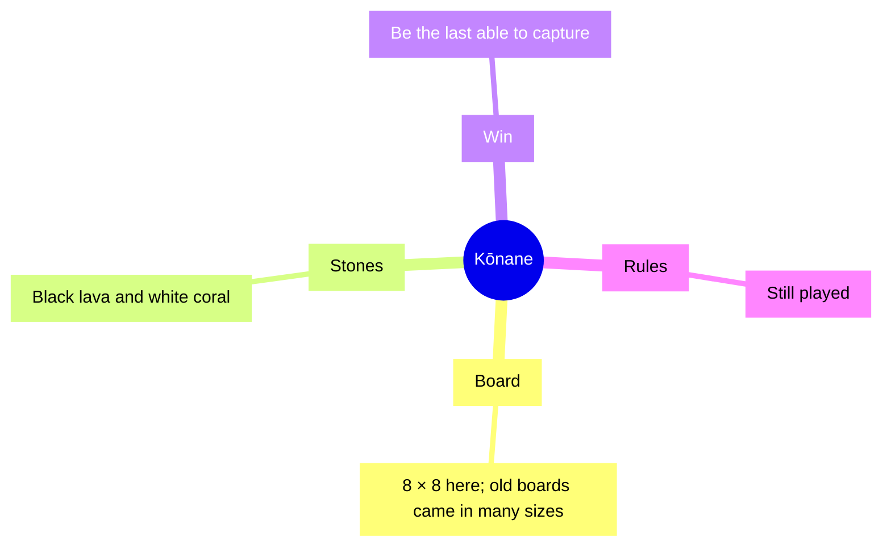
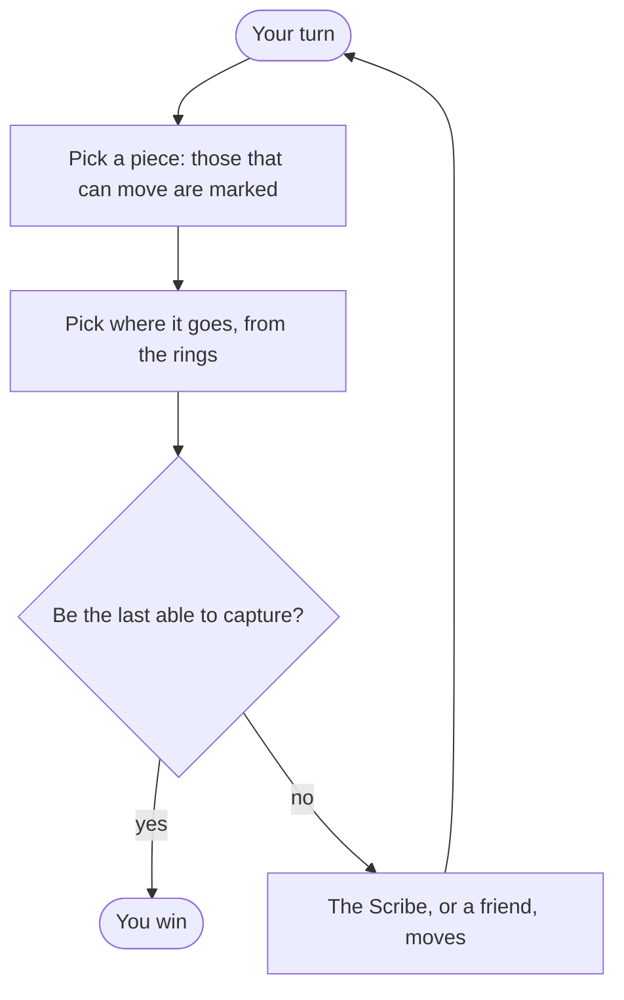

<!-- Written by tools/build-docs.mjs from the sources. Edit those, then run npm run build:docs. -->

# Kōnane

**Wing VI · Games of the World** · by 1778–79 · Hawaiʻi

[← Jungle](jungle.md) · [All games](README.md) · [Yut Nori →](yut.md)

| | |
| --- | --- |
| In the Archives | Playable against the Scribe, or a friend on the same screen |
| Rules | Still played |
| How we know them | Still played |
| Family | [Capture games](README.md#capture-games) |
| Exhibit id | `konane`: `[librarium_archives start="konane"]` |

## At a glance

| | |
| --- | --- |
| Board | 8 × 8 here; old boards came in many sizes |
| Stones | Black lava and white coral |
| Win | Be the last able to capture |

## The placard

Kōnane is a Hawaiian game of capture. Old boards, papamū, were cut into large flat stones as rows of small hollows, and the pieces were black lava and white coral; one such stone survives at Puʻuhonua o Hōnaunau. Captain James Cook's expedition saw the game played during its visit in 1778–79.

The board starts full. Two stones are lifted to open it, and from then on every move is a jump that takes a stone, so the board empties as the game goes on. The first player who cannot jump loses, and a draw is impossible. Mathematicians have shown that judging a large board is extremely hard.

## A turn

## The rules as played here

1. The board starts full. You play black (lava) and begin by lifting one of your stones from the centre or a corner; the Scribe then lifts one of its white (coral) stones next to the gap.
2. After that every move is a capture: jump one of your stones over a neighbouring white stone, along a row or column, into the empty point beyond. The jumped stone is removed. No diagonal moves.
3. You may keep jumping in the same direction while there is a stone to jump and an empty point beyond, and stop whenever you like.
4. The first player who cannot capture loses. There are no draws.

**Source:** The common modern rules on an 8 × 8 board; old Hawaiian boards came in many sizes.

### Rule choices

- **Kōnane:** black lifts a stone from the centre or a corner, white lifts one beside the gap, and from then on every move is a capture. Multiple jumps run in a straight line and may stop anywhere. The first player who cannot capture loses.

## At the table

| | |
| --- | --- |
| The Scribe | Gentle, Fair or Sharp (see [the Scribe](../scribe.md#levels)) |
| Pass-and-play with a friend | Yes |
| Undo | Yes |
| Hint | Yes |
| Saved and resumed | Yes |

Keys, the move list, replays and the guide are the same at every table: see [Visiting the Archives](../visiting.md#at-a-table).

## How the Scribe plays

**Method:** Shared search: negamax with alpha-beta; captures played out at the leaves; iterative deepening; time budget per level. See [the Scribe](../scribe.md).

## Sources

The sources for every placard are listed in [Historical notes and sources](../sources.md).

## In the code

| | |
| --- | --- |
| Rules and the Scribe | [`src/rules/konane.js`](../../src/rules/konane.js) |
| Table presenter | [`src/hall/table-konane.js`](../../src/hall/table-konane.js) |
| 3D model | [`src/hall/build-games-of-the-world.js`](../../src/hall/build-games-of-the-world.js) |
| Placard | [`src/hall/09-exhibit-data.js`](../../src/hall/09-exhibit-data.js) |
