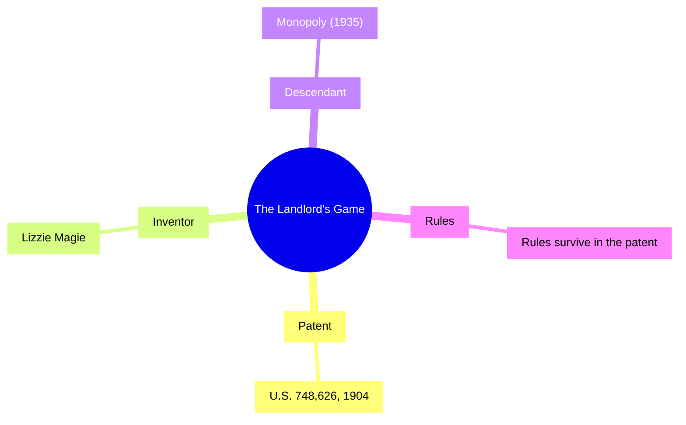
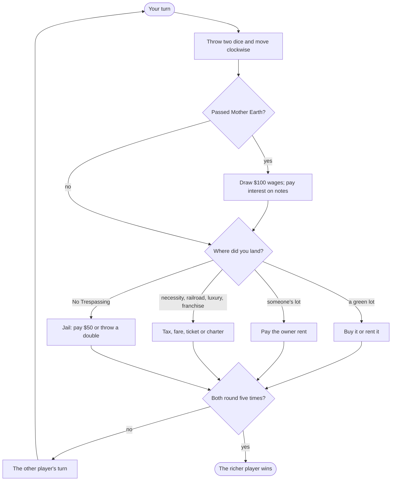

<!-- Written by tools/build-docs.mjs from the sources. Edit those, then run npm run build:docs. -->

# The Landlord's Game

**Wing V · The Modern Board Game** · 1904 CE · United States

[← Chinese Checkers](chinese.md) · [All games](README.md) · [Kalah →](kalah.md)

| | |
| --- | --- |
| In the Archives | Playable against the Scribe, or a friend on the same screen |
| Rules | Rules survive in the patent |
| How we know them | Survive in the patent |
| Family | [Roll and move on a printed track](README.md#roll-and-move-on-a-printed-track) |
| Exhibit id | `landlord`: `[librarium_archives start="landlord"]` |
| Rounds | **Three rounds** · Five rounds |

## At a glance

| | |
| --- | --- |
| Patent | U.S. 748,626, 1904 |
| Inventor | Lizzie Magie |
| Descendant | Monopoly (1935) |

## The placard

Lizzie Magie was granted U.S. Patent 748,626 for The Landlord's Game on January 5, 1904. She meant it as a lesson. A follower of the economist Henry George, she wanted players to feel how land monopoly enriches landlords and ruins everyone else, and she gave the game two sets of rules: one that rewarded monopoly, and one that rewarded shared prosperity.

For years players made their own boards, adding the streets of their own towns; Quakers in Atlantic City gave it theirs. In 1935 Parker Brothers bought a version from Charles Darrow, published it as Monopoly and credited him as its inventor. Magie's part came back to light in the 1970s, when Ralph Anspach dug up her patents while fighting Parker Brothers in court over his game Anti-Monopoly.

> The board follows the drawing in Magie's patent, space for space. At the table you play the patent's rules against the Scribe, three times round by default or five as the patent has it.

## A turn

## The rules as played here

1. Throw two dice and move your checker that many spaces clockwise. Each time you pass Mother Earth you draw $100 in wages, for five times round the board (three in the short game).
2. A green lot can be bought for its price or rented for its rent, both paid to the Public Treasury. On a lot someone owns, pay the rent to the owner; on your own, pay nothing. At the start you draw lot tickets and may buy those lots before your first throw.
3. Bread, Coal, Shelter and Clothing are absolute necessities: $5 tax. A railroad costs $5 fare. Luxury costs $50 for a ticket worth $60 at the end, or decline and lose the move. The first to land on a franchise takes its charter free, and charges $5 to anyone else who lands there. Legacy pays $100. The Public Park is free.
4. No Trespassing sends you to jail, in the Coal corner. To leave, pay a $50 fine or throw a double. A double that would carry you past a railroad lets you ride to the next one instead (and pay its fare).
5. Short of cash, you borrow $100 notes from the Bank against your lots (worth $10 more than the loan) and pay $5 interest on each note at every wage; notes are repaid before you pass Mother Earth when you can. With nothing to borrow against, you go to the poorhouse.
6. When both players have been round five times (or three) the game ends. Your worth is your cash, your lots at their price and $60 a luxury ticket, less any notes. The richer player wins. Once round and free of debt, you may move either way.

**Source:** U.S. Patent 748,626, granted to Lizzie J. Magie on January 5, 1904: the board is read from the patent drawing and the rules from its text, for two players. The patent's rule for two checkers sharing a lot is left out.

### Rule choices

- **The Landlord's Game** follows U.S. Patent 748,626 (1904). The board's forty spaces, prices, rents and taxes are read from the patent drawing: Mother Earth, 22 lots priced at ten times their number, four absolute necessities, four railroads, three luxuries, two franchises, Legacy, the Public Park and poorhouse, the jail, and Lord Blueblood's No Trespassing corner. The rules are the patent's, for two players: lot tickets at the start, buy or rent, $100 wages, $5 taxes and fares, $50 luxuries worth $60 at the end, franchise charters, jail with a $50 fine or a double, railroad rides on a double, Bank notes at $5 interest, and the poorhouse. It is three times round by default, or five as in the patent (a table variant). The patent's rule for two checkers sharing a lot is left out, and loans and repayments are made for you.

### Rounds

Chosen at the table under Options. Changing it restarts the game.

| Choice | |
| --- | --- |
| Three rounds | the default |
| Five rounds |  |

## At the table

| | |
| --- | --- |
| The Scribe | Gentle, Fair or Sharp (see [the Scribe](../scribe.md#levels)) |
| Pass-and-play with a friend | Yes |
| Undo | No |
| Hint | No |
| Saved and resumed | No |

Keys, the move list, replays and the guide are the same at every table: see [Visiting the Archives](../visiting.md#at-a-table).

## How the Scribe plays

**Method:** Rules of thumb: scored moves for dice games. See [the Scribe](../scribe.md).

**Measured strength**

| Fair vs Gentle | Sharp vs Fair | Games |
| --- | --- | --- |
| 67% | 52% | 600 and 1,500 |

**Game by game:** Lot tickets, buy or rent, luxuries, the jail fine, railroad rides. Sharp buys every lot it can afford, since land pays

## Sources

The sources for every placard are listed in [Historical notes and sources](../sources.md).

## In the code

| | |
| --- | --- |
| Rules and the Scribe | [`src/rules/the-landlords-game.js`](../../src/rules/the-landlords-game.js) |
| Table presenter | [`src/hall/table-landlord.js`](../../src/hall/table-landlord.js) |
| 3D model | [`src/hall/build-the-landlords-game.js`](../../src/hall/build-the-landlords-game.js) |
| Placard | [`src/hall/09-exhibit-data.js`](../../src/hall/09-exhibit-data.js) |
