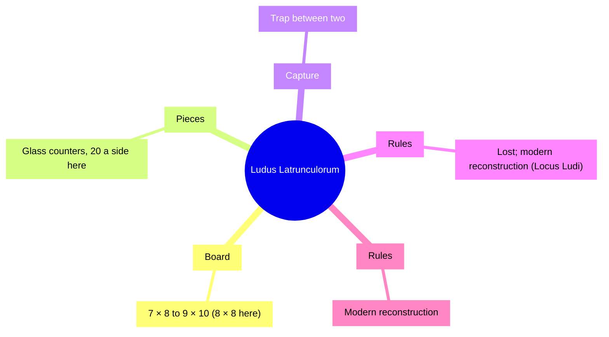
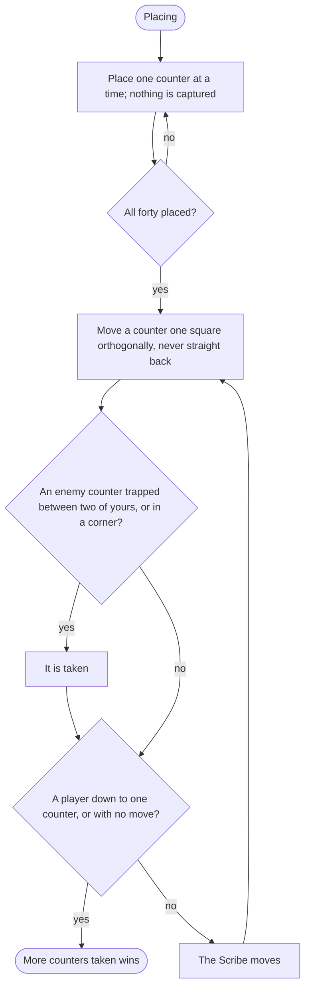

<!-- Written by tools/build-docs.mjs from the sources. Edit those, then run npm run build:docs. -->

# Ludus Latrunculorum

**Wing II · Strategy Takes the Table** · by the 1st century BCE · Rome · Late Republic to Empire

[← Weiqi (Go)](go.md) · [All games](README.md) · [Ludus Duodecim Scriptorum →](xii.md)

| | |
| --- | --- |
| In the Archives | Playable against the Scribe, or a friend on the same screen |
| Rules | Modern reconstruction |
| How we know them | Lost |
| Family | [Capture games](README.md#capture-games) |
| Exhibit id | `latrunculi`: `[librarium_archives start="latrunculi"]` |

## At a glance

| | |
| --- | --- |
| Board | 7 × 8 to 9 × 10 (8 × 8 here) |
| Pieces | Glass counters, 20 a side here |
| Capture | Trap between two |
| Rules | Lost; modern reconstruction (Locus Ludi) |

## The placard

The "game of soldiers", or of brigands, was Rome's war game. The scholar Varro mentions it in the 1st century BCE, Ovid alludes to it, and a 1st-century CE poem, the Laus Pisonis, praises a player commanding an army of glass pieces.

Boards scratched into stone turn up wherever the legions went. Sixteen have been found at the fort of Vindolanda on Hadrian's Wall alone, and sizes vary from 7 × 8 to 9 × 10 squares. A piece seems to have been captured by trapping it between two enemies, but how pieces moved is still debated, and every modern version is a reconstruction.

The table plays one such modern reconstruction, not a rulebook from Rome: the "Piso" rules of Locus Ludi, a research project on ancient games at the University of Fribourg. Counters are placed one at a time on the empty board, as the Laus Pisonis suggests, then step one square at a time, and a counter trapped between two enemies is taken.

> The full Roman rules are lost. This table plays a modern reconstruction: the "Piso" rules of the Locus Ludi project.

## A turn

## The rules as played here

1. This is a modern reconstruction. Roman writers describe the board and the trapping of counters, but not the full rules; the table follows the "Piso" rules of the Locus Ludi project at the University of Fribourg.
2. You have twenty blue glass counters and the Scribe twenty white. Take turns placing them one at a time on any empty square, you first. Nothing is captured while placing.
3. Then move one counter one square up, down or sideways onto an empty square. A counter may not step straight back to the square it just left.
4. Trap an enemy counter between the counter you move and another of yours, along a row or column, and it is taken. A counter in a corner is trapped by counters on the two squares beside it. One move can take several. You may move between two enemy counters safely.
5. The game ends when a player is down to one counter or cannot move. Whoever has taken more counters wins. If 30 moves each go by with no capture, the game ends there.

**Source:** A modern reconstruction: the "Piso" rules of Locus Ludi (University of Fribourg), drawn from Varro, Ovid, Martial and the Laus Pisonis, and from boards found across the Roman world. The 30-move limit is ours.

### Rule choices

- **Ludus latrunculorum:** the "Piso" rules of Locus Ludi (University of Fribourg). An 8 × 8 board; twenty counters each, placed one at a time with no captures. Then a counter steps one square orthogonally, and may not step straight back to the square it just left. A counter trapped between the mover and another enemy counter along a line is taken, several at once if so; a counter in a corner is trapped by the two squares beside it; moving between two enemies is safe. The game ends when a player is down to one counter or cannot move, and whoever has taken more wins. House rule: 30 moves each without a capture also ends it.

## At the table

| | |
| --- | --- |
| The Scribe | Gentle, Fair or Sharp (see [the Scribe](../scribe.md#levels)) |
| Pass-and-play with a friend | Yes |
| Undo | Yes |
| Hint | Yes |
| Saved and resumed | Yes |

Keys, the move list, replays and the guide are the same at every table: see [Visiting the Archives](../visiting.md#at-a-table).

## How the Scribe plays

**Method:** Shared search: negamax with alpha-beta; captures played out at the leaves; iterative deepening; time budget per level. See [the Scribe](../scribe.md).

**Measured strength**

| Fair vs Gentle | Sharp vs Fair | Games |
| --- | --- | --- |
| 4–1, 1 draw | 6–0, 1 draw | 6 and 7; with captures played out, the new Sharp beat the old one 7–0, with 7 draws |

**Game by game:** Placing: counters next to friends and away from the corners. Moving: counters taken, threats and room to move

## Sources

The sources for every placard are listed in [Historical notes and sources](../sources.md).

## In the code

| | |
| --- | --- |
| Rules and the Scribe | [`src/rules/ludus-latrunculorum.js`](../../src/rules/ludus-latrunculorum.js) |
| Table presenter | [`src/hall/table-latrunculi.js`](../../src/hall/table-latrunculi.js) |
| 3D model | [`src/hall/build-ludus-latrunculorum.js`](../../src/hall/build-ludus-latrunculorum.js) |
| Placard | [`src/hall/09-exhibit-data.js`](../../src/hall/09-exhibit-data.js) |
