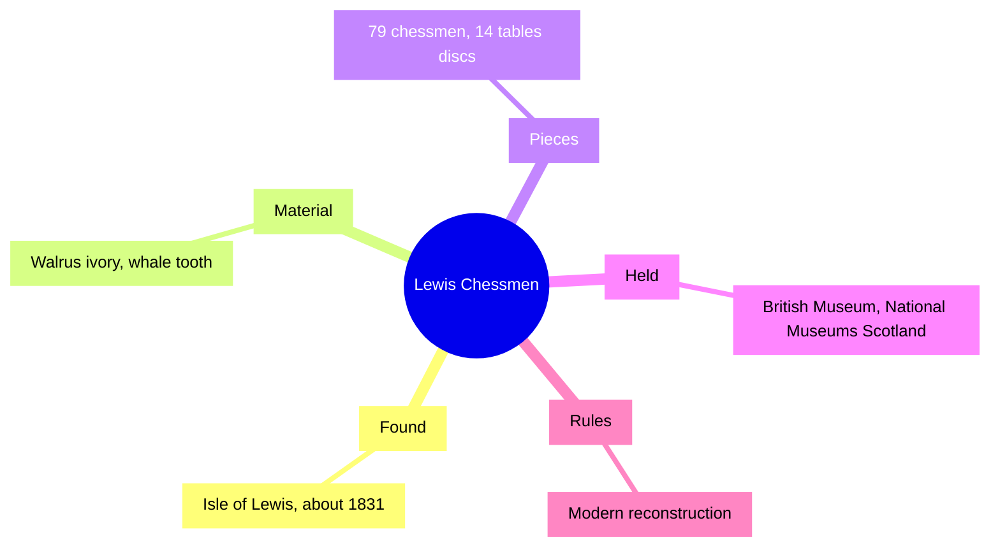
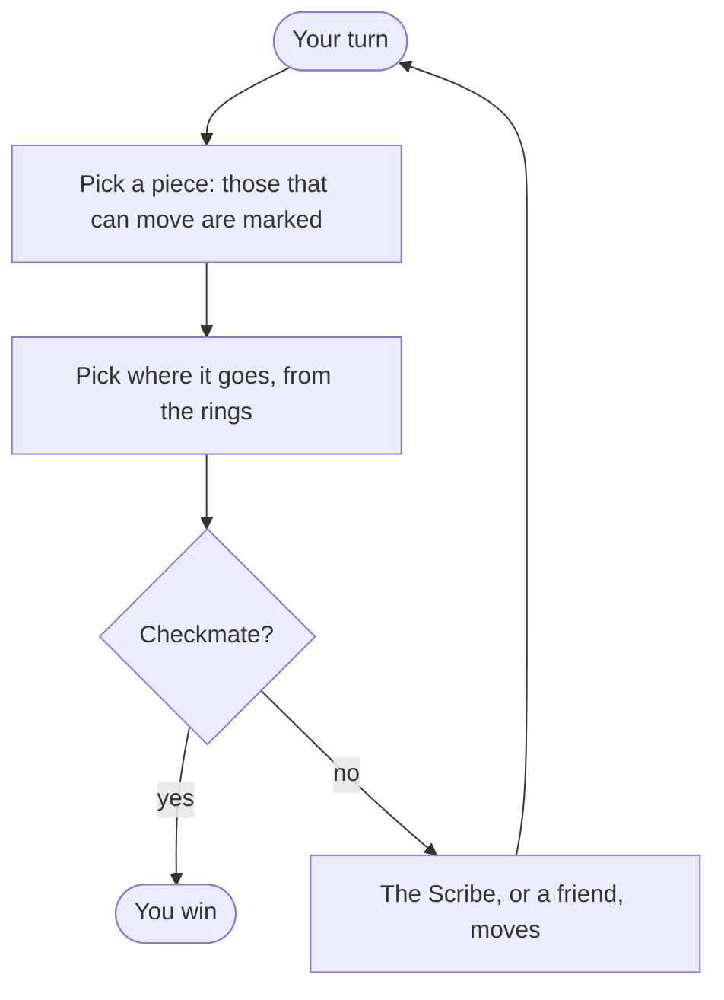

<!-- Written by tools/build-docs.mjs from the sources. Edit those, then run npm run build:docs. -->

# The Lewis Chessmen

**Wing III · Kings, Cards and Courts** · c. 1150–1200 CE · Norway and the Hebrides · 12th century

[← Rithmomachia](rithmo.md) · [All games](README.md) · [Courier Chess →](courier.md)

| | |
| --- | --- |
| In the Archives | Playable against the Scribe, or a friend on the same screen |
| Rules | Modern reconstruction |
| How we know them | Medieval European chess, partly lost |
| Family | [The chess family](README.md#the-chess-family) |
| Exhibit id | `lewis`: `[librarium_archives start="lewis"]` |
| Rule engine | `lewischess` |

## At a glance

| | |
| --- | --- |
| Found | Isle of Lewis, about 1831 |
| Material | Walrus ivory, whale tooth |
| Pieces | 79 chessmen, 14 tables discs |
| Held | British Museum, National Museums Scotland |

## The placard

Around 1831 a hoard of more than ninety game pieces came to light on the Isle of Lewis in the Outer Hebrides. Most are carved from walrus ivory and a few from whale teeth, probably in Trondheim, Norway, in the later 12th century. The British Museum holds 82 of them and National Museums Scotland 11.

They show chess as medieval Europe played it: kings and queens on thrones, bishops in mitres, knights on ponies, and warders standing in for rooks. Four warders bite the tops of their shields like the berserkers of the Norse sagas. The hoard also held fourteen tablemen, mostly plain discs, for playing tables, and a buckle, perhaps from the bag that carried them.

> The figures are our own simplified carvings, not copies. The table plays a modern reconstruction of chess as Europe played it around 1200, after H. J. R. Murray: shatranj's moves under European names.

## A turn

## The rules as played here

1. This is a modern reconstruction of chess as Europe played it around 1200, when the Lewis chessmen were carved. The moves are those Europe took over from shatranj, after H. J. R. Murray.
2. The king moves one square in any direction. The rook moves like a modern rook and the knight like a modern knight.
3. The queen, still the old fers or counsellor, steps only one square diagonally. The bishop, the alfin, jumps exactly two squares diagonally, over anything in between.
4. The pawn steps one square forward and takes one square diagonally forward, never two at once. On the far rank it becomes a queen.
5. Only checkmate wins. A stalemate, a long stretch with no capture or pawn move, or two bare kings is a draw. There is no castling: the king's and queen's first-move leaps of the later Middle Ages are left out.

**Source:** A modern reconstruction after H. J. R. Murray, A History of Chess (1913). Medieval rules for stalemate and the bare king varied from place to place; this table treats both as in modern chess.

### Rule choices

- **Medieval chess** (at the Lewis chessmen): a modern reconstruction after Murray of chess around 1200: shatranj's moves under European names (the queen steps one square diagonally, the bishop leaps two). Only checkmate wins; stalemate, bare kings and fifty quiet moves each are draws, since medieval rules on these varied. The later first-move leaps of king and queen are left out.

## At the table

| | |
| --- | --- |
| The Scribe | Gentle, Fair or Sharp (see [the Scribe](../scribe.md#levels)) |
| Pass-and-play with a friend | Yes |
| Undo | Yes |
| Hint | Yes |
| Saved and resumed | Yes |

Keys, the move list, replays and the guide are the same at every table: see [Visiting the Archives](../visiting.md#at-a-table).

## How the Scribe plays

**Measured strength**

| Fair vs Gentle | Sharp vs Fair | Games |
| --- | --- | --- |
| 6–0 | 1–0, 5 draws | 6 each; with only checkmate winning, many games are drawn |

## Sources

Checked in [the placard fact-check](../fact-check.md):

- **Claim as it stood:** Four warders bite their shields; fourteen plain discs; a buckle **What the sources say:** Four berserker warders; fourteen tablemen, largely undecorated; a belt buckle **Verdict:** Correct; "plain discs" softened to "mostly plain discs"

The sources for every placard are listed in [Historical notes and sources](../sources.md).

## In the code

| | |
| --- | --- |
| Rules and the Scribe | [`src/rules/medieval-chess.js`](../../src/rules/medieval-chess.js) |
| Table presenter | [`src/hall/table-lewis.js`](../../src/hall/table-lewis.js) |
| 3D model | [`src/hall/build-the-lewis-chessmen-simplified.js`](../../src/hall/build-the-lewis-chessmen-simplified.js) |
| Placard | [`src/hall/09-exhibit-data.js`](../../src/hall/09-exhibit-data.js) |
