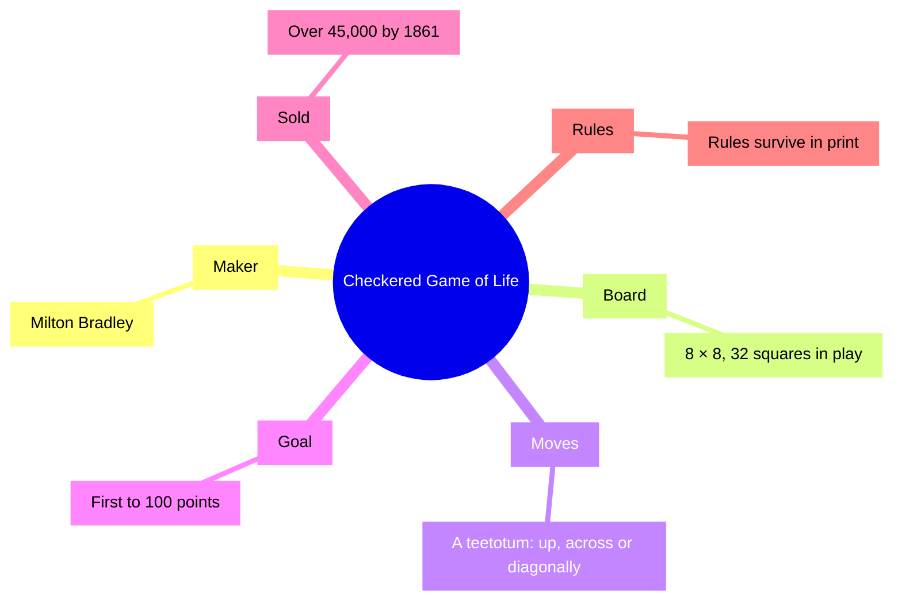
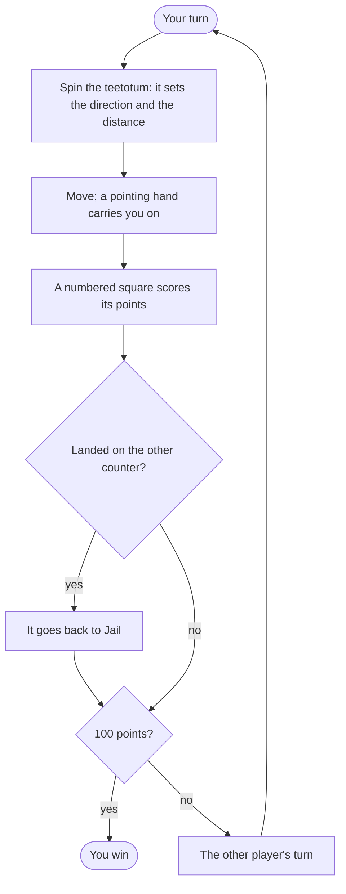

<!-- Written by tools/build-docs.mjs from the sources. Edit those, then run npm run build:docs. -->

# The Checkered Game of Life

**Wing V · The Modern Board Game** · 1860 CE · Springfield, Massachusetts

[← Conquian](conquian.md) · [All games](README.md) · [Pinochle →](pinochle.md)

| | |
| --- | --- |
| In the Archives | Playable against the Scribe, or a friend on the same screen |
| Rules | Rules survive in print |
| How we know them | Survive in print (Bradley's patent, 1866) |
| Family | [Roll and move on a printed track](README.md#roll-and-move-on-a-printed-track) |
| Exhibit id | `lifegame`: `[librarium_archives start="lifegame"]` |

## At a glance

| | |
| --- | --- |
| Maker | Milton Bradley |
| Board | 8 × 8, 32 squares in play |
| Moves | A teetotum: up, across or diagonally |
| Goal | First to 100 points |
| Sold | Over 45,000 by 1861 |

## The placard

Milton Bradley had just set up a colour lithography shop in Springfield, Massachusetts, when he printed The Checkered Game of Life in the winter of 1860. He sold the first few hundred copies himself on a two-day trip to New York, and by 1861 buyers had taken more than 45,000.

Like the Mansion of Happiness it was a moral journey, played with a teetotum. Its squares held the virtues and dangers of a life, from Influence and Fat Office to Poverty, Prison and Ruin. The company Bradley founded later grew it into The Game of Life.

Unlike the Mansion, it let players choose their road: each spin offered moves up, down, across or diagonally, and the first to 100 points won. The board here is laid out as on the company's edition of about 1911, newly drawn, with names and numbers in place of the engravings. Bradley's patent of 1866 gives the rules; what each number of the teetotum allows follows a modern reproduction. Its darkest square, a stark mark of the moralising of its day, puts a player out of the game.

> The table follows Bradley's rules; what each spin allows comes from a modern reproduction.

## A turn

## The rules as played here

1. Both players start at Infancy, bottom left. Only the pale squares are played on; the patterned squares between them are not counted.
2. Spin the teetotum. 1: move one square up or down. 2: one square left or right. 3: one square diagonally. 4: one or two squares up or down. 5: one or two squares left or right. 6: one or two squares diagonally. When there is a choice, you choose.
3. You can never stop on a square with a pointing hand: it carries you on at once (School to College, Industry to Wealth, Gambling to Ruin, Crime to Prison, and so on).
4. A square with a number scores it each time you land there: Happy Old Age 50, Wealth 10, and 5 for Happiness, Success, Congress, Honor, College and Fat Office.
5. Land on the other player's square and that counter is sent back to Jail. Prison costs you your next move. From Speculation, your next spin decides: a 3 or a 6 takes you to Wealth, anything else to Ruin.
6. The square marked Suicide puts a player out of the game. The first to 100 points wins.

**Source:** Milton Bradley's rules as described in his patent of 1866 (U.S. 53,561), on the board of about 1911 shown here. The patent does not list what each number allows; that table, and the Speculation rule, follow a modern reproduction of the original (Baldwin Games, 2024).

### Rule choices

- **The Checkered Game of Life:** the board of the Milton Bradley Co. edition of about 1911, read from a scan, with Bradley's rules from his patent of 1866 (U.S. 53,561). Only the 32 pale squares are played on. Both counters start at Infancy. A square with a pointing hand cannot be stopped on and carries you to its target (School to College, Industry to Wealth, Gambling to Ruin, Crime to Prison and the rest). Numbered squares score each time you land: Happy Old Age 50, Wealth 10, and 5 each for Happiness, Success, Congress, Honor, College and Fat Office. Landing on the other counter sends it to Jail; Prison costs a move; the square marked Suicide puts a player out. First to 100 wins. The patent does not list what each number of the teetotum allows, so the table follows a modern reproduction (Baldwin Games, 2024): 1 one square up or down, 2 left or right, 3 diagonally, 4 to 6 the same by one or two squares, counting only squares in play; and from Speculation a 3 or 6 goes to Wealth, anything else to Ruin. You play red against one Scribe.

## At the table

| | |
| --- | --- |
| The Scribe | Gentle, Fair or Sharp (see [the Scribe](../scribe.md#levels)) |
| Pass-and-play with a friend | Yes |
| Undo | No |
| Hint | Yes |
| Saved and resumed | No |

Keys, the move list, replays and the guide are the same at every table: see [Visiting the Archives](../visiting.md#at-a-table).

## How the Scribe plays

**Measured strength**

| Fair vs Gentle | Sharp vs Fair | Games |
| --- | --- | --- |
| 71% | 50% | 1,000 each; the spin decides most games |

## Sources

The sources for every placard are listed in [Historical notes and sources](../sources.md).

## In the code

| | |
| --- | --- |
| Rules and the Scribe | [`src/rules/the-checkered-game-of.js`](../../src/rules/the-checkered-game-of.js) |
| Table presenter | [`src/hall/table-lifegame.js`](../../src/hall/table-lifegame.js) |
| 3D model | [`src/hall/build-the-checkered-game-of.js`](../../src/hall/build-the-checkered-game-of.js) |
| Placard | [`src/hall/09-exhibit-data.js`](../../src/hall/09-exhibit-data.js) |
