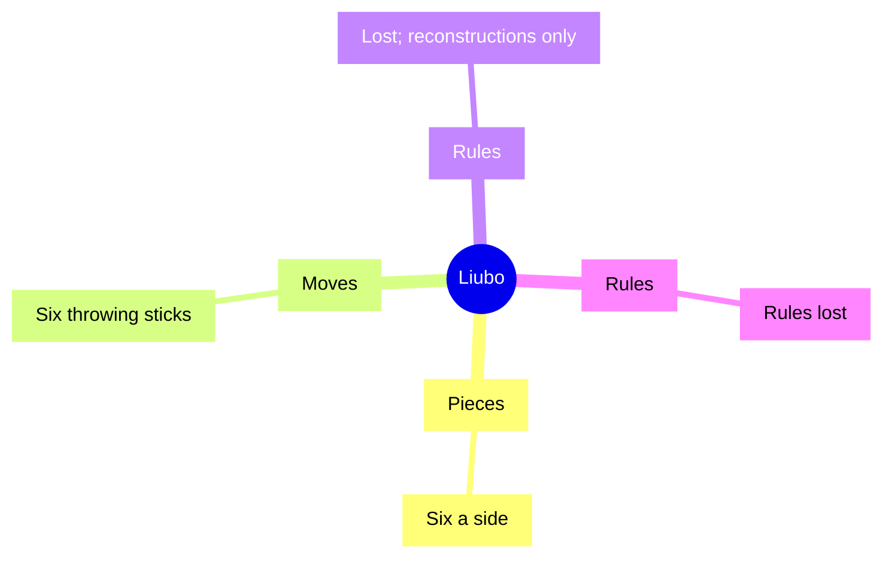

<!-- Written by tools/build-docs.mjs from the sources. Edit those, then run npm run build:docs. -->

# Liubo

**Wing II · Strategy Takes the Table** · by the 4th century BCE · China · Warring States to Han

[← Petteia](petteia.md) · [All games](README.md) · [Weiqi (Go) →](go.md)

| | |
| --- | --- |
| In the Archives | On display |
| Rules | Rules lost |
| How we know them | Lost; reconstructions only |
| Family | [Race games](README.md#race-games) |
| Exhibit id | `liubo`: `[librarium_archives start="liubo"]` |

## At a glance

| | |
| --- | --- |
| Pieces | Six a side |
| Moves | Six throwing sticks |
| Rules | Lost; reconstructions only |

## The placard

Liubo, "six sticks", was the great board game of Han dynasty China, played by emperors and buried with nobles. The oldest boards come from a 4th-century BCE tomb at Pingshan in Hebei, and a complete set in a lacquer box was found in 1973 in a 2nd-century BCE tomb at Mawangdui.

Each player had six pieces, moved by throws of six sticks, and a piece that reached a certain place was stood on end and became an "owl". The board's T, L and V marks also appear on bronze mirrors of the time. After the Han the game faded, perhaps losing out to weiqi, and by the 14th century no one knew how to play it. More than a thousand bamboo slips with its rules from the tomb of the Marquis of Haihun, opened in 2015, were reported in 2019; until they are fully read, every modern version is a reconstruction.

> On display. The board, pieces and sticks are new, after the Mawangdui set.

## Sources

Checked in [the placard fact-check](../fact-check.md):

- **Claim as it stood:** Rule slips "found in the tomb of the Marquis of Haihun in 2019" **What the sources say:** The tomb was excavated by 2015; the 1,000+ liubo slips were reported in March 2019 **Verdict:** Changed to "opened in 2015, were reported in 2019"

The sources for every placard are listed in [Historical notes and sources](../sources.md).

## In the code

| | |
| --- | --- |
| 3D model | [`src/hall/build-backfill-displays.js`](../../src/hall/build-backfill-displays.js) |
| Placard | [`src/hall/09-exhibit-data.js`](../../src/hall/09-exhibit-data.js) |
