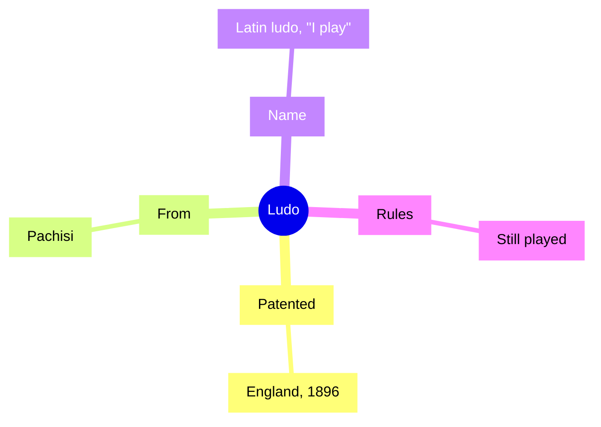
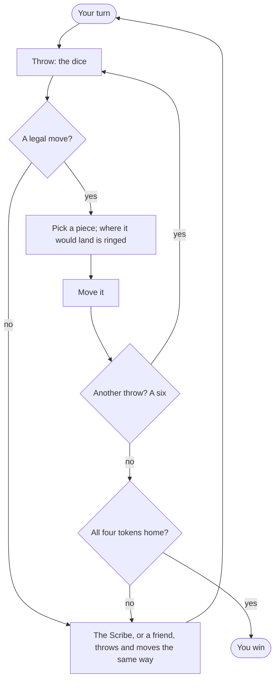

<!-- Written by tools/build-docs.mjs from the sources. Edit those, then run npm run build:docs. -->

# Ludo

**Wing IV · Printed Boards and Parlour Tables** · 1896 CE · England, from India

[← Bézique](bezique.md) · [All games](README.md) · [Mahjong →](mahjong.md)

| | |
| --- | --- |
| In the Archives | Playable against the Scribe, or a friend on the same screen |
| Rules | Still played |
| How we know them | Still played |
| Family | [Race games](README.md#race-games) |
| Exhibit id | `ludo`: `[librarium_archives start="ludo"]` |

## At a glance

| | |
| --- | --- |
| Patented | England, 1896 |
| From | Pachisi |
| Name | Latin ludo, "I play" |

## The placard

Ludo is Pachisi made simple for the Victorian nursery. The royal game of India, played with cowrie shells on a cloth cross, reached Britain through trade and empire, and in 1896 a version with a single die and a square board was patented in England as Ludo, Latin for "I play".

It travelled the world from there. The Royal Navy turned it into a rougher game called uckers, and it is still one of the first board games many children learn. The race, the six to come out and the token sent home all come straight from Pachisi, two tables away.

## A turn

## The rules as played here

1. You play red and the Scribe yellow, from opposite corners. Each of you has four tokens in your yard. You throw first.
2. Throw one die. A six brings a token out onto your starting square, or moves one six squares, and earns another throw.
3. Tokens run once round the board, clockwise, then turn up your own coloured column to the centre. You need the exact throw to finish.
4. Land on a Scribe token and it goes back to its yard. Your home column is safe from capture.
5. The first to bring all four tokens home wins. If no token can move, the turn passes.

**Source:** Ludo as patented in England in 1896, with the common rules: a six to come out, a six to throw again, capture by landing, and an exact throw home.

### Rule choices

- **Ludo:** two players, red and yellow, from opposite corners. A six brings a token out or moves one, and earns another throw; landing on an enemy token sends it to its yard; your home column is safe; the finish needs the exact throw. There are no blocks or safe squares on the track.

## At the table

| | |
| --- | --- |
| The Scribe | Gentle, Fair or Sharp (see [the Scribe](../scribe.md#levels)) |
| Pass-and-play with a friend | Yes |
| Undo | No |
| Hint | Yes |
| Saved and resumed | No |

Keys, the move list, replays and the guide are the same at every table: see [Visiting the Archives](../visiting.md#at-a-table).

## How the Scribe plays

**Method:** Rules of thumb: scored moves for dice games. See [the Scribe](../scribe.md).

**Measured strength**

| Fair vs Gentle | Sharp vs Fair | Games |
| --- | --- | --- |
| 81% | 65% | 600 and 1,000 |

**Game by game:** Captures, coming out, getting home. Sharp counts how many enemy tokens could reach a square in one throw

## Sources

The sources for every placard are listed in [Historical notes and sources](../sources.md).

## In the code

| | |
| --- | --- |
| Rules and the Scribe | [`src/rules/ludo.js`](../../src/rules/ludo.js) |
| Table presenter | [`src/hall/table-ludo.js`](../../src/hall/table-ludo.js) |
| 3D model | [`src/hall/build-round-five.js`](../../src/hall/build-round-five.js) |
| Placard | [`src/hall/09-exhibit-data.js`](../../src/hall/09-exhibit-data.js) |
