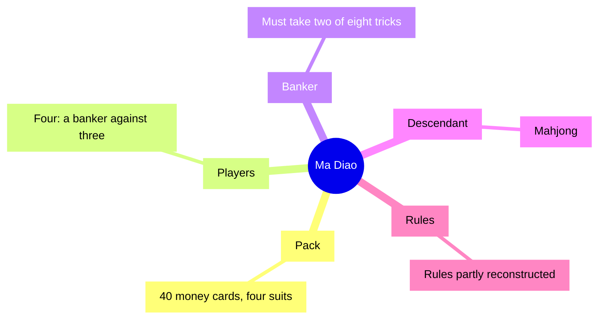
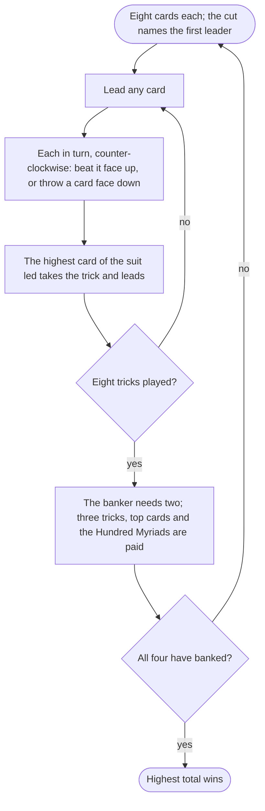

<!-- Written by tools/build-docs.mjs from the sources. Edit those, then run npm run build:docs. -->

# Ma Diao

**Wing VI · Games of the World** · by c. 1600 CE · China · the late Ming

[← Ganjifa](ganjifa.md) · [All games](README.md) · [Makruk →](makruk.md)

| | |
| --- | --- |
| In the Archives | Playable against the Scribe, in 4 seats |
| Rules | Rules partly reconstructed |
| How we know them | Partly reconstructed (Andrew Lo, after Pan Zhiheng and Feng Menglong) |
| Family | [Cards](README.md#cards) |
| Exhibit id | `madiao`: `[librarium_archives start="madiao"]` |

## At a glance

| | |
| --- | --- |
| Pack | 40 money cards, four suits |
| Players | Four: a banker against three |
| Banker | Must take two of eight tricks |
| Descendant | Mahjong |

## The placard

Ma diao was the great card game of late Ming China. It was played with forty money cards in four suits, Cash, Strings of cash, Myriads and Tens of Myriads, the units a merchant counted in. The pack was recorded in the 15th century, and the writers Pan Zhiheng and Feng Menglong set down the rules in the early 17th.

Three players stand together against the banker, who has to take two of the eight tricks; the name is often read as a horse with one leg lifted. The high cards showed heroes of the novel Water Margin. The Kangxi Emperor banned the making and selling of the cards in 1691, but officials and even the imperial family went on playing.

Under the Qing the rules grew ever more elaborate. Later games dropped the Tens suit, and games of drawing and discarding with several three-suited packs led, in the 19th century, to mahjong, whose circles, bamboo and characters still echo the coins, strings and myriads.

> The table plays the heart of the game, eight tricks with the banker needing two, and its main payments. The faces are our own drawings, not copies of a pack.

## A turn

Seats: You, West, North, East.

## The rules as played here

1. Four players with forty money cards in four suits: Cash, Strings, Myriads and Tens of Myriads. In Cash the order runs backwards, so Zero Cash is highest and 9 Cash lowest; in Strings and Myriads the 9 is highest; in Tens, Myriad Myriads is highest. Eight cards each; eight stay in the stock.
2. One player is the banker and plays against the other three. Each of the four banks once, and play goes counter-clockwise: you, East, North, West.
3. The cut decides who leads first. Lead any card. The others may play any card: you need not follow suit. A card of the suit led that beats the highest so far is played face up; any other card goes face down. The highest card of the suit led takes the trick, and its taker leads next.
4. The banker must take at least two of the eight tricks, or pays each player a stake. Whoever takes three or more tricks is paid a stake: the banker by each player, a player by the banker. A trick taken with the top card of a suit (Zero Cash, 9 Strings, 9 Myriads, Myriad Myriads) is paid a stake the same way, the banker only if it made its two. Win a trick with the Hundred Myriads and take exactly two tricks, and the banker pays you three and each other player one; the banker who does it is paid three by each. Taking all eight is paid eight.
5. After four deals, the highest total wins.

**Source:** Ma Diao as described by Pan Zhiheng and Feng Menglong in the early 17th century, after the summaries of Andrew Lo's studies on Wikipedia and The World of Playing Cards. The hall plays the heart of the game and its main payments; the special hands that end a deal at once, and the bonus for the card under the stock, are left out.

### Rule choices

- **Ma Diao:** after the summaries of Andrew Lo's work on Wikipedia and The World of Playing Cards: four players with the 40 money cards, eight each and eight in the stock, counter-clockwise play, a banker who must take two tricks, and each player banking once. No need to follow suit; a card of the suit led that beats the trick is played face up, any other face down. The payments kept are the banker's minimum, three or more tricks, tricks taken with a suit's top card, the Hundred Myriads taking exactly two tricks, and all eight; the hands that end a deal at once, and the card under the stock, are left out.

## At the table

| | |
| --- | --- |
| The Scribe | Gentle, Fair or Sharp (see [the Scribe](../scribe.md#levels)) |
| Pass-and-play with a friend | No |
| Undo | No |
| Hint | No |
| Saved and resumed | Yes |

Keys, the move list, replays and the guide are the same at every table: see [Visiting the Archives](../visiting.md#at-a-table).

## How the Scribe plays

**Method:** Sampling the unseen cards: deals what it cannot see at random and plays each deal out, as Tarocchi's Sharp does. See [the Scribe](../scribe.md).

**Games with hidden cards and tiles:** The three players work together against the banker: each beats the banker's card with its cheapest winner, leaves a partner's winning card alone and throws its weakest card face down. The banker wins tricks cheaply until it has its two. Anyone leads a top card it holds, as a sure trick. Sharp deals the unseen cards (the other hands, the stock and the cards thrown face down) many times, plays each deal out and picks the card that pays it most

## Sources

Checked in [the placard fact-check](../fact-check.md):

- **Claims:** Forty money cards in four suits; the pack recorded by Lu Rong in the 15th century, the rules by Pan Zhiheng and Feng Menglong in the early 17th; three against the banker, who needs two tricks; Water Margin heroes on the high cards; the Kangxi Emperor's ban of 1691, ignored at court; ever more elaborate under the Qing; Tens dropped in later games, and three-suited games leading to mahjong **Source:** Wikipedia, Madiao (after Andrew Lo); The World of Playing Cards, Madiao

The sources for every placard are listed in [Historical notes and sources](../sources.md).

## In the code

| | |
| --- | --- |
| Rules and the Scribe | [`src/rules/madiao.js`](../../src/rules/madiao.js) |
| Table presenter | [`src/hall/table-card-room-5.js`](../../src/hall/table-card-room-5.js) |
| 3D model | [`src/hall/build-card-room-5.js`](../../src/hall/build-card-room-5.js) |
| Placard | [`src/hall/09-exhibit-data.js`](../../src/hall/09-exhibit-data.js) |
