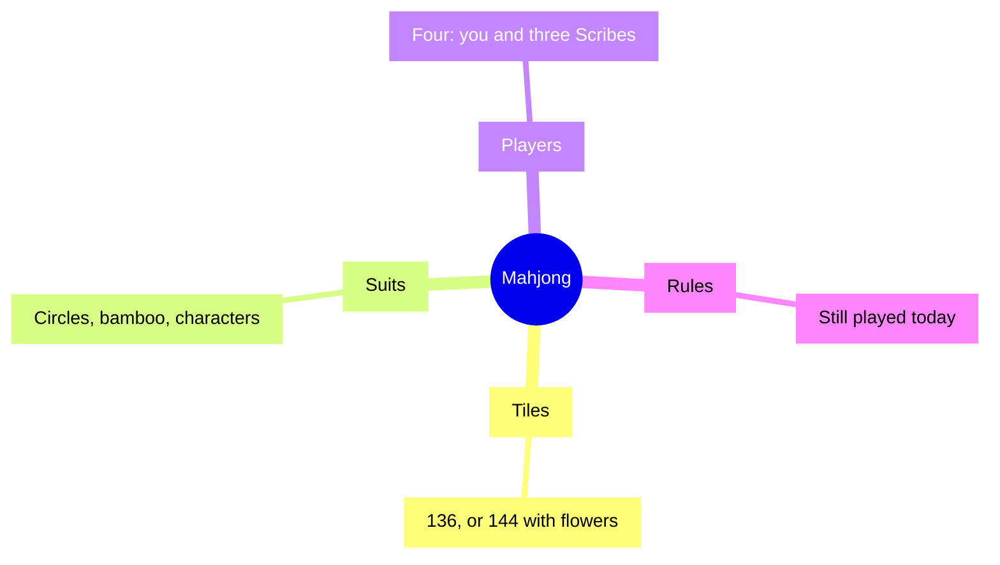
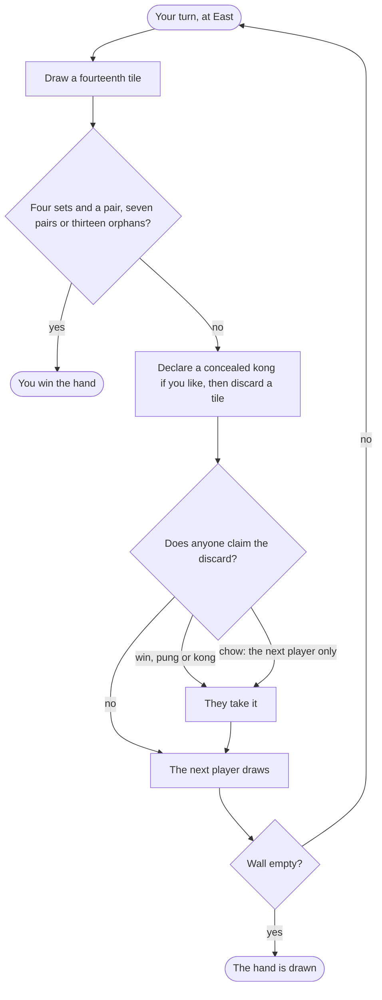

<!-- Written by tools/build-docs.mjs from the sources. Edit those, then run npm run build:docs. -->

# Mahjong

**Wing IV · Printed Boards and Parlour Tables** · mid-1800s CE · China · Qing dynasty

[← Ludo](ludo.md) · [All games](README.md) · [The Mansion of Happiness →](mansion.md)

| | |
| --- | --- |
| In the Archives | Playable against the Scribe, in 4 seats |
| Rules | Still played today |
| How we know them | Still played |
| Family | [Tiles](README.md#tiles) |
| Exhibit id | `mahjong`: `[librarium_archives start="mahjong"]` |

## At a glance

| | |
| --- | --- |
| Tiles | 136, or 144 with flowers |
| Suits | Circles, bamboo, characters |
| Players | Four: you and three Scribes |

## The placard

Mahjong took shape in the Shanghai region in the middle or later years of the 19th century, during the Qing dynasty. It grew out of older Chinese card games and keeps their money suits: circles, bamboo and characters, joined by winds and dragons. A full set has 136 tiles, or 144 with the flowers and seasons.

After the First World War an American living in Shanghai, Joseph P. Babcock, simplified the rules, added English labels and coined the name mah-jongg. In the mid-1920s it became a craze in the United States, Britain and Australia, and in 1937 players in New York founded the National Mah Jongg League.

> A table needs four, so three Scribes join you. Scoring is left out: whoever goes out first wins the hand.

## A turn

Seats: East, South, West, North.

## The rules as played here

1. You sit at East, nearest the table's front, against three Scribes. Each hand is thirteen tiles; on your turn you draw a fourteenth and discard one by clicking it.
2. Go out with four sets and a pair: a set is a pung (three alike), a kong (four alike) or a chow (a run of three in one suit). Seven pairs, or one of each terminal and honour plus one more (thirteen orphans), also win.
3. You can claim another player's discard to win, or to make a pung or kong; a chow only from the player on your left (North). The buttons show what you can claim. A win beats a pung or kong, which beats a chow.
4. Declare a kong of four alike from your hand with its button; you then draw a replacement tile.
5. The first to go out wins the hand. If the wall runs out first, the hand is drawn. Scoring varies so much between rule sets that the Archives leave it out.

**Source:** Common modern rules for 136 tiles without flowers. Scoring is left out: whoever goes out first wins.

### Rule choices

- **Mahjong:** a basic Chinese game with the 136 tiles (no flowers or seasons). Go out with four sets and a pair, seven pairs or the thirteen orphans. You may claim a discard for a pung or kong from anyone, a chow only from the player on your left, and a win from anyone; a win beats a pung or kong, which beats a chow. A kong draws a replacement tile. There is no scoring: whoever goes out first wins the hand, and an empty wall is a draw.

## At the table

| | |
| --- | --- |
| The Scribe | Gentle, Fair or Sharp (see [the Scribe](../scribe.md#levels)) |
| Pass-and-play with a friend | No |
| Undo | No |
| Hint | No |
| Saved and resumed | Yes |

Keys, the move list, replays and the guide are the same at every table: see [Visiting the Archives](../visiting.md#at-a-table).

## How the Scribe plays

**Method:** Hidden information: plays only from what it can see. See [the Scribe](../scribe.md).

**Games with hidden cards and tiles:** Each of the three Scribes counts how far its hand is from ready (shanten) and keeps the discards that leave the most useful draws open. It claims only when a claim brings its hand closer

## Sources

The sources for every placard are listed in [Historical notes and sources](../sources.md).

## In the code

| | |
| --- | --- |
| Rules and the Scribe | [`src/rules/mahjong.js`](../../src/rules/mahjong.js) |
| Table presenter | [`src/hall/table-mahjong.js`](../../src/hall/table-mahjong.js) |
| 3D model | [`src/hall/build-mahjong.js`](../../src/hall/build-mahjong.js) |
| Placard | [`src/hall/09-exhibit-data.js`](../../src/hall/09-exhibit-data.js) |
