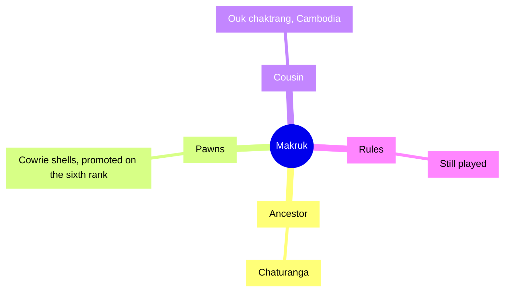
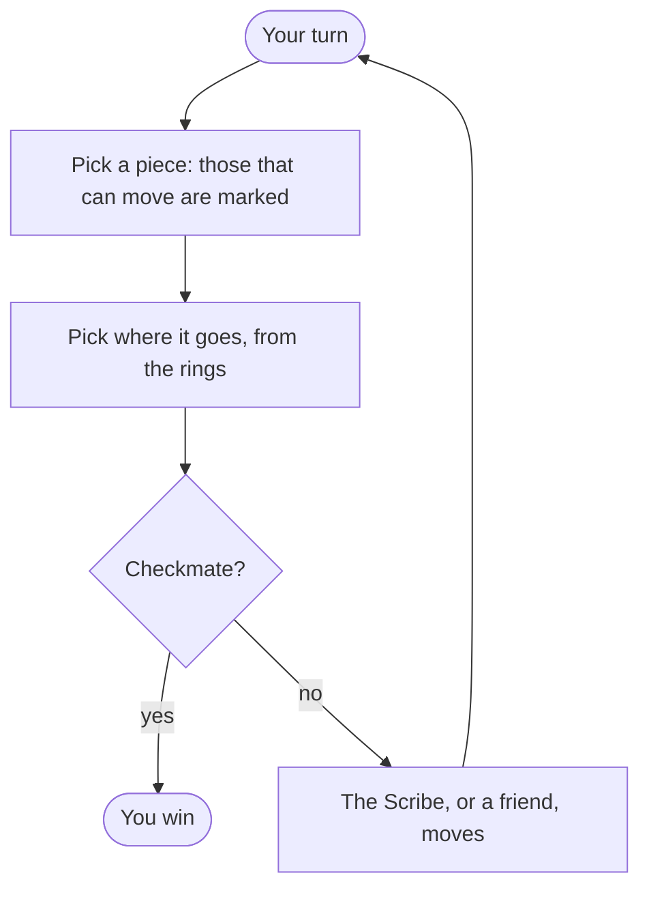

<!-- Written by tools/build-docs.mjs from the sources. Edit those, then run npm run build:docs. -->

# Makruk

**Wing VI · Games of the World** · traditional · Thailand

[← Ma Diao](madiao.md) · [All games](README.md) · [Bagh-chal →](baghchal.md)

| | |
| --- | --- |
| In the Archives | Playable against the Scribe, or a friend on the same screen |
| Rules | Still played |
| How we know them | Still played |
| Family | [The chess family](README.md#the-chess-family) |
| Exhibit id | `makruk`: `[librarium_archives start="makruk"]` |

## At a glance

| | |
| --- | --- |
| Ancestor | Chaturanga |
| Pawns | Cowrie shells, promoted on the sixth rank |
| Cousin | Ouk chaktrang, Cambodia |

## The placard

Makruk, Thai chess, is a cousin of chess from the same Indian ancestor, chaturanga. Its pieces keep moves that European chess gave up: the met, the counsellor beside the king, steps only one square diagonally, like the Persian firzan, and the khon moves like a shogi silver general. Cambodia plays nearly the same game as ouk chaktrang.

The pawns are cowrie shells, set out on the third rank, and a pawn that reaches the sixth rank is turned over to show its promotion. Endgames are timed by counting: the side behind counts its moves, and if the count runs out before mate, the game is drawn. It is still played across Thailand today.

## A turn

## The rules as played here

1. You play white and move first. Checkmate the Scribe's khun (king) to win.
2. Khun: one square any way. Ruea (boat): like a rook. Ma (horse): like a knight. Khon (nobleman): one square diagonally, or one straight forward. Met (seed): one square diagonally.
3. Bia (cowrie, the pawn): one square forward, capturing one square diagonally forward. No double first step. A bia reaching the sixth rank turns over and moves like a met.
4. There is no castling. Stalemate is a draw.
5. Counting: when no unpromoted bia is left, the side behind may count, and mate must come within 64 moves. When a side is down to its khun alone, the other must mate within a limit set by its pieces (8 moves with two rueas, 16 with one, and so on), counted from the number of pieces on the board. Otherwise the game is drawn.

**Source:** Makruk as played in Thailand today, with the counting rules simplified: the count is kept for you.

### Rule choices

- **Makruk:** Thai rules: no castling, no double pawn step, promotion on the sixth rank to a met, stalemate drawn. The counts: once no unpromoted pawn is left, mate must come within 64 moves; once a side has only its khun, the other must mate within a limit set by its pieces (8 with two rueas, 16 with one, 22 with two khons, 32 with two horses, 44 with one khon, otherwise 64), counted from the number of pieces on the board.

## At the table

| | |
| --- | --- |
| The Scribe | Gentle, Fair or Sharp (see [the Scribe](../scribe.md#levels)) |
| Pass-and-play with a friend | Yes |
| Undo | Yes |
| Hint | Yes |
| Saved and resumed | Yes |

Keys, the move list, replays and the guide are the same at every table: see [Visiting the Archives](../visiting.md#at-a-table).

## How the Scribe plays

**Method:** Shared search: negamax with alpha-beta; captures played out at the leaves; iterative deepening; time budget per level. See [the Scribe](../scribe.md).

**Measured strength**

| Fair vs Gentle | Sharp vs Fair | Games |
| --- | --- | --- |
| 6–0 | 2 wins, 4 draws | 6 each |

**Game by game (Makruk, Janggi):** Material (Janggi's tournament points), soldiers and cowries pushed forward

## Sources

The sources for every placard are listed in [Historical notes and sources](../sources.md).

## In the code

| | |
| --- | --- |
| Rules and the Scribe | [`src/rules/makruk.js`](../../src/rules/makruk.js) |
| Table presenter | [`src/hall/table-makruk.js`](../../src/hall/table-makruk.js) |
| 3D model | [`src/hall/build-hnefatafl.js`](../../src/hall/build-hnefatafl.js) |
| Placard | [`src/hall/09-exhibit-data.js`](../../src/hall/09-exhibit-data.js) |
