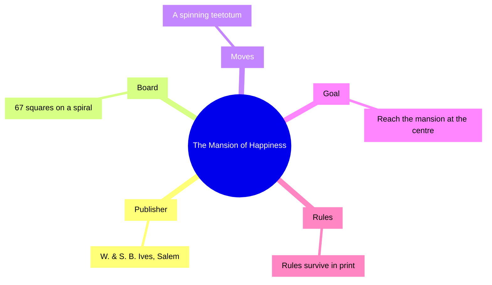
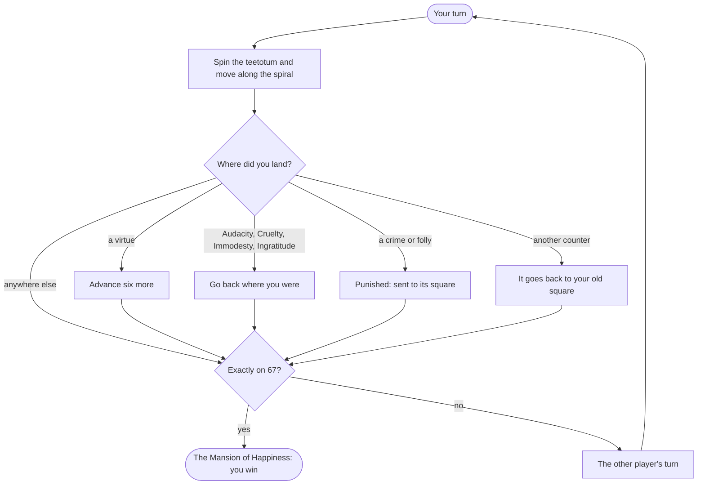

<!-- Written by tools/build-docs.mjs from the sources. Edit those, then run npm run build:docs. -->

# The Mansion of Happiness

**Wing V · The Modern Board Game** · 1843 CE · Salem, Massachusetts

[← Mahjong](mahjong.md) · [All games](README.md) · [Euchre →](euchre.md)

| | |
| --- | --- |
| In the Archives | Playable against the Scribe, or a friend on the same screen |
| Rules | Rules survive in print |
| How we know them | Survive in print |
| Family | [Roll and move on a printed track](README.md#roll-and-move-on-a-printed-track) |
| Exhibit id | `mansion`: `[librarium_archives start="mansion"]` |

## At a glance

| | |
| --- | --- |
| Publisher | W. & S. B. Ives, Salem |
| Board | 67 squares on a spiral |
| Moves | A spinning teetotum |
| Goal | Reach the mansion at the centre |

## The placard

In 1843 W. & S. B. Ives of Salem, Massachusetts, published The Mansion of Happiness, "an instructive, moral and entertaining amusement". The Library of Congress calls it possibly the first board game published in the United States. It was close to a copy of an English game of 1800, and who adapted it is uncertain: Anne Abbott, who designed other games for the same publisher, has often been credited.

Players spun a numbered top called a teetotum and moved along a spiral. Virtues such as temperance and generosity carried them toward the mansion at the centre; vices such as idleness sent them back toward the pillory.

The table follows the original: all 67 squares in their places on the 1843 board, and the rules printed with the game. A Cheat spends a month in the House of Correction and a Robber two in Prison, a Drunkard goes to the Stocks and a Sabbath Breaker to the Whipping Post, and the Mansion must be reached by an exact spin. The board here is newly drawn, and the squares carry their names instead of the original engravings.

> Note the teetotum: dice were thought too close to gambling.

## A turn

## The rules as played here

1. Spin the teetotum and move your counter that many squares along the spiral toward the Mansion of Happiness at its centre. Poverty, the Whipping Post, the Pillory, the Stocks, Prison and Ruin are not counted: you only go there when found guilty.
2. Land on a virtue (Piety, Honesty, Temperance, Gratitude, Prudence, Truth, Chastity, Sincerity, Humility, Industry, Charity, Humanity, Generosity) and advance six more squares.
3. Land on Audacity, Cruelty, Immodesty or Ingratitude and go back to where you were.
4. The Water (6) carries you on to 10, and the Inn (9) on to 12.
5. The guilty are punished: Passion to the Water, Idleness to Poverty, the Road to Folly back to Prudence, a Sabbath Breaker to the Whipping Post, a Perjurer to the Pillory, a Drunkard to the Stocks, the Summit of Dissipation to Ruin. A Cheat spends a month (a turn) in the House of Correction and a Robber two in Prison; both then begin again, unless another player guilty of the same crime sets them free sooner.
6. Land where another counter stands and it goes back to the square you came from.
7. Reach 67 by an exact count to win. Overshoot and you go back to the Seat of Expectation (60); overshoot again and you begin again.

**Source:** The rules printed with the game (as reprinted for the 1894 edition), with every square read from the 1843 Ives board. Two clauses about crimes committed on an occupied square are left out, and the six squares a virtue gives you do not set off the square they reach.

### Rule choices

- **The Mansion of Happiness:** every square read from a scan of the 1843 W. & S. B. Ives board, played by the seventeen rules printed with the game (as reprinted for the 1894 edition). A teetotum of 1 to 6. Poverty, the Whipping Post, the Pillory, the Stocks, Prison and Ruin are not counted when moving. The thirteen virtues advance six squares; Audacity, Cruelty, Immodesty and Ingratitude send you back to where you were; the Water (6) carries you to 10 and the Inn (9) to 12. Passion goes to the Water, Idleness to Poverty, the Road to Folly back to Prudence, a Sabbath Breaker to the Whipping Post, a Perjurer to the Pillory, a Drunkard to the Stocks and the Summit of Dissipation to Ruin; a Cheat spends one turn in the House of Correction and a Robber two in Prison, then begin again, unless freed by another player guilty of the same crime. Landing on another counter sends it back to where you came from. Exact count to 67; an overshoot goes to the Seat of Expectation (60), a second one to the start. Left out: two clauses of the rule for crimes on an occupied square. The squares reached by a virtue's six do not act again. You play the red counter against one Scribe.

## At the table

| | |
| --- | --- |
| The Scribe | Gentle, Fair or Sharp (see [the Scribe](../scribe.md#levels)) |
| Pass-and-play with a friend | Yes |
| Undo | No |
| Hint | No |
| Saved and resumed | No |

Keys, the move list, replays and the guide are the same at every table: see [Visiting the Archives](../visiting.md#at-a-table).

## How the Scribe plays

**Method:** Nothing to choose: the throw moves your one counter. See [the Scribe](../scribe.md).

## Sources

The sources for every placard are listed in [Historical notes and sources](../sources.md).

## In the code

| | |
| --- | --- |
| Rules and the Scribe | [`src/rules/the-mansion-of-happiness.js`](../../src/rules/the-mansion-of-happiness.js) |
| Table presenter | [`src/hall/table-mansion.js`](../../src/hall/table-mansion.js) |
| 3D model | [`src/hall/build-the-mansion-of-happiness.js`](../../src/hall/build-the-mansion-of-happiness.js) |
| Placard | [`src/hall/09-exhibit-data.js`](../../src/hall/09-exhibit-data.js) |
