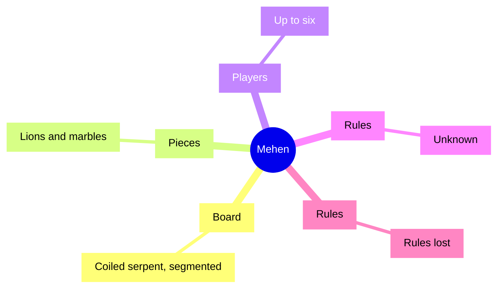

<!-- Written by tools/build-docs.mjs from the sources. Edit those, then run npm run build:docs. -->

# Mehen

**Wing I · The Dawn of Play** · c. 3100–2300 BCE · Egypt · Early Dynastic to Old Kingdom

[← Senet](senet.md) · [All games](README.md) · [The Başur Höyük Pieces →](basur.md)

| | |
| --- | --- |
| In the Archives | On display |
| Rules | Rules lost |
| How we know them | Lost |
| Family | [Race games](README.md#race-games) |
| Exhibit id | `mehen`: `[librarium_archives start="mehen"]` |

## At a glance

| | |
| --- | --- |
| Board | Coiled serpent, segmented |
| Pieces | Lions and marbles |
| Players | Up to six |
| Rules | Unknown |

## The placard

The Mehen board is a snake coiled around itself, with its head at the center and its tail at the rim. It shares its name with a serpent god who wrapped around the sun god Ra to protect him on his night journey.

Up to six players moved small lion figures and marbles along the coils. The game faded after the Old Kingdom, and no text explains how it worked. Scholars have suggested the lions raced toward the snake's head, but every version played today is a guess.

## Sources

The sources for every placard are listed in [Historical notes and sources](../sources.md).

## In the code

| | |
| --- | --- |
| 3D model | [`src/hall/build-mehen.js`](../../src/hall/build-mehen.js) |
| Placard | [`src/hall/09-exhibit-data.js`](../../src/hall/09-exhibit-data.js) |
