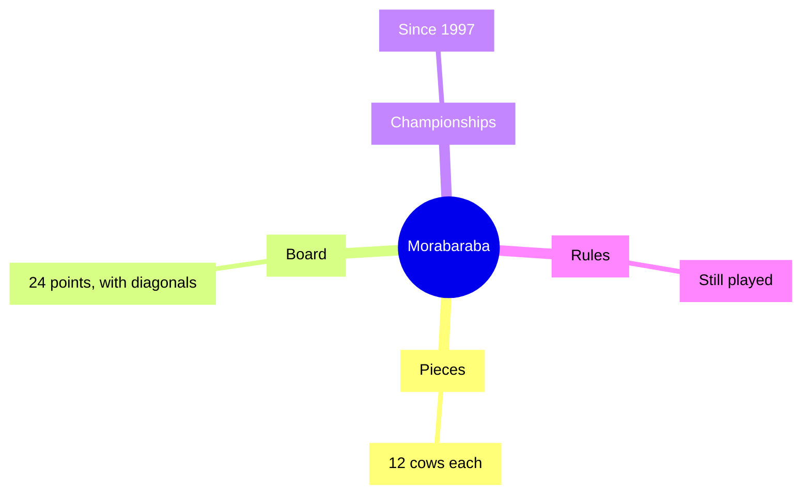
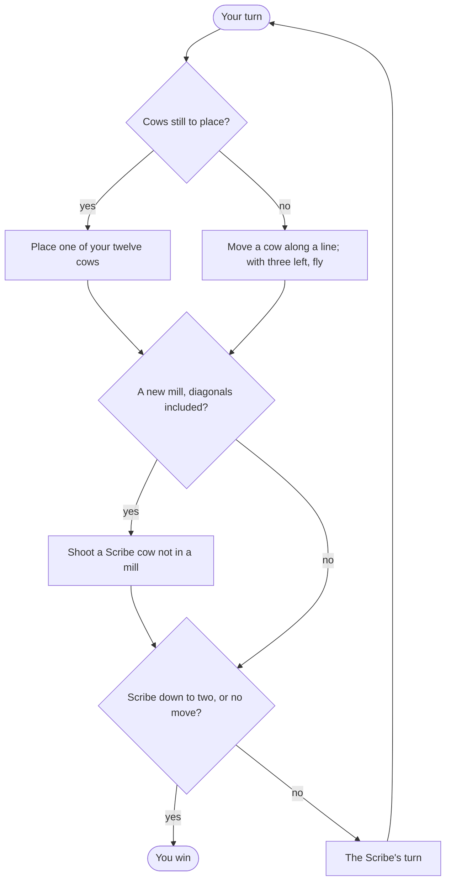

<!-- Written by tools/build-docs.mjs from the sources. Edit those, then run npm run build:docs. -->

# Morabaraba

**Wing VI · Games of the World** · traditional · South Africa, Botswana and Lesotho

[← Bao](bao.md) · [All games](README.md) · [Seega →](seega.md)

| | |
| --- | --- |
| In the Archives | Playable against the Scribe, or a friend on the same screen |
| Rules | Still played |
| How we know them | Still played |
| Family | [Alignment, connection and blocking](README.md#alignment-connection-and-blocking) |
| Exhibit id | `morabaraba`: `[librarium_archives start="morabaraba"]` |

## At a glance

| | |
| --- | --- |
| Pieces | 12 cows each |
| Board | 24 points, with diagonals |
| Championships | Since 1997 |

## The placard

Morabaraba is the mill game of southern Africa, known as mlabalaba, umlabalaba and mmela among other names. Its own name comes from the Southern Sotho moraba-raba, "to mill" or "to go round in a circle". The pieces are called cows, and it is a favourite of young herders, who scratch the board into the ground.

Some have said British settlers brought it, but rock engravings said to be about 800 years old point to an older African history. Today it is a recognised sport: Mind Sports South Africa runs leagues, and world championships have been held since 1997.

## A turn

## The rules as played here

1. Take turns placing your twelve cows on empty points. You play the pale cows and go first.
2. Three of your cows in a row along any line, the diagonals included, make a mill. Each new mill lets you shoot one of the Scribe's cows. Cows in a mill are safe unless every one of them is in a mill.
3. Once every cow is placed, move one cow along a line to a neighbouring empty point.
4. A player down to three cows may fly them to any empty point.
5. You lose when you have two cows left or cannot move. If both sides are down to three and no cow is shot in ten moves each, the game is drawn.

**Source:** Morabaraba as Mind Sports South Africa plays it, on the board with diagonals, without the rule that stops a broken mill being remade at once.

### Rule choices

- **Morabaraba:** Mind Sports South Africa's rules on the board with diagonals: twelve cows each, mills along any line including the diagonals, flying at three, and a draw when both sides have three and no cow is shot in ten moves each. The rule that a broken mill cannot be remade at once is left out, and a mill always shoots.

## At the table

| | |
| --- | --- |
| The Scribe | Gentle, Fair or Sharp (see [the Scribe](../scribe.md#levels)) |
| Pass-and-play with a friend | Yes |
| Undo | Yes |
| Hint | Yes |
| Saved and resumed | Yes |

Keys, the move list, replays and the guide are the same at every table: see [Visiting the Archives](../visiting.md#at-a-table).

## How the Scribe plays

**Method:** Shared search: negamax with alpha-beta; captures played out at the leaves; iterative deepening; time budget per level. See [the Scribe](../scribe.md).

**Measured strength**

| Fair vs Gentle | Sharp vs Fair | Games |
| --- | --- | --- |
| 6–0 | 4–2 | 6 each |

**Game by game (Morris, Morabaraba):** Pieces, open two-in-a-rows, mills and mobility

## Sources

The sources for every placard are listed in [Historical notes and sources](../sources.md).

## In the code

| | |
| --- | --- |
| Rules and the Scribe | [`src/rules/morabaraba.js`](../../src/rules/morabaraba.js) |
| Table presenter | [`src/hall/table-morabaraba.js`](../../src/hall/table-morabaraba.js) |
| 3D model | [`src/hall/build-round-five.js`](../../src/hall/build-round-five.js) |
| Placard | [`src/hall/09-exhibit-data.js`](../../src/hall/09-exhibit-data.js) |
