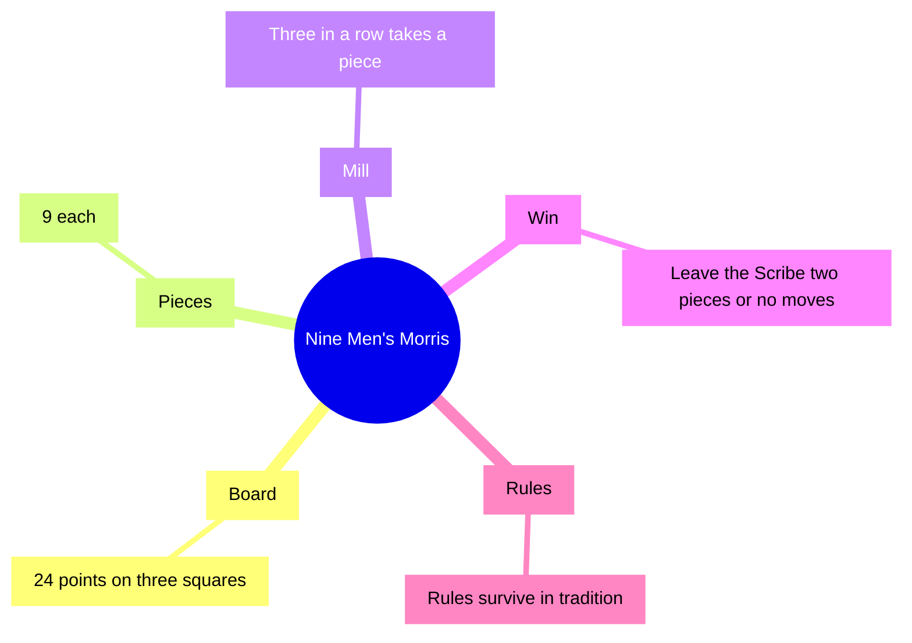
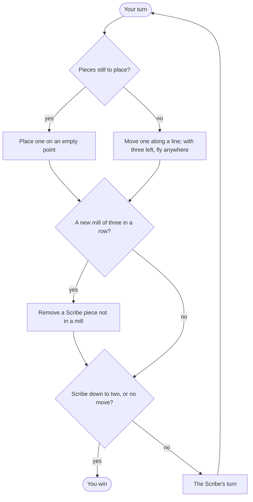

<!-- Written by tools/build-docs.mjs from the sources. Edit those, then run npm run build:docs. -->

# Nine Men's Morris

**Wing II · Strategy Takes the Table** · Roman era onward · The Roman world to medieval Europe

[← Patolli](patolli.md) · [All games](README.md) · [Mancala (Oware) →](oware.md)

| | |
| --- | --- |
| In the Archives | Playable against the Scribe, or a friend on the same screen |
| Rules | Rules survive in tradition |
| How we know them | Survive in tradition |
| Family | [Alignment, connection and blocking](README.md#alignment-connection-and-blocking) |
| Exhibit id | `morris`: `[librarium_archives start="morris"]` |

## At a glance

| | |
| --- | --- |
| Board | 24 points on three squares |
| Pieces | 9 each |
| Mill | Three in a row takes a piece |
| Win | Leave the Scribe two pieces or no moves |

## The placard

Boards for Nine Men's Morris and its smaller cousin, Three Men's Morris, are cut into stone across the Roman world. Carvings at the temple of Kurna in Egypt are often dated to about 1400 BCE, but boards scratched into old buildings are notoriously hard to date and may be far younger.

Under names like merels, mill and Mühle, the game became a European favorite. Alfonso X of Castile pictured it in his Book of Games in the 1280s, monks carved boards into the cloister benches of English cathedrals, villagers cut them into the turf of village greens, and Shakespeare mentions a flooded morris board in A Midsummer Night's Dream.

## A turn

## The rules as played here

1. Take turns placing your nine pieces on empty points.
2. Three of your pieces in a row along a drawn line make a mill. Each new mill lets you remove one of the Scribe's pieces. Pieces in a mill are protected unless every piece is in one.
3. Once every piece is placed, move one piece along a line to a neighboring empty point.
4. When you are down to three pieces, you may fly to any empty point.
5. You lose when you have two pieces left or cannot move. A long stretch with no captures is a draw.

**Source:** Traditional rules, as played across Europe since the Middle Ages.

## At the table

| | |
| --- | --- |
| The Scribe | Gentle, Fair or Sharp (see [the Scribe](../scribe.md#levels)) |
| Pass-and-play with a friend | Yes |
| Undo | Yes |
| Hint | Yes |
| Saved and resumed | Yes |

Keys, the move list, replays and the guide are the same at every table: see [Visiting the Archives](../visiting.md#at-a-table).

## How the Scribe plays

**Method:** Shared search: negamax with alpha-beta; captures played out at the leaves; iterative deepening; time budget per level. See [the Scribe](../scribe.md).

**Game by game (Morris, Morabaraba):** Pieces, open two-in-a-rows, mills and mobility

## Sources

The sources for every placard are listed in [Historical notes and sources](../sources.md).

## In the code

| | |
| --- | --- |
| Rules and the Scribe | [`src/rules/nine-mens-morris.js`](../../src/rules/nine-mens-morris.js) |
| Table presenter | [`src/hall/12-presenters.js`](../../src/hall/12-presenters.js) |
| 3D model | [`src/hall/build-nine-mens-morris-board.js`](../../src/hall/build-nine-mens-morris-board.js) |
| Placard | [`src/hall/09-exhibit-data.js`](../../src/hall/09-exhibit-data.js) |
