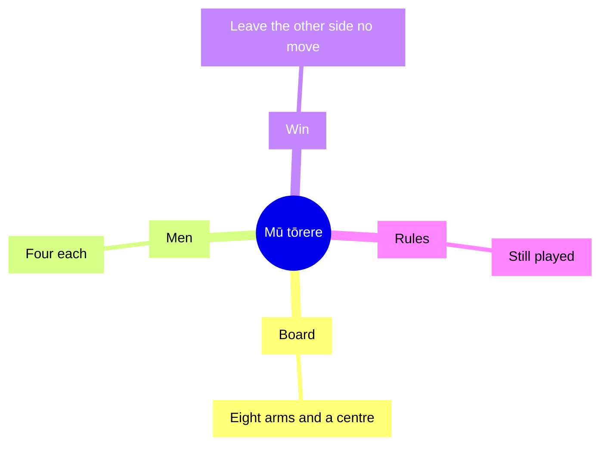
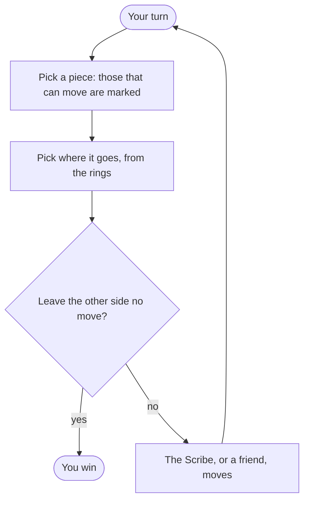

<!-- Written by tools/build-docs.mjs from the sources. Edit those, then run npm run build:docs. -->

# Mū tōrere

**Wing VI · Games of the World** · first described in 1917 · Aotearoa New Zealand · Māori

[← Hex](hex.md) · [All games](README.md) · [Shogi →](shogi.md)

| | |
| --- | --- |
| In the Archives | Playable against the Scribe, or a friend on the same screen |
| Rules | Still played |
| How we know them | Accounts differ |
| Family | [Alignment, connection and blocking](README.md#alignment-connection-and-blocking) |
| Exhibit id | `mutorere`: `[librarium_archives start="mutorere"]` |

## At a glance

| | |
| --- | --- |
| Board | Eight arms and a centre |
| Men | Four each |
| Win | Leave the other side no move |

## The placard

Mū tōrere is a Māori game for two, played on a star of eight arms, the kewai, round a centre, the pūtahi, drawn on the ground or carved in wood. The board has been likened to an octopus. Each player has four men, and the aim is to leave the other player no move at all.

It was first described in print by Elsdon Best in 1917. Scholars still debate whether it is wholly Māori or partly an answer to the draughts that settlers brought, and accounts of its rules differ. It looks simple, but settlers who thought so are said to have lost to it again and again. Played perfectly, it is a draw.

## A turn

## The rules as played here

1. You play the light stones and move first. There is always exactly one empty point, and every move fills it.
2. A man on an arm may move to a neighbouring arm, or into the centre. A man in the centre may move out to the empty arm.
3. A man may move into the centre only if it stands next to one of the Scribe's men.
4. Block the Scribe so it has no move, and you win.
5. House rule: after thirty moves each the game is drawn. With perfect play mū tōrere is a draw.

**Source:** Accounts of the rules differ. The rule for entering the centre used here is the one most often given today; without it the first player can win at once.

### Rule choices

- **Mū tōrere:** a man may move into the centre only from an arm next to an enemy man, the rule most often given today (without it the first player can win at once). House rule: thirty moves each is a draw; perfect play draws anyway.

## At the table

| | |
| --- | --- |
| The Scribe | Gentle, Fair or Sharp (see [the Scribe](../scribe.md#levels)) |
| Pass-and-play with a friend | Yes |
| Undo | Yes |
| Hint | Yes |
| Saved and resumed | Yes |

Keys, the move list, replays and the guide are the same at every table: see [Visiting the Archives](../visiting.md#at-a-table).

## How the Scribe plays

**Method:** Shared search: negamax with alpha-beta; captures played out at the leaves; iterative deepening; time budget per level. See [the Scribe](../scribe.md).

**Measured strength**

| Fair vs Gentle | Sharp vs Fair | Games |
| --- | --- | --- |
|  |  | Sharp looks 16 moves ahead and never loses |

## Sources

The sources for every placard are listed in [Historical notes and sources](../sources.md).

## In the code

| | |
| --- | --- |
| Rules and the Scribe | [`src/rules/mu-torere.js`](../../src/rules/mu-torere.js) |
| Table presenter | [`src/hall/table-mutorere.js`](../../src/hall/table-mutorere.js) |
| 3D model | [`src/hall/build-games-of-the-world.js`](../../src/hall/build-games-of-the-world.js) |
| Placard | [`src/hall/09-exhibit-data.js`](../../src/hall/09-exhibit-data.js) |
