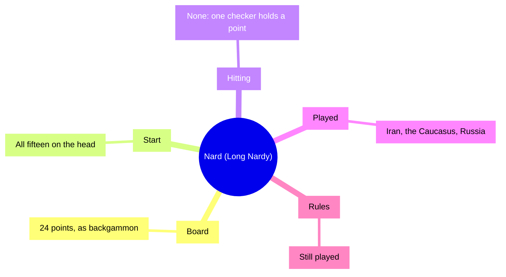
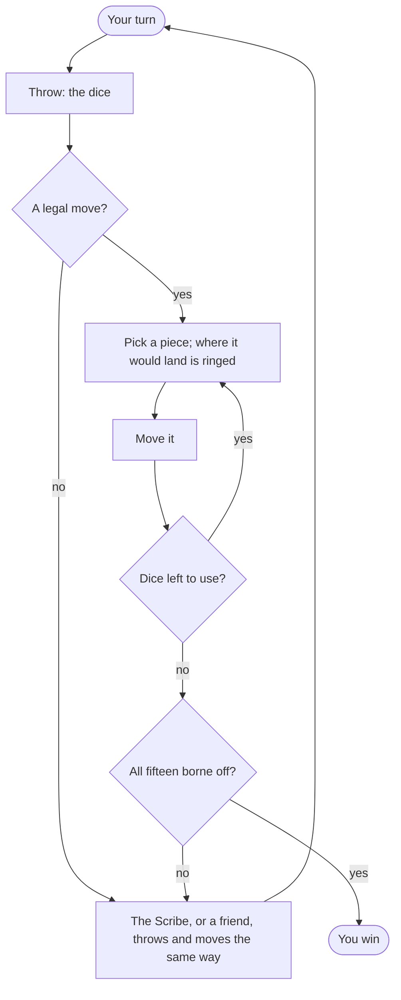

<!-- Written by tools/build-docs.mjs from the sources. Edit those, then run npm run build:docs. -->

# Nard

**Wing VI · Games of the World** · traditional · Iran, the Caucasus and Russia

[← Tâb](tab.md) · [All games](README.md) · [The lectern →](README.md#the-end-of-the-hall)

| | |
| --- | --- |
| In the Archives | Playable against the Scribe, or a friend on the same screen |
| Rules | Still played |
| How we know them | Still played |
| Family | [Race games](README.md#race-games) |
| Exhibit id | `nard`: `[librarium_archives start="nard"]` |

## At a glance

| | |
| --- | --- |
| Board | 24 points, as backgammon |
| Start | All fifteen on the head |
| Hitting | None: one checker holds a point |
| Played | Iran, the Caucasus, Russia |

## The placard

Nard is the Persian branch of the tables family, and long nard, played today from Iran and Azerbaijan to Georgia, Armenia and Russia, is its most popular form. It is likely descended from nardshir, the ancient Persian game that the Tables exhibit in Wing III describes.

It is played on a backgammon board, but everything else is different. All fifteen checkers start on one point, the head, and both sides run the same way round the board. Nobody hits: a single checker holds its point, so the game is about building blocks in the other player's path, short of a full wall of six.

## A turn

## The rules as played here

1. All fifteen of your checkers start on your head, the far right point. Both sides race the same way, counterclockwise, the Scribe from the near left corner.
2. Throw two dice and move one checker by each die, or one checker by both. Doubles are played four times. Use both dice if you can, or the larger if only one can be played.
3. Nobody hits. A single checker holds its point, and you may not land where the Scribe has any checker.
4. Only one checker may leave the head each turn. On your first throw, a double 3, 4 or 6 lets two leave.
5. You may not build six points in a row unless at least one of the Scribe's checkers is already past them.
6. When all fifteen are home, in the near-right quarter, bear them off. The first to bear off all fifteen wins; a win before the loser has borne off any is a mars, worth double.

**Source:** Long nard (long nardy) as played across Iran, the Caucasus and Russia, after the rules collected at bkgm.com and Wikipedia.

### Rule choices

- **Nard:** long nard after bkgm.com and Wikipedia: all fifteen on the head, counterclockwise for both, no hitting, one checker off the head a turn (two on a first throw of 3-3, 4-4 or 6-6), no six-point wall unless an enemy checker is already past it, both dice used where possible (the larger if only one), bearing off as in backgammon. A win before the loser bears off any checker is a mars.

## At the table

| | |
| --- | --- |
| The Scribe | Gentle, Fair or Sharp (see [the Scribe](../scribe.md#levels)) |
| Pass-and-play with a friend | Yes |
| Undo | No |
| Hint | Yes |
| Saved and resumed | No |

Keys, the move list, replays and the guide are the same at every table: see [Visiting the Archives](../visiting.md#at-a-table).

## How the Scribe plays

**Games with hidden cards and tiles (Nard, Duodecim scripta):** Every legal full turn, scored for the race, points held ahead of the enemy (Nard), lone pieces the enemy can reach weighed by what a hit would cost, and, in Duodecim scripta, pieces spread over the last six spaces so exact throws can bear them off

**Measured strength**

| Fair vs Gentle | Sharp vs Fair | Games |
| --- | --- | --- |
| 58% | 59% | 100 each |

## Sources

The sources for every placard are listed in [Historical notes and sources](../sources.md).

## In the code

| | |
| --- | --- |
| Rules and the Scribe | [`src/rules/nard.js`](../../src/rules/nard.js) |
| Table presenter | [`src/hall/table-nard.js`](../../src/hall/table-nard.js) |
| 3D model | [`src/hall/build-nard.js`](../../src/hall/build-nard.js) |
| Placard | [`src/hall/09-exhibit-data.js`](../../src/hall/09-exhibit-data.js) |
