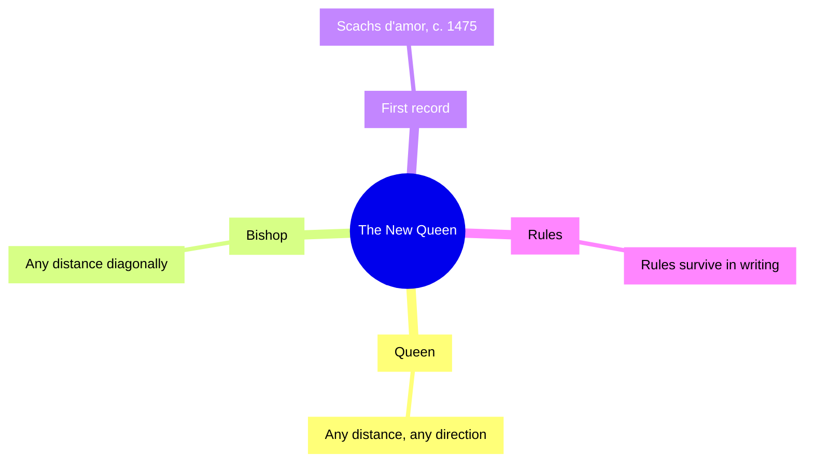
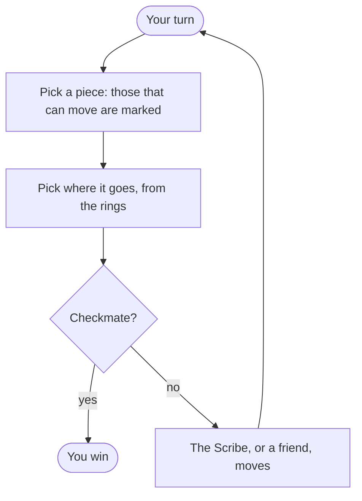

<!-- Written by tools/build-docs.mjs from the sources. Edit those, then run npm run build:docs. -->

# The New Queen

**Wing IV · Printed Boards and Parlour Tables** · c. 1475 CE · Valencia · late 15th century

[← Fox and Geese](foxgeese.md) · [All games](README.md) · [Draughts →](draughts.md)

| | |
| --- | --- |
| In the Archives | Playable against the Scribe, or a friend on the same screen |
| Rules | Rules survive in writing |
| How we know them | Survive in writing (*Scachs d'amor*; Lucena) |
| Family | [The chess family](README.md#the-chess-family) |
| Exhibit id | `newqueen`: `[librarium_archives start="newqueen"]` |
| Rule engine | `chess` |

## At a glance

| | |
| --- | --- |
| Queen | Any distance, any direction |
| Bishop | Any distance diagonally |
| First record | Scachs d'amor, c. 1475 |

## The placard

For six centuries the piece beside the king was the firzan, a counsellor who stepped a single square diagonally. Then, in late 15th-century Spain, she became the strongest piece on the board, free to sweep any distance in any direction. The bishop gained its long diagonal move at the same time.

The earliest record of the new rules is Scachs d'amor, a Catalan poem written in Valencia around 1475 by Francí de Castellví, Narcís Vinyoles and Bernat Fenollar, which plays out a game of chess as a courtship. Luis de Lucena's book on the game, printed in Salamanca around 1497, spread the new rules further, and the faster game soon replaced the old one across Europe.

On the case: the old firzan, left, and the new queen, right.

> Play modern chess here, then shatranj in Wing III to feel how slow the old queen was.

## A turn

## The rules as played here

1. You play white and move first. The queen moves any distance in any direction, the bishop any distance diagonally: the two changes of the 1470s that made chess fast.
2. The rook moves any distance across or up and down, the knight jumps in an L, and the king steps one square in any direction.
3. A pawn steps forward one square, or two from its first square, and captures one square diagonally forward. It may take a pawn that has just passed it with a double step (en passant). On the far rank it becomes a queen.
4. Castling: if neither the king nor that rook has moved, nothing stands between them, and the king is not in check or passing through an attacked square, move the king two squares toward the rook. The rook jumps to the king's other side.
5. Checkmate wins. Stalemate, bare kings, or fifty moves each with no capture or pawn move are draws.

**Source:** Modern rules, with pawns always promoting to a queen and no draw by repetition.

### Rule choices

- **Chess:** modern rules, with castling and en passant. Pawns always promote to a queen; there is no draw by repetition, but stalemate, bare kings and the fifty-move rule are draws.

## At the table

| | |
| --- | --- |
| The Scribe | Gentle, Fair or Sharp (see [the Scribe](../scribe.md#levels)) |
| Pass-and-play with a friend | Yes |
| Undo | Yes |
| Hint | Yes |
| Saved and resumed | Yes |

Keys, the move list, replays and the guide are the same at every table: see [Visiting the Archives](../visiting.md#at-a-table).

## How the Scribe plays

**Method:** Shared search: negamax with alpha-beta; captures played out at the leaves; iterative deepening; time budget per level. See [the Scribe](../scribe.md).

**Game by game (Chess, Shogi):** Captures tried first; chess up to five moves deep, shogi up to four, with drops near the kings when the list is long

## Sources

The sources for every placard are listed in [Historical notes and sources](../sources.md).

## In the code

| | |
| --- | --- |
| Rules and the Scribe | [`src/rules/chess.js`](../../src/rules/chess.js) |
| Table presenter | [`src/hall/table-chess.js`](../../src/hall/table-chess.js) |
| 3D model | [`src/hall/build-chess-with-the-new.js`](../../src/hall/build-chess-with-the-new.js) |
| Placard | [`src/hall/09-exhibit-data.js`](../../src/hall/09-exhibit-data.js) |
