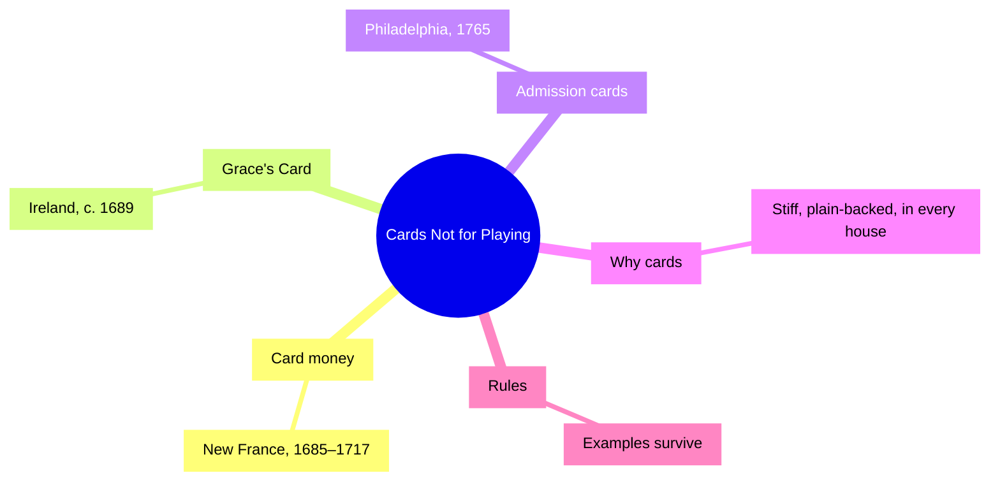

<!-- Written by tools/build-docs.mjs from the sources. Edit those, then run npm run build:docs. -->

# Cards Not for Playing

**Wing IV · Printed Boards and Parlour Tables** · 1685 – 1805 CE · Money, letters and tickets

[← Cribbage](cribbage.md) · [All games](README.md) · [Faro →](faro.md)

| | |
| --- | --- |
| In the Archives | On display |
| Rules | Examples survive |
| How we know them | Examples survive |
| Family | [Cards](README.md#cards) |
| Exhibit id | `notforplay`: `[librarium_archives start="notforplay"]` |

## At a glance

| | |
| --- | --- |
| Card money | New France, 1685–1717 |
| Grace's Card | Ireland, c. 1689 |
| Admission cards | Philadelphia, 1765 |
| Why cards | Stiff, plain-backed, in every house |

## The placard

For centuries a playing card was the handiest piece of stiff paper in the house, and most packs had plain backs until the 1800s. Cards took notes, IOUs, addresses and love letters, and spoiled sheets from the card-makers stiffened book covers.

In 1685 the intendant of New France, Jacques de Meulles, had no coin to pay the soldiers, so he wrote values on playing cards, had them signed and sealed, and issued them as money. Playing-card money was withdrawn in 1717.

When William of Orange offered Baron Grace of Courtstown, in Kilkenny, high honours to change sides, Grace wrote his refusal on a six of hearts, remembered as Grace's Card: "Tell your master I despise his offer." In 1765 the University of Pennsylvania admitted students to classes on cards. Voltaire, finding a friend out, left a dirty card saying he had called four times, and invitations to balls went out on the backs of cards into the 1800s.

> These are our own reproductions, made to show the kinds of use; the wording follows the stories, not any one surviving card.

## Sources

Checked in [the placard fact-check](../fact-check.md):

- **Claims:** Card money in New France under Jacques de Meulles, 1685, to pay the troops; values on the plain backs, corners cut to tell the values apart, signed by officials; withdrawn 1717 **Source:** Bank of Canada Museum; Wikipedia, Card money

The sources for every placard are listed in [Historical notes and sources](../sources.md).

## In the code

| | |
| --- | --- |
| 3D model | [`src/hall/build-card-room.js`](../../src/hall/build-card-room.js) |
| Placard | [`src/hall/09-exhibit-data.js`](../../src/hall/09-exhibit-data.js) |
