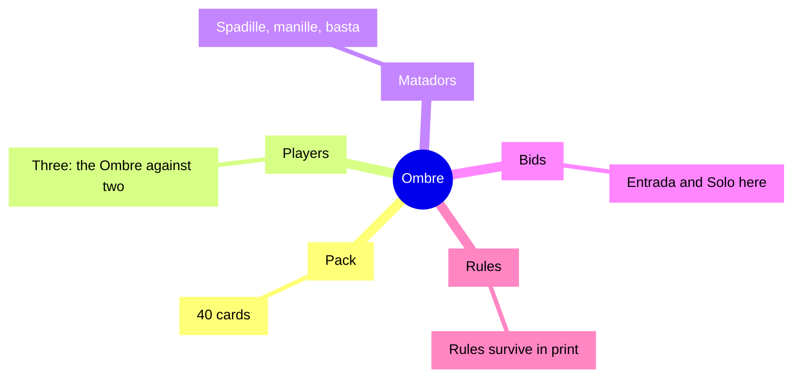
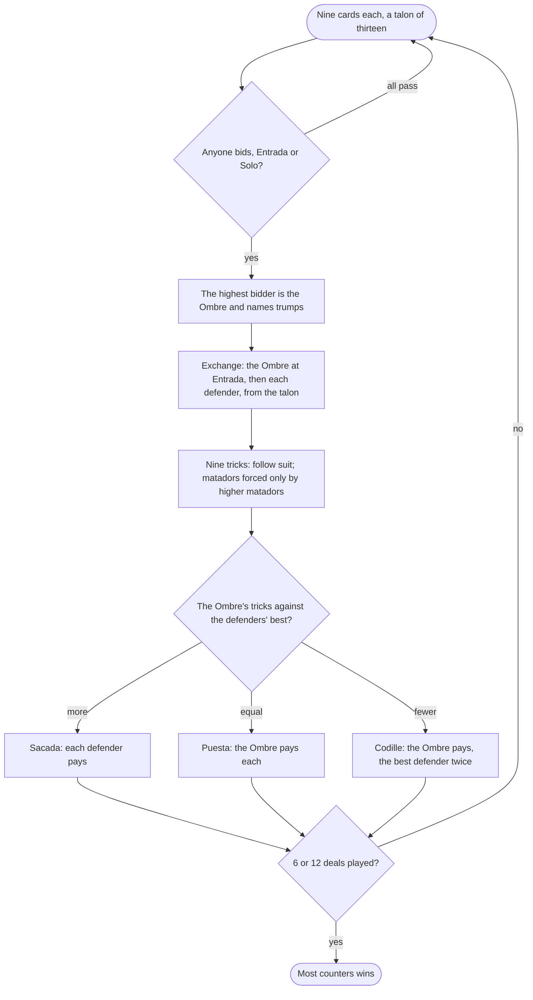

<!-- Written by tools/build-docs.mjs from the sources. Edit those, then run npm run build:docs. -->

# Ombre

**Wing IV · Printed Boards and Parlour Tables** · early 1600s CE · Spain, then every court in Europe

[← The Game of the Goose](goose.md) · [All games](README.md) · [Cribbage →](cribbage.md)

| | |
| --- | --- |
| In the Archives | Playable against the Scribe, in 3 seats |
| Rules | Rules survive in print |
| How we know them | Survive in print; still played as l'Hombre |
| Family | [Cards](README.md#cards) |
| Exhibit id | `ombre`: `[librarium_archives start="ombre"]` |
| Game | **6 deals** · 12 deals |
| Suits drawn | French by default; the Pack switch redraws it in French, German, Swiss or Italian suits |

## At a glance

| | |
| --- | --- |
| Pack | 40 cards |
| Players | Three: the Ombre against two |
| Matadors | Spadille, manille, basta |
| Bids | Entrada and Solo here |

## The placard

Ombre began in Spain around 1600. Its name is the Spanish hombre, the man: the player who took on the other two said "I am the man". It was the first card game in which trumps were bid for instead of turned up, an idea that passed on to Skat, the tarot games and in the end to bridge.

English rules were printed in 1660, and the game was said to have come over with Catherine of Braganza, Charles II's queen. By 1700 it was so fashionable that it had a three-cornered card table of its own, and in Alexander Pope's The Rape of the Lock (1714) Belinda plays a hand of ombre in such detail that the deal can be worked out.

Quadrille and then whist overtook it in the 1700s, but its descendants are still played: l'Hombre in Denmark, the Faroes and Iceland, Tresillo in Spain, and Rocambor in South America.

> The table plays two of the old bids, Entrada and Solo, and keeps score in counters.

## A turn

Seats: You, East, West.

## The rules as played here

1. Three players: you, and East and West, both played by the Scribe. A 40-card pack without eights, nines and tens; each player gets nine cards and thirteen are left face down. Play goes to the right, and the player on the dealer's right (forehand) bids first and leads first.
2. Bidding: pass, or bid Entrada (you will name trumps and exchange cards) or Solo (you name trumps and play the hand as dealt). Each bid must beat the last; a pass is final. The winning bidder is the Ombre, and plays alone against the other two. If all three pass, the next player deals.
3. Trumps: the ace of spades (spadille) and the ace of clubs (basta) are always trumps. With black trumps they rank spadille, the two (manille), basta, king, queen, jack, seven down to three. With red trumps: spadille, the seven (manille), basta, the ace (punto), king, queen, jack, two up to six. In plain suits, black runs king, queen, jack, seven down to two; red runs king, queen, jack, ace, two up to seven.
4. The exchange: the Ombre at Entrada throws away any cards and draws as many from the thirteen, then each defender in turn may do the same with what is left. Click cards to mark them, then exchange. Follow suit if you can. When a trump is led you must play a trump, but a matador (spadille, manille or basta) need never be played unless a higher matador was led and you have no other trump.
5. The Ombre must take more tricks than either defender: sacada, and each defender pays 1 (3 at Solo). Tying the defender with most is puesta: the Ombre pays each of them. If a defender takes more, it is codille: the Ombre pays both, and that defender twice. After 6 deals (or 12) the most counters wins.

**Source:** Classic three-handed Ombre after pagat.com and Wikipedia, with two of the old bids, Entrada and Solo, and payments in counters. Vuelta, the lower bids and the vole are left out.

### Rule choices

- **Ombre:** three-handed, after pagat.com and Wikipedia. A 40-card pack; nine cards each and a talon of thirteen. Bids, low to high: Entrada (name trumps, exchange) and Solo (name trumps, no exchange); a pass is final, and if all three pass the deal moves on. The Ombre exchanges first at Entrada, then each defender in turn from what is left. Matadors (spadille, manille, basta) are forced only by a higher matador. Sacada: each defender pays the stake (1, or 3 at Solo); puesta: the Ombre pays each; codille: the Ombre pays each, and the defender with most twice. Vuelta, the lower bids, the vole and the surrender are left out. Six or twelve deals.

### Game

Chosen at the table under Options. Changing it restarts the game.

| Choice | |
| --- | --- |
| 6 deals | the default |
| 12 deals |  |

## At the table

| | |
| --- | --- |
| The Scribe | Gentle, Fair or Sharp (see [the Scribe](../scribe.md#levels)) |
| Pass-and-play with a friend | No |
| Undo | No |
| Hint | No |
| Saved and resumed | Yes |
| Pack switch | Yes |

Keys, the move list, replays and the guide are the same at every table: see [Visiting the Archives](../visiting.md#at-a-table).

## How the Scribe plays

**Method:** Sampling the unseen cards: deals what it cannot see at random and plays each deal out, as Tarocchi's Sharp does. See [the Scribe](../scribe.md).

**Games with hidden cards and tiles:** Bids by the worth of its hand in its best suit (the matadors, high trumps, side kings and empty suits) against a bar by level; keeps trumps and kings in the exchange; as Ombre leads trumps from strength, as a defender lets the other defender's winning card stand. Sharp prices each bid and suit by dealing the unseen cards many times and playing the hand out, and in play samples the hidden hands to choose each card

## Sources

Checked in [the placard fact-check](../fact-check.md):

- **Claims:** From Spain around 1600; *hombre*, "the man"; the first game with trumps set by bidding; English rules printed in 1660; said to have come with Catherine of Braganza; a three-sided table by 1700; Belinda's game in Pope's *The Rape of the Lock* (1714), detailed enough to reconstruct the deal; overtaken by quadrille and whist; l'Hombre in Denmark, the Faroes and Iceland, Tresillo, Rocambor **Source:** Wikipedia, Ombre; pagat.com, L'Hombre

The sources for every placard are listed in [Historical notes and sources](../sources.md).

## In the code

| | |
| --- | --- |
| Rules and the Scribe | [`src/rules/ombre.js`](../../src/rules/ombre.js) |
| Table presenter | [`src/hall/table-ombre.js`](../../src/hall/table-ombre.js) |
| 3D model | [`src/hall/build-card-room.js`](../../src/hall/build-card-room.js) |
| Placard | [`src/hall/09-exhibit-data.js`](../../src/hall/09-exhibit-data.js) |
