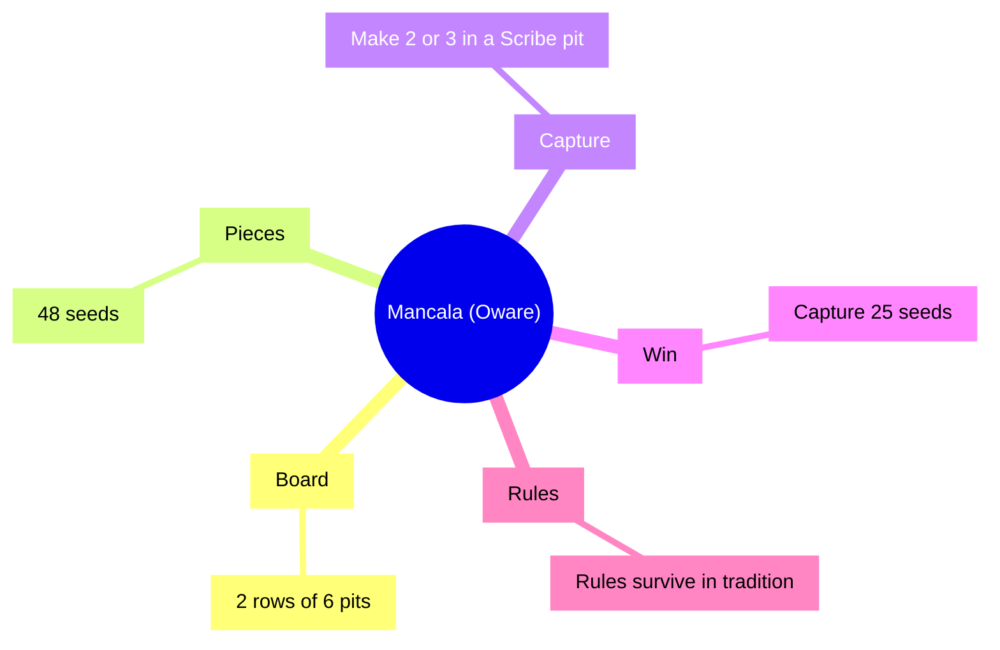
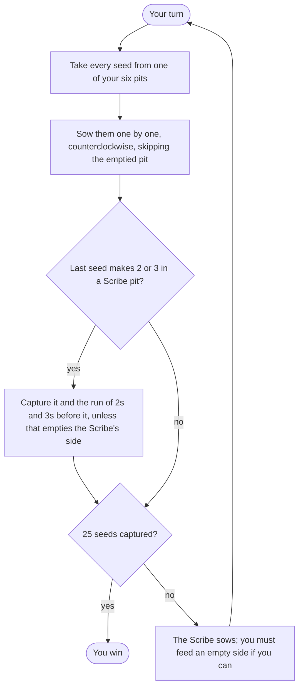

<!-- Written by tools/build-docs.mjs from the sources. Edit those, then run npm run build:docs. -->

# Mancala (Oware)

**Wing II · Strategy Takes the Table** · c. 6th–7th century CE · Africa · Aksum to the Akan

[← Nine Men's Morris](morris.md) · [All games](README.md) · [Alquerque →](alquerque.md)

| | |
| --- | --- |
| In the Archives | Playable against the Scribe, or a friend on the same screen |
| Rules | Rules survive in tradition |
| How we know them | Survive in tradition (abapa) |
| Family | [Mancala](README.md#mancala) |
| Exhibit id | `oware`: `[librarium_archives start="oware"]` |

## At a glance

| | |
| --- | --- |
| Board | 2 rows of 6 pits |
| Pieces | 48 seeds |
| Capture | Make 2 or 3 in a Scribe pit |
| Win | Capture 25 seeds |

## The placard

Mancala is a family of hundreds of games played by sowing seeds around rows of pits. The oldest securely dated evidence comes from the Kingdom of Aksum, in today's Ethiopia and Eritrea, where rows of pits were cut into rock and shaped in pottery in the 6th and 7th centuries CE. Hollows in far older stone slabs in Jordan may be boards too, but that is debated.

The name comes from the Arabic naqala, "to move". Traders carried the game across the Islamic world and the Indian Ocean, and enslaved West Africans carried it to the Caribbean and the Americas. Our table plays Oware, the game of the Akan peoples of Ghana and Côte d'Ivoire, with two rows of six pits and 48 seeds.

## A turn

## The rules as played here

1. Take every seed from one of your six pits (the row nearest you) and sow them one at a time into the following pits, counterclockwise.
2. If a pit holds 12 or more seeds, skip the pit you emptied as you go around.
3. If your last seed lands in one of the Scribe's pits and makes 2 or 3, capture them, along with any unbroken run of 2s and 3s just before it on the Scribe's side.
4. A move that would capture every seed on the Scribe's side captures nothing.
5. If the Scribe's side is empty you must sow into it if you can. If you cannot, the game ends and you keep the seeds on your side.
6. The first to capture 25 seeds wins.

**Source:** Abapa rules, the standard form of Oware played in competitions.

## At the table

| | |
| --- | --- |
| The Scribe | Gentle, Fair or Sharp (see [the Scribe](../scribe.md#levels)) |
| Pass-and-play with a friend | Yes |
| Undo | Yes |
| Hint | Yes |
| Saved and resumed | Yes |

Keys, the move list, replays and the guide are the same at every table: see [Visiting the Archives](../visiting.md#at-a-table).

## How the Scribe plays

**Method:** Shared search: negamax with alpha-beta; captures played out at the leaves; iterative deepening; time budget per level. See [the Scribe](../scribe.md).

## Sources

The sources for every placard are listed in [Historical notes and sources](../sources.md).

## In the code

| | |
| --- | --- |
| Rules and the Scribe | [`src/rules/oware.js`](../../src/rules/oware.js) |
| Table presenter | [`src/hall/table-oware.js`](../../src/hall/table-oware.js) |
| 3D model | [`src/hall/build-oware-board.js`](../../src/hall/build-oware-board.js) |
| Placard | [`src/hall/09-exhibit-data.js`](../../src/hall/09-exhibit-data.js) |
