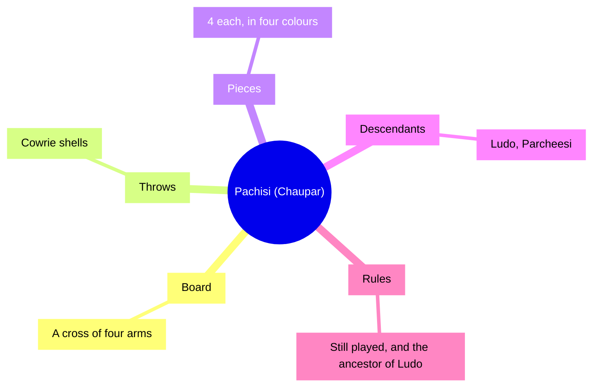
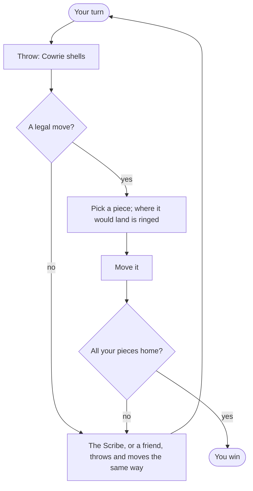

<!-- Written by tools/build-docs.mjs from the sources. Edit those, then run npm run build:docs. -->

# Pachisi (Chaupar)

**Wing IV · Printed Boards and Parlour Tables** · 16th century CE · India · Mughal court

[← International Draughts](idraughts.md) · [All games](README.md) · [Court Cards →](courtcards.md)

| | |
| --- | --- |
| In the Archives | Playable against the Scribe, or a friend on the same screen |
| Rules | Still played, and the ancestor of Ludo |
| How we know them | Still played; ancestor of Ludo |
| Family | [Race games](README.md#race-games) |
| Exhibit id | `pachisi`: `[librarium_archives start="pachisi"]` |
| Pieces | **Short game** · Full game |

## At a glance

| | |
| --- | --- |
| Board | A cross of four arms |
| Throws | Cowrie shells |
| Pieces | 4 each, in four colours |
| Descendants | Ludo, Parcheesi |

## The placard

Pachisi and its close relative chaupar are race games played on a cross of cloth with four arms of squares. Instead of dice, players throw cowrie shells and count how many land mouth up; the name comes from the Hindi for twenty-five, the highest throw.

How old it is is hard to pin down. A relief in the Ellora caves, carved between the 6th and 8th centuries, is often read as a game of this kind. The most famous board is a courtyard at Fatehpur Sikri, the city the Mughal emperor Akbar built in the 1570s, laid out in red and white stone; accounts say people stood in as the pieces.

British players took the game home. Simplified, with a single die and a square board, it was sold in England as Ludo from 1896, and in America as Parcheesi.

> Pachisi is played by four in two partnerships, so here you play two colours against the Scribe's two. The short game takes about a hundred throws; the full game, more than twice as many.

## A turn

## The rules as played here

1. You play two colours as partners: yellow, from the near arm, and blue, from the far arm. The Scribe plays green and cream.
2. Throw six cowries and count those landing mouth up: 2, 3, 4 or 5 move that many squares; one up is 10, none is 25 and all six is 6. A 6, 10 or 25 is a grace: it can bring a piece out of the Charkoni onto the first square, and it earns another throw.
3. Each piece goes down the middle of its own arm, anticlockwise round the outside of the cross, and back up its own middle into the Charkoni, which needs an exact throw. No throw is 1, so a piece may not stop on the last square before home.
4. Land on an enemy piece to send it back to the Charkoni, and throw again. Pieces on the twelve castle squares, marked with a cross, are safe, and you may not land on a castle held by the enemy.
5. Bring all your pieces home first to win. The short game gives each colour two pieces, the full game four.

**Source:** The common rules with six cowries (pachisi has no single standard). As in some versions, each colour's first piece may come out on any throw; later ones need a grace. Each throw is moved at once rather than collected first, and the short game uses two pieces per colour so it fits a visit to the Archives.

### Rule choices

- **Pachisi:** six cowries (2, 3, 4, 5; one mouth up is 10, none 25, all six 6). A 6, 10 or 25 is a grace and earns another throw, as does a capture. Each colour's first piece may come out on any throw, later ones only on a grace. Castles are safe and can't be entered while the enemy holds them. No throw is 1, so a piece may not stop on the last square before home. The short game gives each colour two pieces (about a hundred throws), the full game four.

### Pieces

Chosen at the table under Options. Changing it restarts the game.

| Choice | |
| --- | --- |
| Short game | the default |
| Full game |  |

## At the table

| | |
| --- | --- |
| The Scribe | Gentle, Fair or Sharp (see [the Scribe](../scribe.md#levels)) |
| Pass-and-play with a friend | Yes |
| Undo | No |
| Hint | Yes |
| Saved and resumed | No |

Keys, the move list, replays and the guide are the same at every table: see [Visiting the Archives](../visiting.md#at-a-table).

## How the Scribe plays

**Method:** Rules of thumb: scored moves for dice games. See [the Scribe](../scribe.md).

**Measured strength**

| Fair vs Gentle | Sharp vs Fair | Games |
| --- | --- | --- |
| 72% |  | hundreds |

**Game by game (Yut Nori, Pachisi):** Progress, captures, safety, and castles in Pachisi

## Sources

The sources for every placard are listed in [Historical notes and sources](../sources.md).

## In the code

| | |
| --- | --- |
| Rules and the Scribe | [`src/rules/pachisi.js`](../../src/rules/pachisi.js) |
| Table presenter | [`src/hall/table-pachisi.js`](../../src/hall/table-pachisi.js) |
| 3D model | [`src/hall/build-pachisi.js`](../../src/hall/build-pachisi.js) |
| Placard | [`src/hall/09-exhibit-data.js`](../../src/hall/09-exhibit-data.js) |
