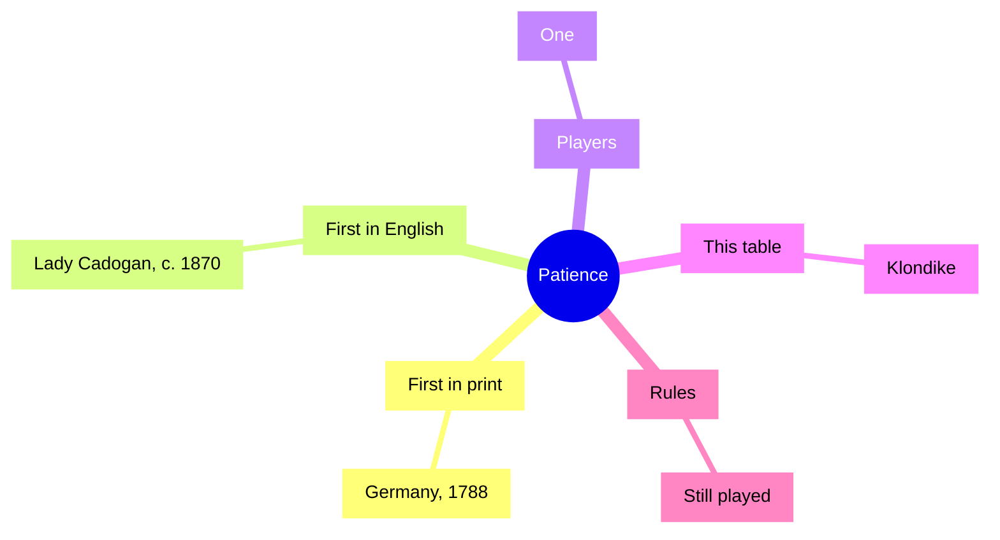
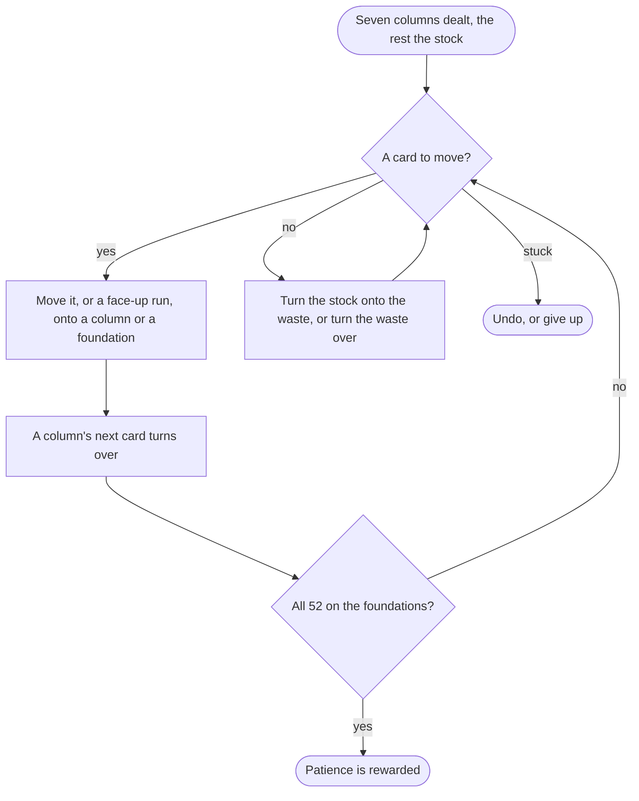

<!-- Written by tools/build-docs.mjs from the sources. Edit those, then run npm run build:docs. -->

# Patience

**Wing IV · Printed Boards and Parlour Tables** · 1788 CE · Germany, France, England

[← Whist](whist.md) · [All games](README.md) · [Snakes and Ladders →](snakes.md)

| | |
| --- | --- |
| In the Archives | Playable, alone: there is no Scribe at this table |
| Rules | Still played |
| How we know them | Still played |
| Family | [Cards](README.md#cards) |
| Exhibit id | `patience`: `[librarium_archives start="patience"]` |
| Stock | **Draw one** · Draw three |

## At a glance

| | |
| --- | --- |
| First in print | Germany, 1788 |
| First in English | Lady Cadogan, c. 1870 |
| Players | One |
| This table | Klondike |

## The placard

Games of patience, for one player, first appear in print in 1788, in a German anthology of card games, Das neue Königliche L'Hombre-Spiel. They came soon after the layouts for reading fortunes in cards, in the 1760s; the Danish and Norwegian name, kabal, still recalls the cabbala.

Patience was fashionable in France early in the 1800s and reached Britain and America later in the century. Lady Adelaide Cadogan's Illustrated Games of Patience, of about 1870, was the first collection in English.

Klondike, the game at this table, is the best known of hundreds. From 1990 it came with Microsoft Windows, and put a game of patience in front of millions.

> The one table with no Scribe: you play alone. Undo and Hint are there if you want them.

## A turn

## The rules as played here

1. Klondike, played alone. Twenty-eight cards are dealt in seven columns, one to seven cards each, the top card of each face up. The rest are the stock.
2. Build the four foundations up by suit from the ace to the king. Pick a card, then the place it goes; a card with only one place to go goes there at once.
3. In the columns, build down in alternating colours: a red six on a black seven. You may move any face-up run together. When a column's face-up cards are gone, its next card turns over; only a king (with any run below it) may go into an empty column.
4. Click the stock to turn a card (or three, in Draw three) onto the waste; its top card can be played. When the stock runs out, turn the waste over and go through it again, as often as you like. You can also take a card back down from a foundation.
5. You win when all fifty-two cards are on the foundations. Once every card is face up and the stock is spent, the rest go up by themselves.

**Source:** Klondike as usually played, with unlimited passes through the stock. Undo and Hint are open to you; there is no Scribe at this table.

### Rule choices

- **Patience:** Klondike, after the usual rules: build down in alternating colours, kings to empty columns, foundations up by suit, unlimited passes through the stock (draw one or three). Cards may come back down from a foundation. Once every card is face up and the stock is spent, the rest go up by themselves. There is no Scribe; Undo and Hint are open, and Give up ends the game.

### Stock

Chosen at the table under Options. Changing it restarts the game.

| Choice | |
| --- | --- |
| Draw one | the default |
| Draw three |  |

## At the table

| | |
| --- | --- |
| The Scribe | None: Patience is played alone |
| Pass-and-play with a friend | No |
| Undo | Yes |
| Hint | Yes |
| Saved and resumed | Yes |

Keys, the move list, replays and the guide are the same at every table: see [Visiting the Archives](../visiting.md#at-a-table).

## Hint

There is no Scribe at this table. Hint suggests a move by rule of thumb (a card up to a foundation, then a move that turns over a hidden card, then the waste, then the stock). Played on its own, that rule wins about 36% of draw-one deals and 10% of draw-three deals, over 300 deals each.

## Sources

Checked in [the placard fact-check](../fact-check.md):

- **Claims:** First in print in 1788 in *Das neue Königliche L'Hombre-Spiel*; after cartomantic layouts of about 1765; Danish and Norwegian *kabal*; France early 1800s, Britain and America later; Lady Cadogan's *Illustrated Games of Patience*, about 1870 (1874 in the references); Klondike with Windows from 1990 **Source:** Wikipedia, Patience (game)

The sources for every placard are listed in [Historical notes and sources](../sources.md).

## In the code

| | |
| --- | --- |
| Rules and the Scribe | [`src/rules/patience.js`](../../src/rules/patience.js) |
| Table presenter | [`src/hall/table-patience.js`](../../src/hall/table-patience.js) |
| 3D model | [`src/hall/build-card-room.js`](../../src/hall/build-card-room.js) |
| Placard | [`src/hall/09-exhibit-data.js`](../../src/hall/09-exhibit-data.js) |
