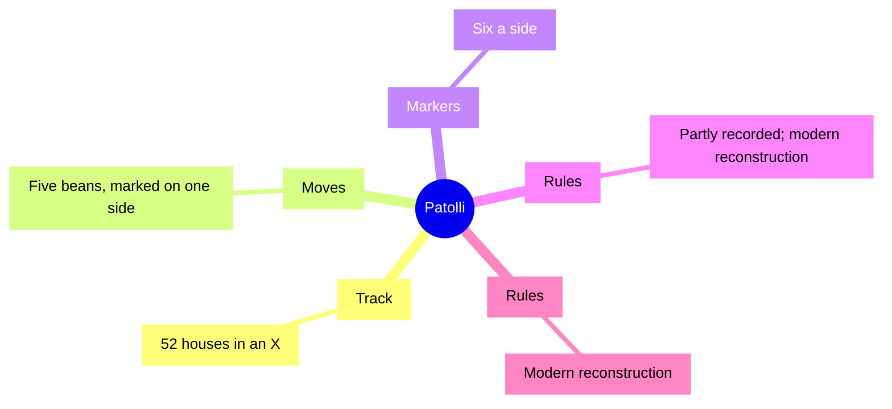
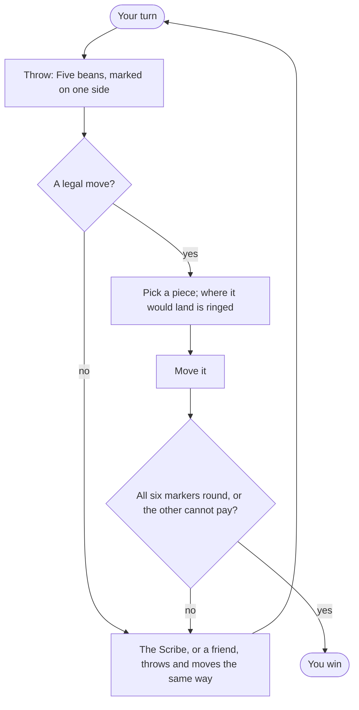

<!-- Written by tools/build-docs.mjs from the sources. Edit those, then run npm run build:docs. -->

# Patolli

**Wing II · Strategy Takes the Table** · by c. 300 CE · Mesoamerica

[← Ludus Duodecim Scriptorum](xii.md) · [All games](README.md) · [Nine Men's Morris →](morris.md)

| | |
| --- | --- |
| In the Archives | Playable against the Scribe, or a friend on the same screen |
| Rules | Modern reconstruction |
| How we know them | Partly recorded (Durán) |
| Family | [Race games](README.md#race-games) |
| Exhibit id | `patolli`: `[librarium_archives start="patolli"]` |

## At a glance

| | |
| --- | --- |
| Track | 52 houses in an X |
| Moves | Five beans, marked on one side |
| Markers | Six a side |
| Rules | Partly recorded; modern reconstruction |

## The placard

Patolli was played across Mesoamerica for more than a thousand years: by the Maya from around 300 CE, and later by the Toltecs and the Aztecs. Its track of 52 houses ran in an X across a reed mat, and each player raced six markers by throwing black beans marked on one side.

It was a gambler's game. Players staked blankets, precious stones, gold and food, and sometimes their homes or their freedom. The Dominican friar Diego Durán, writing in the 16th century, described players who carried the mat under an arm the way gamblers of his day carried cards. Moctezuma liked to watch his nobles play; the Spanish suppressed the game.

Durán and others recorded the mat, the beans, the markers and the stakes, but not a full set of rules. The table plays a modern reconstruction built on those accounts, the version most often given today: a 1 to enter, captures only in the centre, a treasure paid on the dark houses and another throw on the red tips. The mat, beans and stones are new.

> Only parts of the rules were written down. This table plays a modern reconstruction.

## A turn

## The rules as played here

1. This is a modern reconstruction. Spanish writers such as Diego Durán describe the mat, the beans, the six markers and the stakes, but not every rule; the table follows the reconstruction most often given today.
2. You have six red markers and six treasures; the Scribe has six blue markers and six treasures. Throw five beans and count the marked sides: 1 to 4 move that many houses, all five move 10, and none means you pay a treasure as an offering to the god Macuilxochitl.
3. A throw of 1 may put a new marker on your starting house, in the centre. Markers run clockwise round all 52 houses and leave the mat on reaching the last house by an exact throw.
4. A marker may not land on an occupied house, except in the four centre houses: land on an enemy marker there and it goes back to its owner, who pays you a treasure.
5. Landing on one of the dark houses costs you a treasure, paid to the other player. Landing on a red tip at the end of an arm earns another throw. Each marker that completes the circuit earns a treasure from the other player.
6. When one player has brought all six markers round, that player also takes the offerings and a last treasure, and whoever holds more treasures wins. A player who cannot pay loses at once.

**Source:** A modern reconstruction, following the rules most often given today from Diego Durán's 16th-century account and the Aztec codices. Treasure paid for a completed circuit, the 150-throw limit and deciding the game on treasure after one round are our choices.

### Rule choices

- **Patolli:** the reconstruction most often given today, from Diego Durán's account. 52 houses; six markers and six treasures each; five beans (1 to 4 marks move that many, all five move 10, none costs an offering to Macuilxochitl). A 1 enters a marker on its centre house; markers run the whole circuit clockwise and leave by exact count. No landing on an occupied house except in the centre, where an enemy is sent back and its owner pays a treasure. Dark houses cost a treasure; red tips give another throw. Our choices: a treasure is paid for each completed circuit, the game is one round, and when one side has all six markers home (or after 150 throws each) the side with more treasures wins. A player who cannot pay loses.

## At the table

| | |
| --- | --- |
| The Scribe | Gentle, Fair or Sharp (see [the Scribe](../scribe.md#levels)) |
| Pass-and-play with a friend | Yes |
| Undo | No |
| Hint | Yes |
| Saved and resumed | No |

Keys, the move list, replays and the guide are the same at every table: see [Visiting the Archives](../visiting.md#at-a-table).

## How the Scribe plays

**Method:** Rules of thumb: scored moves for dice games. See [the Scribe](../scribe.md).

**Measured strength**

| Fair vs Gentle | Sharp vs Fair | Games |
| --- | --- | --- |
| 91% | 73% | 400 and 600 |

**Game by game:** Bringing markers home, captures in the centre, entering, the red tips, and avoiding the dark houses. Sharp also weighs the odds of being hit on a centre house

## Sources

The sources for every placard are listed in [Historical notes and sources](../sources.md).

## In the code

| | |
| --- | --- |
| Rules and the Scribe | [`src/rules/patolli.js`](../../src/rules/patolli.js) |
| Table presenter | [`src/hall/table-patolli.js`](../../src/hall/table-patolli.js) |
| 3D model | [`src/hall/build-backfill-displays.js`](../../src/hall/build-backfill-displays.js) |
| Placard | [`src/hall/09-exhibit-data.js`](../../src/hall/09-exhibit-data.js) |
