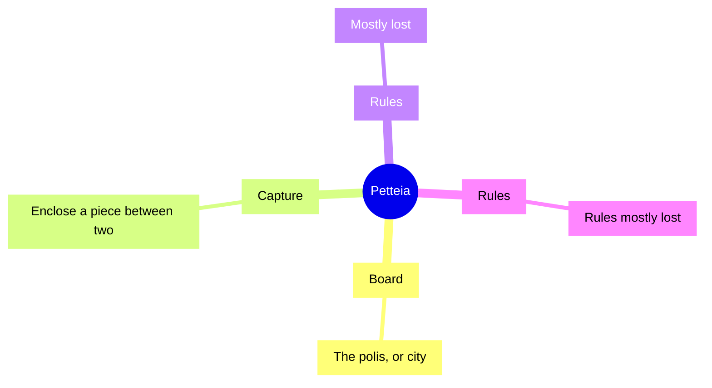

<!-- Written by tools/build-docs.mjs from the sources. Edit those, then run npm run build:docs. -->

# Petteia

**Wing II · Strategy Takes the Table** · by 443 BCE · Classical Greece

[← Hounds and Jackals](hounds.md) · [All games](README.md) · [Liubo →](liubo.md)

| | |
| --- | --- |
| In the Archives | On display |
| Rules | Rules mostly lost |
| How we know them | Mostly lost |
| Family | [Capture games](README.md#capture-games) |
| Exhibit id | `petteia`: `[librarium_archives start="petteia"]` |

## At a glance

| | |
| --- | --- |
| Board | The polis, or city |
| Capture | Enclose a piece between two |
| Rules | Mostly lost |

## The placard

Petteia, "pebbles", was the board game of classical Greece. The comic poet Cratinus mentions it in 443 or 442 BCE, and Plato and Aristotle both use it to make a point. The board, Julius Pollux wrote much later, was called the polis, the city, and the pieces were called dogs.

Each player had pieces of one colour, and a piece was captured by enclosing it between two enemies, so the art was never to leave a piece alone. Beyond that, the size of the board, the opening position and most of the rules are lost. The Roman game of soldiers, further down this wing, may descend from it.

> On display. The 8 × 8 slab is our guess: no petteia board has been securely identified.

## Sources

Checked in [the placard fact-check](../fact-check.md):

- **Claim as it stood:** Cratinus mentions it in 443 or 442 BCE **What the sources say:** His *Drapetides*, 443/442 BCE, is the earliest known reference **Verdict:** Correct

The sources for every placard are listed in [Historical notes and sources](../sources.md).

## In the code

| | |
| --- | --- |
| 3D model | [`src/hall/build-backfill-displays.js`](../../src/hall/build-backfill-displays.js) |
| Placard | [`src/hall/09-exhibit-data.js`](../../src/hall/09-exhibit-data.js) |
