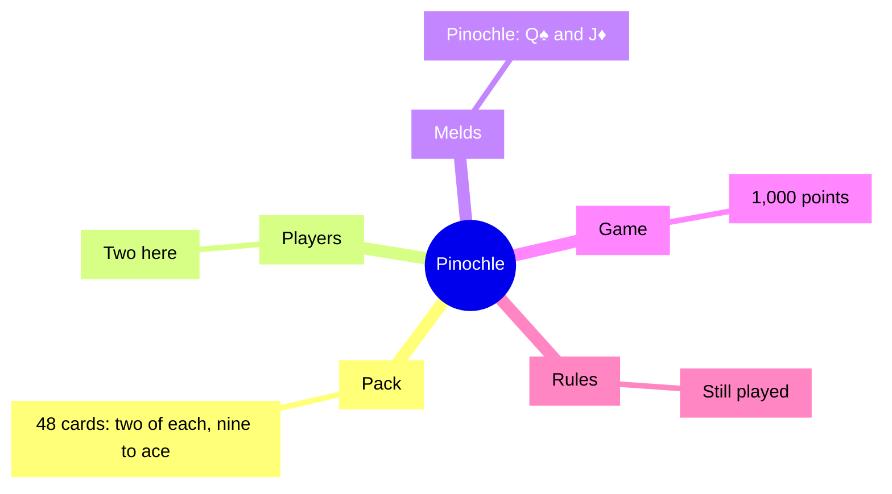
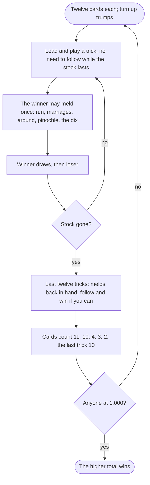

<!-- Written by tools/build-docs.mjs from the sources. Edit those, then run npm run build:docs. -->

# Pinochle

**Wing V · The Modern Board Game** · late 1800s CE · America, from Binokel

[← The Checkered Game of Life](lifegame.md) · [All games](README.md) · [Reversi →](reversi.md)

| | |
| --- | --- |
| In the Archives | Playable against the Scribe |
| Rules | Still played |
| How we know them | Still played |
| Family | [Cards](README.md#cards) |
| Exhibit id | `pinochle`: `[librarium_archives start="pinochle"]` |
| Game | **To 1,000** · One deal |
| Suits drawn | French by default; the Pack switch redraws it in French, German, Swiss or Italian suits |

## At a glance

| | |
| --- | --- |
| Pack | 48 cards: two of each, nine to ace |
| Players | Two here |
| Melds | Pinochle: Q♠ and J♦ |
| Game | 1,000 points |

## The placard

Pinochle is bézique's American branch. German immigrants brought the Swiss and Swabian game of Binokel to America in the last quarter of the 1800s, and the name was misheard and misspelled into pinochle. By 1889 a St. Louis paper was reporting its popularity in New York.

Early players made up their 48-card packs from other packs; boxed pinochle packs were sold once the game was popular in the early 1900s. It was a favourite of Jewish and Irish immigrants, while most Germans in America kept to Skat. During the First World War Syracuse, New York, banned it as German.

The name may come from the French binocle, eyeglasses. Today the standard form is partnership auction pinochle for four, played in clubs and tournaments. This table plays the two-handed game.

## A turn

## The rules as played here

1. A 48-card pinochle pack: two of every card from the nine to the ace in each suit, ranking ace, ten, king, queen, jack, nine. Each of you gets twelve; the next card is turned up for trumps and the rest are the stock.
2. While the stock lasts you need not follow suit. The higher card of the suit led wins, a trump beats any other suit, and of two identical cards the first played wins. The winner may then meld once, and draws first; the loser draws next.
3. Melds are laid face up and can still be played to tricks. Run (ace, ten, king, queen, jack of trumps) 150. Royal marriage (king and queen of trumps) 40, other marriages 20. Aces around (one of each suit) 100, kings around 80, queens around 60, jacks around 40. Pinochle (queen of spades and jack of diamonds) 40, double pinochle 300. The dix (nine of trumps) 10; the first one shown is exchanged for the turned-up card. A card may count again in another kind of meld, never the same kind.
4. When the stock is gone (the loser of that trick takes the turned-up card), melds return to the hand and the last twelve tricks are played strictly: follow suit and win the trick if you can; if you cannot follow, trump if you can.
5. Cards taken in tricks count: ace 11, ten 10, king 4, queen 3, jack 2, and 10 for the last trick. The first to 1,000 at the end of a deal wins.

**Source:** Two-handed pinochle after pagat.com, which follows the American books. One meld after each trick won, chosen from a list; the run on a royal marriage already down scores the 110 it adds, and double pinochle on a pinochle already down 260.

### Rule choices

- **Pinochle:** two-handed, after pagat.com: twelve cards each, one meld after each trick won while the stock lasts (a run 150, or 110 on a royal marriage already down; marriages 20 and 40; aces, kings, queens and jacks around; the pinochle 40, double 300; the dix 10, the first exchanged for the turned-up trump), then twelve strict tricks. Cards count 11, 10, 4, 3 and 2, and 10 for the last trick. To 1,000 or one deal.

### Game

Chosen at the table under Options. Changing it restarts the game.

| Choice | |
| --- | --- |
| To 1,000 | the default |
| One deal |  |

## At the table

| | |
| --- | --- |
| The Scribe | Gentle, Fair or Sharp (see [the Scribe](../scribe.md#levels)) |
| Pass-and-play with a friend | No |
| Undo | No |
| Hint | No |
| Saved and resumed | Yes |
| Pack switch | Yes |

Keys, the move list, replays and the guide are the same at every table: see [Visiting the Archives](../visiting.md#at-a-table).

## How the Scribe plays

**Method:** Hidden information: plays only from what it can see. See [the Scribe](../scribe.md).

**Games with hidden cards and tiles:** Bézique's Scribe with pinochle's melds and card points: keeps aces, tens, trumps and the cards of melds it can still make, wins a trick cheaply for points or a meld, and plays the last twelve by the strict rules

**Measured strength**

| Fair vs Gentle | Sharp vs Fair | Games |
| --- | --- | --- |
| 136–14 | 90–60 | 150 games each, to 1,000 |

## Sources

Checked in [the placard fact-check](../fact-check.md):

- **Claims:** From bézique by way of Binokel; brought to America by German immigrants in the last quarter of the 1800s; the name misheard; a St. Louis paper on its popularity in New York, 1889; made-up packs before boxed pinochle packs in the early 1900s; favoured by Jewish and Irish immigrants while most Germans kept to Skat; banned in Syracuse in the First World War; perhaps from French *binocle*; partnership auction pinochle the standard game today **Source:** Wikipedia, Pinochle

The sources for every placard are listed in [Historical notes and sources](../sources.md).

## In the code

| | |
| --- | --- |
| Rules and the Scribe | [`src/rules/pinochle.js`](../../src/rules/pinochle.js) |
| Table presenter | [`src/hall/table-pinochle.js`](../../src/hall/table-pinochle.js) |
| 3D model | [`src/hall/build-card-room.js`](../../src/hall/build-card-room.js) |
| Placard | [`src/hall/09-exhibit-data.js`](../../src/hall/09-exhibit-data.js) |
