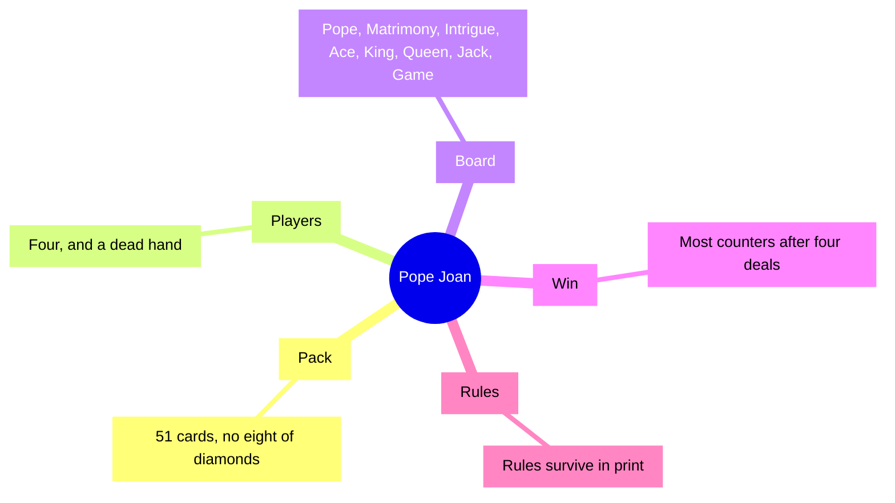
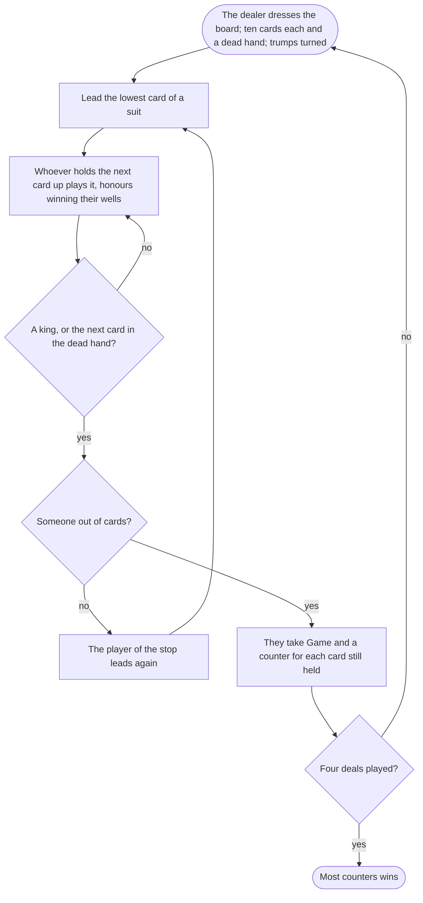

<!-- Written by tools/build-docs.mjs from the sources. Edit those, then run npm run build:docs. -->

# Pope Joan

**Wing IV · Printed Boards and Parlour Tables** · 1732 CE · England · on its own board

[← Tablut](tablut.md) · [All games](README.md) · [Whist →](whist.md)

| | |
| --- | --- |
| In the Archives | Playable against the Scribe, in 4 seats |
| Rules | Rules survive in print |
| How we know them | Survive in print |
| Family | [Cards](README.md#cards) |
| Exhibit id | `popejoan`: `[librarium_archives start="popejoan"]` |
| Game | **Four deals** · Eight deals |
| Suits drawn | French by default; the Pack switch redraws it in French, German, Swiss or Italian suits |

## At a glance

| | |
| --- | --- |
| Pack | 51 cards, no eight of diamonds |
| Players | Four, and a dead hand |
| Board | Pope, Matrimony, Intrigue, Ace, King, Queen, Jack, Game |
| Win | Most counters after four deals |

## The placard

Pope Joan is the English cousin of the French nain jaune, the yellow dwarf, named after its seven of diamonds. Both are played for counters on a board of compartments. The earliest English mention, in 1732, calls the game Pope Julius; Pope Joan may come from the legend of a woman pope, or from nain jaune misheard. Its Pope is the nine of diamonds, a card also called the Curse of Scotland.

It was a family game of the 18th and 19th centuries, played on a round board with eight wells; some Victorian boards were lacquered wood and turned on a stand. It is played in Dickens's The Pickwick Papers (1836–37), and Hoyle's books printed its rules through the 1800s.

There is little skill in it: the cards run in sequences by themselves, and the only choice is which suit to start. The fun is in the board, where unclaimed stakes pile up from deal to deal until somebody plays the right card.

> Ten cards to each of four players and to the dead hand, with the turn-up added to it.

## A turn

Seats: You, West, North, East.

## The rules as played here

1. Four players with 30 counters each, and a board of eight compartments. Each dealer dresses the board: six counters on Pope, two each on Matrimony and Intrigue, one each on Ace, King, Queen, Jack and Game. Counters not won stay for the next deal.
2. The pack has no eight of diamonds. Ten cards each, ten to a dead hand that nobody plays, and the last card turned up for trumps. If it is the ace, king, queen or jack of trumps, or the nine of diamonds (the Pope), the dealer takes that compartment at once.
3. The player left of the dealer leads the lowest card they hold of any suit they choose. Whoever holds the next card up in that suit plays it, and so on, aces low, kings high. The run stops at a king, or when the next card is in the dead hand or out of the pack (the seven of diamonds always stops, since there is no eight). Whoever played the last card leads again, the lowest card of any suit. Here the cards that follow are played for you.
4. Play the ace, king, queen or jack of trumps and take that compartment; play the Pope and take Pope. Play both the queen and jack of trumps for Intrigue, both the king and queen for Matrimony.
5. The first to play their last card takes Game, and a counter from each other player for every card they still hold; whoever still holds the Pope pays nothing.
6. After four deals (or eight), whoever has most counters wins.

**Source:** Pope Joan as David Parlett gives it from the Victorian sources, with Wikipedia's account of the deal and the turn-up. The hall deals ten to each player and ten and the turn-up to the dead hand.

### Rule choices

- **Pope Joan:** after Parlett and Wikipedia: the dealer dresses the board (Pope 6, Matrimony and Intrigue 2, the others 1), ten cards each and ten to the dead hand, which also takes the turned-up trump. A turned honour or Pope wins its well for the dealer at once. Runs go up the suit until a king, the dead hand or the missing eight of diamonds; Matrimony and Intrigue need both their cards played by one player. The first player out takes Game and a counter for each card still held, except from the Pope's holder. Four or eight deals; unclaimed stakes stay on the board.

### Game

Chosen at the table under Options. Changing it restarts the game.

| Choice | |
| --- | --- |
| Four deals | the default |
| Eight deals |  |

## At the table

| | |
| --- | --- |
| The Scribe | Gentle, Fair or Sharp (see [the Scribe](../scribe.md#levels)) |
| Pass-and-play with a friend | No |
| Undo | No |
| Hint | No |
| Saved and resumed | Yes |
| Pack switch | Yes |

Keys, the move list, replays and the guide are the same at every table: see [Visiting the Archives](../visiting.md#at-a-table).

## How the Scribe plays

**Method:** Sampling the unseen cards: deals what it cannot see at random and plays each deal out, as Tarocchi's Sharp does. See [the Scribe](../scribe.md).

**Games with hidden cards and tiles:** The only choice is which suit to lead. Fair leads the suit that lets it play the most cards in a row, above all a run up to its own king or through the honours it holds. Sharp deals the unseen hands, the dead hand included, many times and plays the deal out from each choice, to see which wins it most counters. Gentle often leads at random

## Sources

Checked in [the placard fact-check](../fact-check.md):

- **Claims:** The English counterpart of nain jaune, named after the seven of diamonds; the OED's 1732 mention as Pope Julius; the name's two explanations; the nine of diamonds also the Curse of Scotland; round boards with eight compartments, some lacquered and revolving; *The Pickwick Papers*; Hoyle's rules through the 1800s **Source:** Wikipedia, Pope Joan (card game); David Parlett, Pope Joan

The sources for every placard are listed in [Historical notes and sources](../sources.md).

## In the code

| | |
| --- | --- |
| Rules and the Scribe | [`src/rules/popejoan.js`](../../src/rules/popejoan.js) |
| Table presenter | [`src/hall/table-card-room-5.js`](../../src/hall/table-card-room-5.js) |
| 3D model | [`src/hall/build-card-room-5.js`](../../src/hall/build-card-room-5.js) |
| Placard | [`src/hall/09-exhibit-data.js`](../../src/hall/09-exhibit-data.js) |
