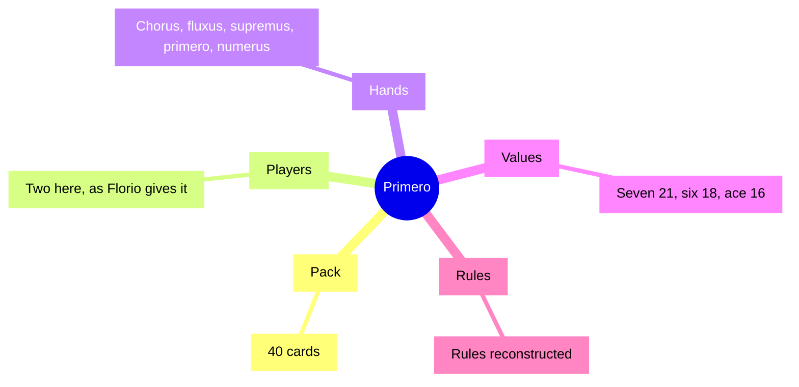
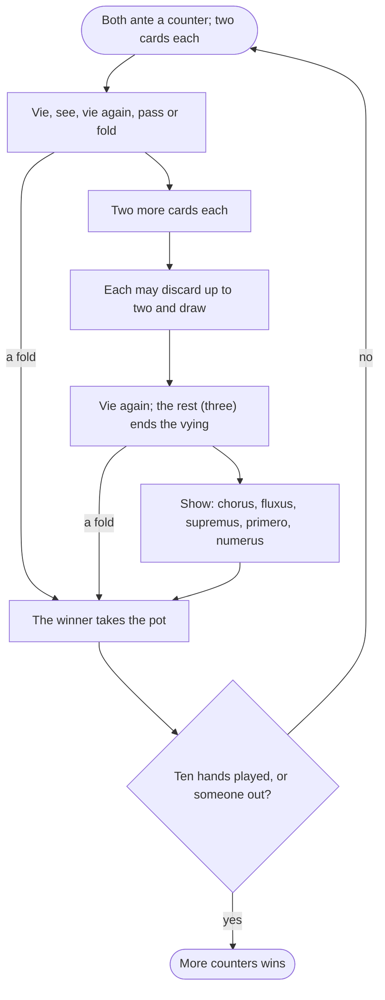

<!-- Written by tools/build-docs.mjs from the sources. Edit those, then run npm run build:docs. -->

# Primero

**Wing IV · Printed Boards and Parlour Tables** · 1526 CE · Italy, Spain and England

[← Draughts](draughts.md) · [All games](README.md) · [International Draughts →](idraughts.md)

| | |
| --- | --- |
| In the Archives | Playable against the Scribe |
| Rules | Rules reconstructed |
| How we know them | Reconstructed (du Coeur, pagat.com) |
| Family | [Cards](README.md#cards) |
| Exhibit id | `primero`: `[librarium_archives start="primero"]` |
| Game | **Ten hands** · Until one is out |
| Suits drawn | French by default; the Pack switch redraws it in French, German, Swiss or Italian suits |

## At a glance

| | |
| --- | --- |
| Pack | 40 cards |
| Players | Two here, as Florio gives it |
| Hands | Chorus, fluxus, supremus, primero, numerus |
| Values | Seven 21, six 18, ace 16 |

## The placard

Primero, primiera in Italy, was the great gambling game of the 16th century. Each player holds four cards and vies, or bets, on them: the best hand takes the pot, unless a bold vie has made the others give up first. The earliest known account is Francesco Berni's mock-serious poem on the game, printed in Rome in 1526, and Girolamo Cardano called it the noblest card game of all.

It was played at the English court by Henry VIII's time. In Shakespeare's Henry VIII the king is left at primero with the Duke of Suffolk, and Falstaff, in The Merry Wives of Windsor, has never prospered since he forswore himself at primero. John Florio set out a game for two, at a shilling a stake, in 1591.

Its hands (a prime of all four suits, a flush, four of a kind) and its betting and bluffing make it the best-known forerunner of poker. By the later 1600s it had split into many local games and gone out of fashion.

> The table plays the English game for two, as John Florio gives it, with one exchange of cards.

## A turn

## The rules as played here

1. You and the Scribe each start with 30 counters, and each hand both put one in the pot. The pack has forty cards: aces, twos to sevens and the three courts of each suit.
2. Two cards each, then a round of vying. Vie to put a counter in; the other must see you (match it), vie again, or fold and lose the pot. If neither vies, both pass.
3. Two more cards each. You may then discard up to two and draw as many: click the cards, then exchange them, or keep your hand.
4. A second round of vying, where you may also vie the rest: three counters, after which there is no more vying. Then both hands are shown.
5. Hands, high to low: chorus (four of a kind), fluxus (all four of one suit), supremus (the ace, six and seven of one suit, 55), primero (one of each suit), and numerus (the best two or three of one suit). Within a kind, the higher total wins: seven 21, six 18, ace 16, five 15, four 14, three 13, two 12, courts 10. If both are equal, the elder hand (not the dealer) wins.
6. The game is ten hands (or until one of you has no counters left). Whoever has more counters wins.

**Source:** Primero in the English form John Florio describes for two players (1591), with the hands, values and vying of Cardano and Minsheu, after the reconstructions of Justin du Coeur and pagat.com. The hall plays one exchange and limits each round to two vies.

### Rule choices

- **Primero:** John Florio's English game for two, with Cardano's and Minsheu's hands and values: a 40-card pack, an ante of one, two cards and a round of vying (vie, see, vie again, pass or fold; two vies a round), two more cards, one exchange of up to two cards, and a second round in which three counters, the rest, end the vying. Hands rank chorus, fluxus, supremus (ace, six and seven of a suit, 55), primero and numerus; ties go to the elder hand. Ten hands of 30 counters each, or until one player is out.

### Game

Chosen at the table under Options. Changing it restarts the game.

| Choice | |
| --- | --- |
| Ten hands | the default |
| Until one is out |  |

## At the table

| | |
| --- | --- |
| The Scribe | Gentle, Fair or Sharp (see [the Scribe](../scribe.md#levels)) |
| Pass-and-play with a friend | No |
| Undo | No |
| Hint | No |
| Saved and resumed | Yes |
| Pack switch | Yes |

Keys, the move list, replays and the guide are the same at every table: see [Visiting the Archives](../visiting.md#at-a-table).

## How the Scribe plays

**Method:** Sampling the unseen cards: deals what it cannot see at random and plays each deal out, as Tarocchi's Sharp does. See [the Scribe](../scribe.md).

**Games with hidden cards and tiles:** Deals out the cards it cannot see many times (its own cards to come, and a hand for you, each improved by a quick exchange) to judge how often its hand wins. It vies when it expects to win well over half the time, vies the rest when far ahead, sees when the pot pays for the risk, and vies on nothing now and then. In the exchange it tries every discard of up to two cards against many draws. Sharp deals more often, reads your vies (a player who vies twice is seldom weak) and bluffs a little more; Gentle often plays at random

**Measured strength**

| Fair vs Gentle | Sharp vs Fair | Games |
| --- | --- | --- |
| 160–33, 7 even | 165–123, 12 even | 200 and 300 games of ten hands, seats swapped |

## Sources

Checked in [the placard fact-check](../fact-check.md):

- **Claims:** The great gambling game of the 16th century; Berni's poem printed in Rome in 1526 the earliest known account; Cardano called it the noblest card game; Henry VIII left at primero with the Duke of Suffolk, and Falstaff's oath, in Shakespeare; Florio's two-player game at a shilling a stake, 1591; the forerunner of poker; split into local games and out of fashion by the later 1600s **Source:** Wikipedia, Primero; Justin du Coeur's reconstruction; pagat.com

The sources for every placard are listed in [Historical notes and sources](../sources.md).

## In the code

| | |
| --- | --- |
| Rules and the Scribe | [`src/rules/primero.js`](../../src/rules/primero.js) |
| Table presenter | [`src/hall/table-card-room-5.js`](../../src/hall/table-card-room-5.js) |
| 3D model | [`src/hall/build-card-room-5.js`](../../src/hall/build-card-room-5.js) |
| Placard | [`src/hall/09-exhibit-data.js`](../../src/hall/09-exhibit-data.js) |
