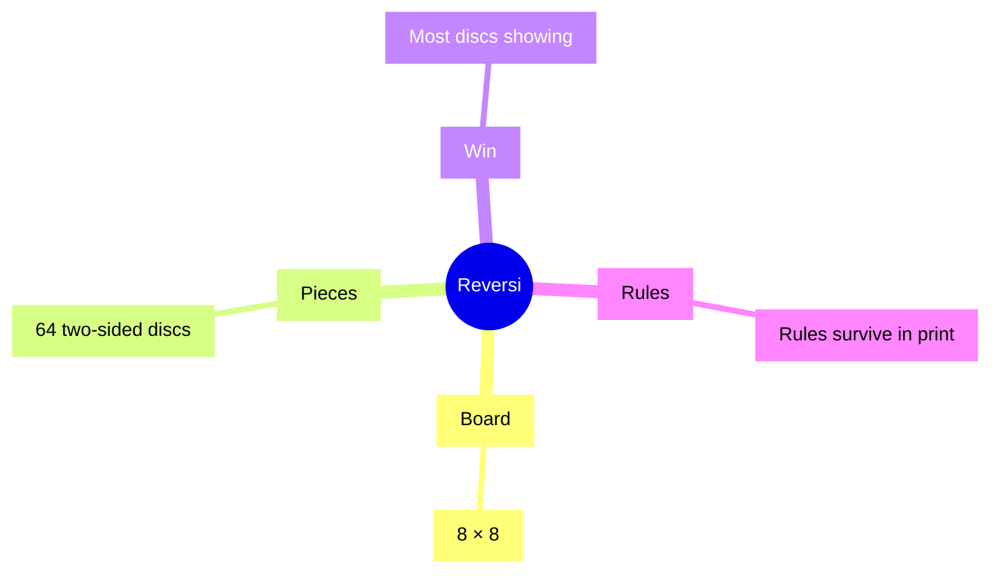
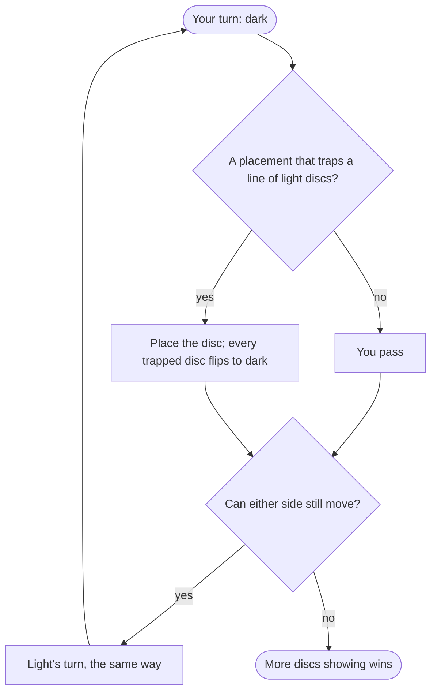

<!-- Written by tools/build-docs.mjs from the sources. Edit those, then run npm run build:docs. -->

# Reversi

**Wing V · The Modern Board Game** · 1883 CE · Victorian England

[← The Checkered Game of Life](lifegame.md) · [All games](README.md) · [Halma →](halma.md)

| | |
| --- | --- |
| In the Archives | Playable against the Scribe, or a friend on the same screen |
| Rules | Rules survive in print |
| How we know them | Survive in print; played today as Othello |
| Family | [Territory and enclosure](README.md#territory-and-enclosure) |
| Exhibit id | `reversi`: `[librarium_archives start="reversi"]` |

## At a glance

| | |
| --- | --- |
| Board | 8 × 8 |
| Pieces | 64 two-sided discs |
| Win | Most discs showing |

## The placard

Two Englishmen, Lewis Waterman and John W. Mollett, each claimed to have invented reversi in 1883, and each called the other a fraud. Whoever was first, the game of flipping discs caught on: the Saturday Review mentioned it in 1886, and the German publisher Ravensburger was making it by 1893.

In 1971 the Japanese salesman Goro Hasegawa patented Othello, which starts from four discs in the centre instead of an empty board. Othello is the version played in tournaments today, and its opening is the one we use here.

## A turn

## The rules as played here

1. You play the dark discs and move first.
2. Place a disc so that it traps a straight line of the Scribe's discs, across, up or down, or diagonally, between your new disc and one of yours. Every trapped disc flips to your colour.
3. A move must flip at least one disc. If you cannot move, you pass.
4. The game ends when neither player can move. Whoever has more discs showing wins.

**Source:** The standard rules, starting from the four centre discs as Othello (1971) made standard. Early reversi began with an empty board.

### Rule choices

- **Reversi** starts from the four centre discs of Othello rather than the empty board of the 1880s. A player with no legal move passes; the game ends when neither can move.

## At the table

| | |
| --- | --- |
| The Scribe | Gentle, Fair or Sharp (see [the Scribe](../scribe.md#levels)) |
| Pass-and-play with a friend | Yes |
| Undo | Yes |
| Hint | Yes |
| Saved and resumed | Yes |

Keys, the move list, replays and the guide are the same at every table: see [Visiting the Archives](../visiting.md#at-a-table).

## How the Scribe plays

**Method:** Shared search: negamax with alpha-beta; captures played out at the leaves; iterative deepening; time budget per level. See [the Scribe](../scribe.md).

**Game by game:** Corners, edges and mobility, then exact disc counting near the end. Gentle plays a random legal move

## Sources

Checked in [the placard fact-check](../fact-check.md):

- **Claim as it stood:** Goro Hasegawa, a salesman, patented Othello in 1971 **What the sources say:** Patented in Japan in 1971, when he was a 38-year-old salesman **Verdict:** Correct

The sources for every placard are listed in [Historical notes and sources](../sources.md).

## In the code

| | |
| --- | --- |
| Rules and the Scribe | [`src/rules/reversi.js`](../../src/rules/reversi.js) |
| Table presenter | [`src/hall/table-reversi.js`](../../src/hall/table-reversi.js) |
| 3D model | [`src/hall/build-reversi.js`](../../src/hall/build-reversi.js) |
| Placard | [`src/hall/09-exhibit-data.js`](../../src/hall/09-exhibit-data.js) |
