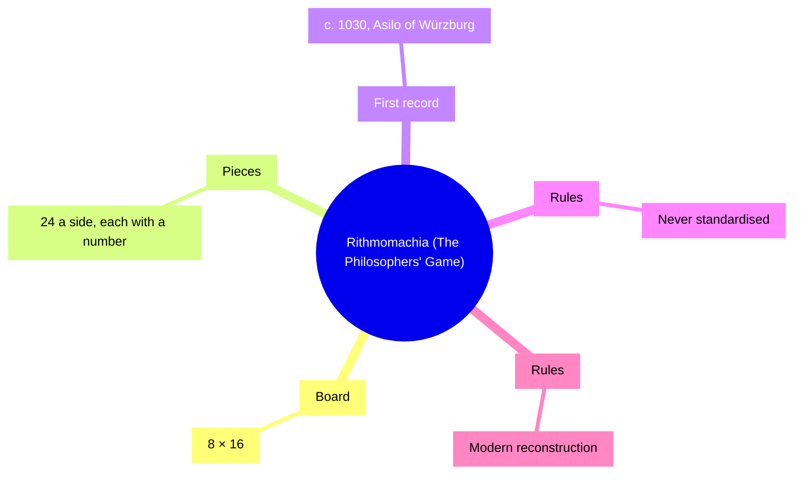
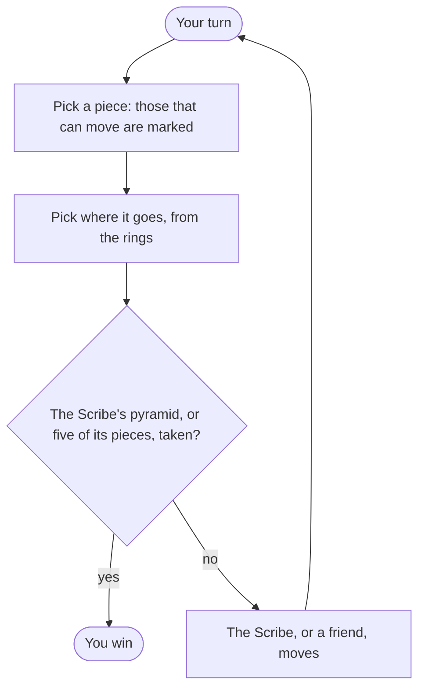

<!-- Written by tools/build-docs.mjs from the sources. Edit those, then run npm run build:docs. -->

# Rithmomachia

**Wing III · Kings, Cards and Courts** · c. 1030 CE · Southern Germany · monastery schools

[← Chaturaji](chaturaji.md) · [All games](README.md) · [The Lewis Chessmen →](lewis.md)

| | |
| --- | --- |
| In the Archives | Playable against the Scribe, or a friend on the same screen |
| Rules | Modern reconstruction |
| How we know them | Never standardised |
| Family | [The chess family](README.md#the-chess-family) |
| Exhibit id | `rithmo`: `[librarium_archives start="rithmo"]` |

## At a glance

| | |
| --- | --- |
| Board | 8 × 16 |
| Pieces | 24 a side, each with a number |
| First record | c. 1030, Asilo of Würzburg |
| Rules | Never standardised |

## The placard

Rithmomachia, "the battle of numbers", was a game for scholars. The first written evidence dates from around 1030, when a monk named Asilo, probably the later Bishop Adalbero of Würzburg, devised it to illustrate the number theory of Boethius' De institutione arithmetica, the standard arithmetic textbook of the day.

It spread through the schools and monasteries of southern Germany and France. Roger Bacon recommended it to his students, and Thomas More let the citizens of his Utopia play it. Printed books on it appeared in the 16th century, but the rules were never settled, and it faded in the 17th century along with Boethian arithmetic.

Every piece carries a number drawn from Boethius' ratios. The Evens and the Odds each field rounds, triangles, squares and a pyramid whose value is the sum of a stack of square numbers.

> Its rules were never standardised. This table plays a modern reconstruction: Claude de Boissière's array and moves of 1556, with the four classic captures.

## A turn

## The rules as played here

1. This is a modern reconstruction: the medieval rules were never fixed. You play the Evens, the white pieces, and move first. Every piece carries a number.
2. Pieces move straight along a row or a column, never diagonally and never over another piece. Rounds move exactly one square, triangles exactly two and squares exactly three. The pyramid may move one, two or three.
3. Meeting: move onto an enemy piece of exactly your piece's value to take it.
4. After your move, any enemy piece caught in these ways is taken as well. Assault: one of your pieces, times the number of empty squares between it and the enemy along a row or column, makes the enemy's value. Ambuscade: two of your pieces on either side of it, in a row or column, add up to its value. Siege: your pieces or the board's edge close it in on all four sides.
5. The pyramid counts as one piece of its full value: 91 for the Evens, 190 for the Odds. Take the Scribe's pyramid, or any 5 of its pieces, to win: victory by bodies, de corpore. A side with no move loses, and after 150 moves each, whoever has taken more wins.

**Source:** A modern reconstruction. The array and the moves follow Claude de Boissière's book of 1556, as set out by J. F. C. Richards and Jeff Joyner; the four captures are the classic meeting, assault, ambuscade and siege. Pyramids are taken only whole.

### Rule choices

- **Rithmomachia:** a modern reconstruction. Claude de Boissière's 1556 array (as set out by J. F. C. Richards and Jeff Joyner) on an 8 × 16 board: rounds move one square, triangles two and squares three, orthogonally and never leaping, the pyramid one to three. Captures are the four classic ones: meeting (move onto an equal enemy), and after your move, assault (your piece times the empty squares between makes the enemy), ambuscade (two pieces either side add up to it) and siege (closed in on four sides). Pyramids are taken only whole. Win by taking the pyramid or five pieces; after 150 moves each, the more pieces taken wins.

## At the table

| | |
| --- | --- |
| The Scribe | Gentle, Fair or Sharp (see [the Scribe](../scribe.md#levels)) |
| Pass-and-play with a friend | Yes |
| Undo | Yes |
| Hint | Yes |
| Saved and resumed | Yes |

Keys, the move list, replays and the guide are the same at every table: see [Visiting the Archives](../visiting.md#at-a-table).

## How the Scribe plays

**Measured strength**

| Fair vs Gentle | Sharp vs Fair | Games |
| --- | --- | --- |
| 5–0, 1 draw | 2–2, 2 draws | 6 each; most games run to the 150-move limit |

**Game by game:** Pieces taken by each side and pieces brought forward into contact; moves that capture are tried first

## Sources

The sources for every placard are listed in [Historical notes and sources](../sources.md).

## In the code

| | |
| --- | --- |
| Rules and the Scribe | [`src/rules/rithmomachia.js`](../../src/rules/rithmomachia.js) |
| Table presenter | [`src/hall/table-rithmo.js`](../../src/hall/table-rithmo.js) |
| 3D model | [`src/hall/build-rithmomachia.js`](../../src/hall/build-rithmomachia.js) |
| Placard | [`src/hall/09-exhibit-data.js`](../../src/hall/09-exhibit-data.js) |
