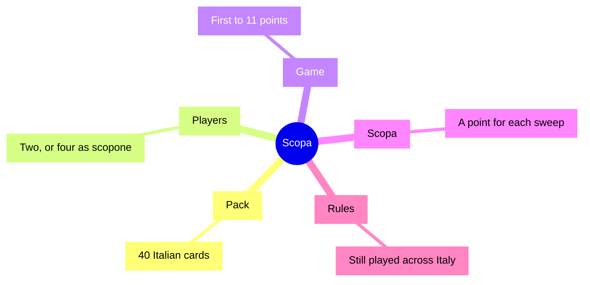
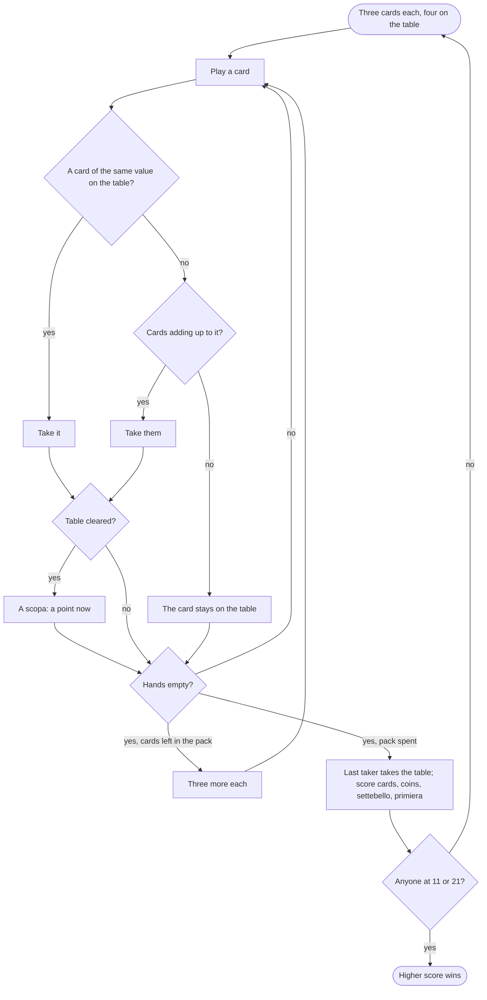

<!-- Written by tools/build-docs.mjs from the sources. Edit those, then run npm run build:docs. -->

# Scopa

**Wing IV · Printed Boards and Parlour Tables** · 18th century CE · Naples and all Italy

[← Dominoes](dominoes.md) · [All games](README.md) · [Tablut →](tablut.md)

| | |
| --- | --- |
| In the Archives | Playable against the Scribe |
| Rules | Still played across Italy |
| How we know them | Still played |
| Family | [Cards](README.md#cards) |
| Exhibit id | `scopa`: `[librarium_archives start="scopa"]` |
| Game | **To 11** · To 21 |
| Suits drawn | Italian (Latin) suits by default; the Pack switch redraws it in French, German, Swiss or Italian suits |

## At a glance

| | |
| --- | --- |
| Pack | 40 Italian cards |
| Players | Two, or four as scopone |
| Game | First to 11 points |
| Scopa | A point for each sweep |

## The placard

Scopa means broom: the best play sweeps the table clean. It is a fishing game, where cards are won by matching them rather than in tricks, and it was especially popular in Naples in the 1700s, though it was played all over Italy.

It uses a 40-card Italian pack of coins, cups, swords and batons, the Latin suits that came into Europe with the first cards in the 1370s. They descend from the coins, cups, swords and polo sticks of the Mamluk packs, the polo sticks turned into batons by European makers.

Scopa travelled with Italian emigrants: in Tunisia it is played as chkobba. Scopone, its four-player form, is played in two partnerships.

> The cards are our own, drawn in the Italian style. The Pack switch at the table redraws them in French, German or Swiss suits.

## A turn

## The rules as played here

1. A 40-card Italian pack: ace to seven in four suits (coins, cups, swords and batons), with the fante (knave) worth 8, the cavallo (knight) 9 and the re (king) 10. Each of you gets three cards and four go face up on the table.
2. Play one card. If a table card has the same value, you must take it. If none does but two or more add up to your card's value, you take them instead (a single card always comes first). If you take nothing, your card stays on the table. You may always choose which card to play.
3. Clearing the table is a scopa, a point at once. The last play of the hand never counts as a scopa. When both hands are empty, three more cards each are dealt until the pack runs out; then whatever is left on the table goes to whoever took last.
4. After each hand: a point for most cards, a point for most coins, a point for the settebello (the seven of coins), and a point for the primiera, the better set of one card from each suit (sevens 21, sixes 18, aces 16, fives 15, fours 14, threes 13, twos 12, court cards 10). Ties score nothing. The first to 11 wins; if both get there in the same hand, the higher score wins.

**Source:** Scopa for two players, after the rules at pagat.com. A deal with three or four kings on the table is dealt again, as there.

### Rule choices

- **Scopa:** two players with the 40-card Italian pack, as on pagat.com. A card must take a single card of its value if there is one, otherwise any set adding up to it; clearing the table is a scopa except on the last play. A table dealt with three or four kings is dealt again. Hands score cards, coins, the settebello and the primiera; the first to 11 (or 21) wins, and a tie at the target plays another hand.

### Game

Chosen at the table under Options. Changing it restarts the game.

| Choice | |
| --- | --- |
| To 11 | the default |
| To 21 |  |

## At the table

| | |
| --- | --- |
| The Scribe | Gentle, Fair or Sharp (see [the Scribe](../scribe.md#levels)) |
| Pass-and-play with a friend | No |
| Undo | No |
| Hint | No |
| Saved and resumed | Yes |
| Pack switch | Yes |

Keys, the move list, replays and the guide are the same at every table: see [Visiting the Archives](../visiting.md#at-a-table).

## How the Scribe plays

**Method:** Hidden information: plays only from what it can see. See [the Scribe](../scribe.md).

**Games with hidden cards and tiles:** Scores each play for the cards taken (coins, sevens, the settebello) and a sweep, less the chance the other player can sweep what is left or take a seven, from the cards it has not seen. Sharp counts every card already taken; Fair remembers only the table. Gentle often plays at random

## Sources

Checked in [the placard fact-check](../fact-check.md):

- **Claims:** "Broom"; especially popular in Naples in the 1700s; Latin suits from the Mamluk coins, cups, swords and polo sticks; chkobba; scopone in partnerships **Source:** Wikipedia, Scopa; pagat.com; WOPC, History of Playing Cards

The sources for every placard are listed in [Historical notes and sources](../sources.md).

## In the code

| | |
| --- | --- |
| Rules and the Scribe | [`src/rules/scopa.js`](../../src/rules/scopa.js) |
| Table presenter | [`src/hall/table-scopa.js`](../../src/hall/table-scopa.js) |
| 3D model | [`src/hall/build-card-room.js`](../../src/hall/build-card-room.js) |
| Placard | [`src/hall/09-exhibit-data.js`](../../src/hall/09-exhibit-data.js) |
