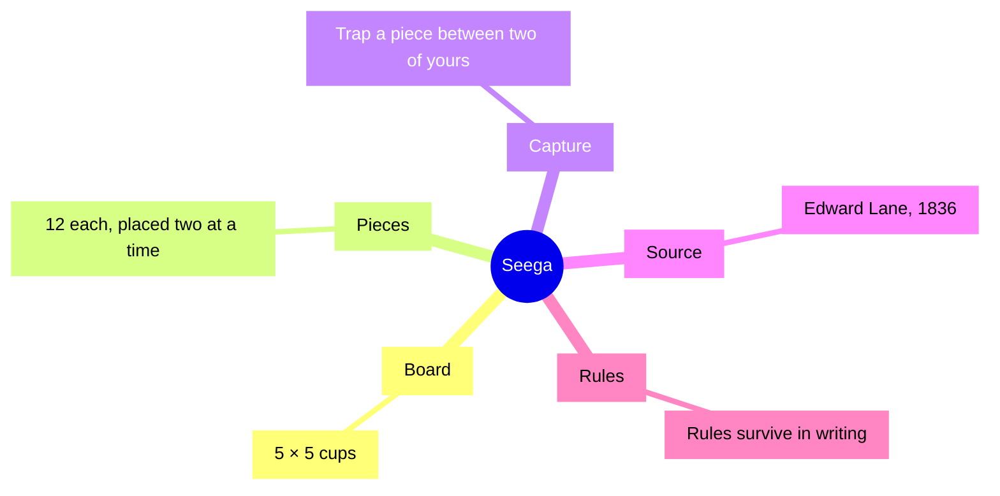
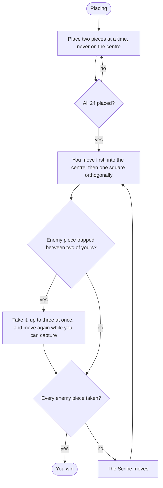

<!-- Written by tools/build-docs.mjs from the sources. Edit those, then run npm run build:docs. -->

# Seega

**Wing VI · Games of the World** · recorded in the 1820s · Egypt · recorded by Edward Lane

[← Morabaraba](morabaraba.md) · [All games](README.md) · [Tâb →](tab.md)

| | |
| --- | --- |
| In the Archives | Playable against the Scribe, or a friend on the same screen |
| Rules | Rules survive in writing |
| How we know them | Survive in writing |
| Family | [Capture games](README.md#capture-games) |
| Exhibit id | `seega`: `[librarium_archives start="seega"]` |

## At a glance

| | |
| --- | --- |
| Board | 5 × 5 cups |
| Pieces | 12 each, placed two at a time |
| Capture | Trap a piece between two of yours |
| Source | Edward Lane, 1836 |

## The placard

Seega is a game of the Nile valley, played on rows of cups scooped in the ground or cut in stone. Edward William Lane, an English scholar who lived in Cairo in the 1820s and 1830s, described it in his Manners and Customs of the Modern Egyptians (1836): boards of five, seven or nine rows, with twelve pieces each on the five-row board, the khamsáwee seega.

The pieces, called kelbs or "dogs", go down two at a time until only the centre is empty. Then the game becomes a fight of pincers: a piece trapped between two enemies along a line is lifted off, and a player keeps capturing for as long as they can.

Versions of it are still played in North Africa and the Middle East. Lane gives no rule for a game that stalls behind walls of pieces, so the table settles that by count after twenty quiet moves each.

## A turn

## The rules as played here

1. You have twelve dark stones and the Scribe twelve pieces of red clay. Take turns placing two at a time on any empty square except the centre, you first.
2. When all are placed, you move first, and your first move must go into the empty centre. After that, move one piece one square up, down or sideways onto an empty square.
3. Trap an enemy piece between the piece you move and another of yours, along a row or column, and it is taken. One move can take up to three. You may move between two enemy pieces safely.
4. After a capture, keep moving as long as you can capture again.
5. If your move leaves the Scribe with no move, you must lift one of your own pieces to open a way, and the same holds for the Scribe.
6. Take every enemy piece to win. If 20 moves each go by with no capture, whoever has more pieces wins.

**Source:** Edward William Lane, Manners and Customs of the Modern Egyptians (1836), on the five-square seega. Lane gives no ending for a game that stalls; the 20-move rule is ours.

### Rule choices

- **Seega:** Lane's five-cup board: twelve pieces each, placed two at a time, never on the centre; the first move must enter the centre. A piece trapped between the mover and another enemy piece along a row or column is taken (several at once if so), moving between two enemies is safe, and a player who has captured keeps moving while another capture is open. A player whose move leaves the other side no move must lift one of their own pieces to open a way, as Lane describes for the opening. Taking every enemy piece wins; twenty moves each without a capture end the game in favour of the larger side (house rule).

## At the table

| | |
| --- | --- |
| The Scribe | Gentle, Fair or Sharp (see [the Scribe](../scribe.md#levels)) |
| Pass-and-play with a friend | Yes |
| Undo | Yes |
| Hint | Yes |
| Saved and resumed | Yes |

Keys, the move list, replays and the guide are the same at every table: see [Visiting the Archives](../visiting.md#at-a-table).

## How the Scribe plays

**Method:** Shared search: negamax with alpha-beta; captures played out at the leaves; iterative deepening; time budget per level. See [the Scribe](../scribe.md).

**Measured strength**

| Fair vs Gentle | Sharp vs Fair | Games |
| --- | --- | --- |
| 7–2, 3 draws | 4–2, 6 draws | 12 each; many games end on the 20-move count |

**Game by game:** Placing: solid blocks that cannot be trapped. Moving: material, threats, room to move and pieces that cannot be trapped, searched with whole capture chains as one turn

## Sources

The sources for every placard are listed in [Historical notes and sources](../sources.md).

## In the code

| | |
| --- | --- |
| Rules and the Scribe | [`src/rules/seega.js`](../../src/rules/seega.js) |
| Table presenter | [`src/hall/table-seega.js`](../../src/hall/table-seega.js) |
| 3D model | [`src/hall/build-seega.js`](../../src/hall/build-seega.js) |
| Placard | [`src/hall/09-exhibit-data.js`](../../src/hall/09-exhibit-data.js) |
