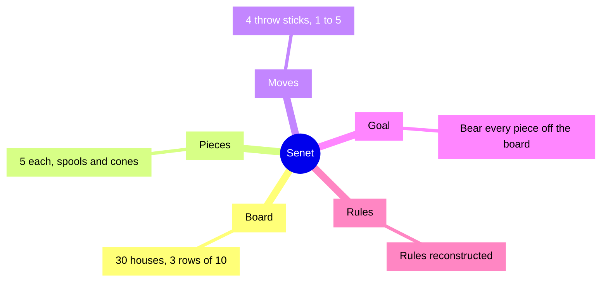
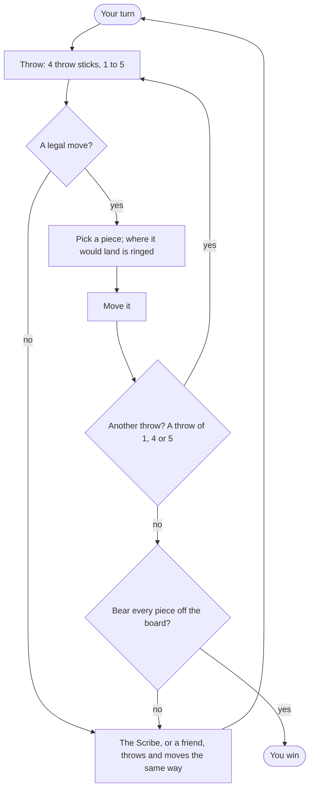

<!-- Written by tools/build-docs.mjs from the sources. Edit those, then run npm run build:docs. -->

# Senet

**Wing I · The Dawn of Play** · c. 3100 BCE · Egypt · Early Dynastic period

[← The entrance](README.md) · [All games](README.md) · [Mehen →](mehen.md)

| | |
| --- | --- |
| In the Archives | Playable against the Scribe, or a friend on the same screen |
| Rules | Rules reconstructed |
| How we know them | Reconstructed (after Kendall, 1978) |
| Family | [Race games](README.md#race-games) |
| Exhibit id | `senet`: `[librarium_archives start="senet"]` |

## At a glance

| | |
| --- | --- |
| Board | 30 houses, 3 rows of 10 |
| Pieces | 5 each, spools and cones |
| Moves | 4 throw sticks, 1 to 5 |
| Goal | Bear every piece off the board |

## The placard

Pieces of what may be Senet boards turn up in First Dynasty burials around 3100 BCE, and the first unmistakable painting of the game appears in the tomb of Hesy-Re, about 2620 BCE. It is one of the oldest board games we know by name.

The board has 30 squares, called houses, in three rows of ten. Players threw four flat sticks instead of dice. Over the centuries the game took on religious meaning: its name means "passing", and by the New Kingdom a match stood for the soul's journey through the underworld. Tutankhamun was buried with several sets.

No rulebook survives. We play a popular modern reconstruction that follows Timothy Kendall's, first published in 1978 and revised since.

## A turn

## The rules as played here

1. Throw four sticks and count the white sides. No white sides counts as 5.
2. A throw of 1, 4 or 5 earns another throw. A 2 or 3 ends your turn.
3. Land on a lone opponent to swap places with it. Two pieces side by side guard each other, and three in a row form a wall that cannot be passed.
4. Every piece must stop exactly on house 26, the House of Happiness. From there a 1 drops it into the House of Water, which washes it back to house 15. A 2, 3 or 4 moves it to the last houses, and a 5 bears it off.
5. Pieces on houses 28, 29 and 30 leave with an exact 3, 2 or 1.
6. The first to bear off all five pieces wins.

**Source:** A modern reconstruction after Timothy Kendall (1978, revised since). The ancient rules were never written down.

## At the table

| | |
| --- | --- |
| The Scribe | Gentle, Fair or Sharp (see [the Scribe](../scribe.md#levels)) |
| Pass-and-play with a friend | Yes |
| Undo | No |
| Hint | Yes |
| Saved and resumed | No |

Keys, the move list, replays and the guide are the same at every table: see [Visiting the Archives](../visiting.md#at-a-table).

## How the Scribe plays

**Method:** Rules of thumb: scored moves for dice games. See [the Scribe](../scribe.md).

**Game by game (Senet, Ur):** Each move scored for progress, safety and captures; Gentle adds a lot of chance

## Sources

Checked in [the placard fact-check](../fact-check.md):

- **Claim as it stood:** Rules follow "Timothy Kendall's 1979 work" **What the sources say:** Kendall's *Passing Through the Netherworld* is dated 1978; the first printing of his rules is sometimes given as 1979 **Verdict:** Changed to "first published in 1978 and revised since" (also in the rules note and docs/exhibits.md)

The sources for every placard are listed in [Historical notes and sources](../sources.md).

## In the code

| | |
| --- | --- |
| Rules and the Scribe | [`src/rules/00-core.js`](../../src/rules/00-core.js) |
| Table presenter | [`src/hall/12-presenters.js`](../../src/hall/12-presenters.js) |
| 3D model | [`src/hall/build-senet-board.js`](../../src/hall/build-senet-board.js) |
| Placard | [`src/hall/09-exhibit-data.js`](../../src/hall/09-exhibit-data.js) |
