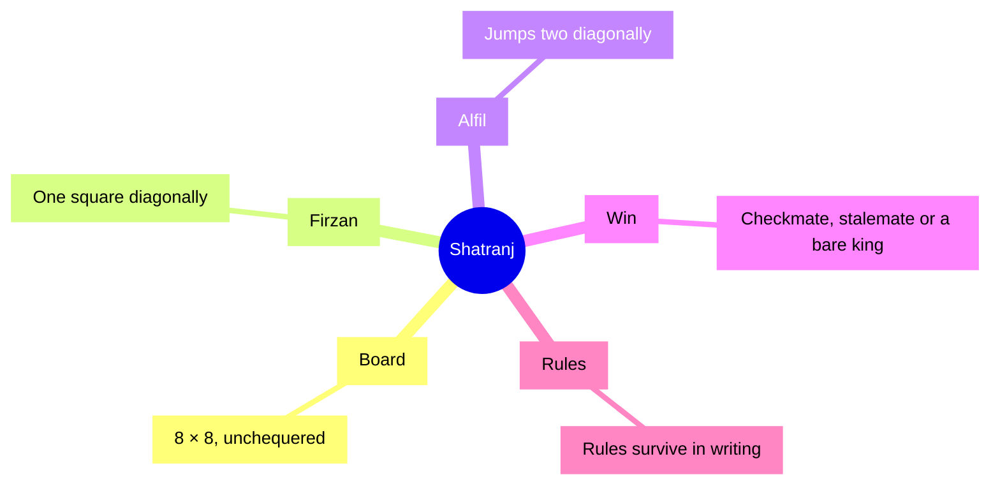
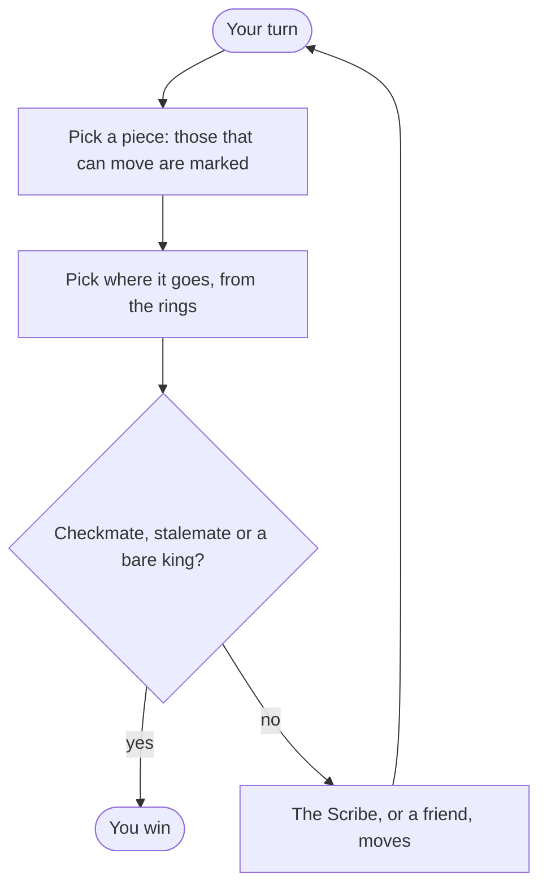

<!-- Written by tools/build-docs.mjs from the sources. Edit those, then run npm run build:docs. -->

# Shatranj

**Wing III · Kings, Cards and Courts** · c. 600–1200 CE · Persia and the Islamic world

[← Chaturanga](chaturanga.md) · [All games](README.md) · [Xiangqi →](xiangqi.md)

| | |
| --- | --- |
| In the Archives | Playable against the Scribe, or a friend on the same screen |
| Rules | Rules survive in writing |
| How we know them | Survive in writing (al-Adli, as-Suli) |
| Family | [The chess family](README.md#the-chess-family) |
| Exhibit id | `shatranj`: `[librarium_archives start="shatranj"]` |

## At a glance

| | |
| --- | --- |
| Board | 8 × 8, unchequered |
| Firzan | One square diagonally |
| Alfil | Jumps two diagonally |
| Win | Checkmate, stalemate or a bare king |

## The placard

Chaturanga reached Sasanian Persia as chatrang, and after the Islamic conquest it became shatranj, the chess of the caliphs' courts. Masters such as al-Adli and as-Suli wrote about openings and endgames in the 9th and 10th centuries, ranked players into classes, and composed mansubat: chess problems built from chains of checks.

The pieces were slower than ours. The firzan, ancestor of the queen, stepped a single square diagonally, and the alfil, ancestor of the bishop, hopped two. Through Muslim Spain and Sicily the game reached Europe in the 10th century, where, one explanation goes, the elephant's tusks were read as a bishop's mitre.

## A turn

## The rules as played here

1. The shah (king) moves one square in any direction, and the rukh (rook) and faras (knight) move as in modern chess.
2. The firzan, ancestor of the queen, moves only one square diagonally.
3. The alfil, ancestor of the bishop, jumps exactly two squares diagonally, over anything in between.
4. The baidaq (pawn) steps one square forward and captures one square diagonally forward. It never moves two at once, and on the far rank it becomes a firzan.
5. You win by checkmate (shah mat), by stalemating the Scribe, or by capturing everything but its king, unless it can strip yours bare on the very next move.
6. There is no castling. A long stretch with no capture or pawn move is a draw.

**Source:** Rules as recorded by medieval Arabic writers such as al-Adli and as-Suli (9th–10th centuries).

## At the table

| | |
| --- | --- |
| The Scribe | Gentle, Fair or Sharp (see [the Scribe](../scribe.md#levels)) |
| Pass-and-play with a friend | Yes |
| Undo | Yes |
| Hint | Yes |
| Saved and resumed | Yes |

Keys, the move list, replays and the guide are the same at every table: see [Visiting the Archives](../visiting.md#at-a-table).

## How the Scribe plays

**Method:** Shared search: negamax with alpha-beta; captures played out at the leaves; iterative deepening; time budget per level. See [the Scribe](../scribe.md).

## Sources

The sources for every placard are listed in [Historical notes and sources](../sources.md).

## In the code

| | |
| --- | --- |
| Rules and the Scribe | [`src/rules/shatranj.js`](../../src/rules/shatranj.js) |
| Table presenter | [`src/hall/build-hanafuda.js`](../../src/hall/build-hanafuda.js) |
| 3D model | [`src/hall/build-shatranj-board-and-pieces.js`](../../src/hall/build-shatranj-board-and-pieces.js) |
| Placard | [`src/hall/09-exhibit-data.js`](../../src/hall/09-exhibit-data.js) |
