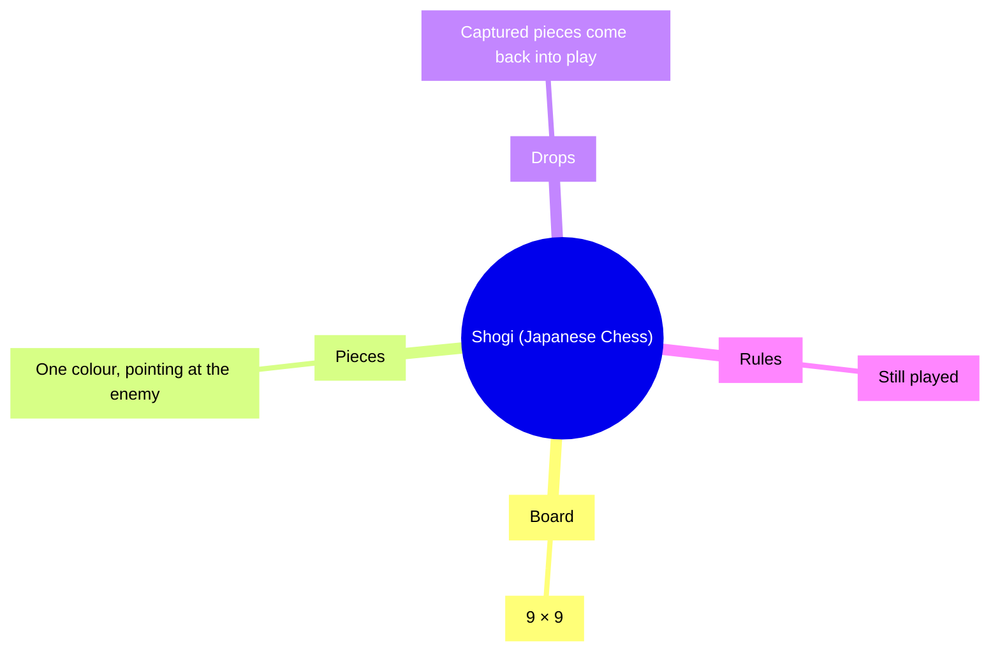
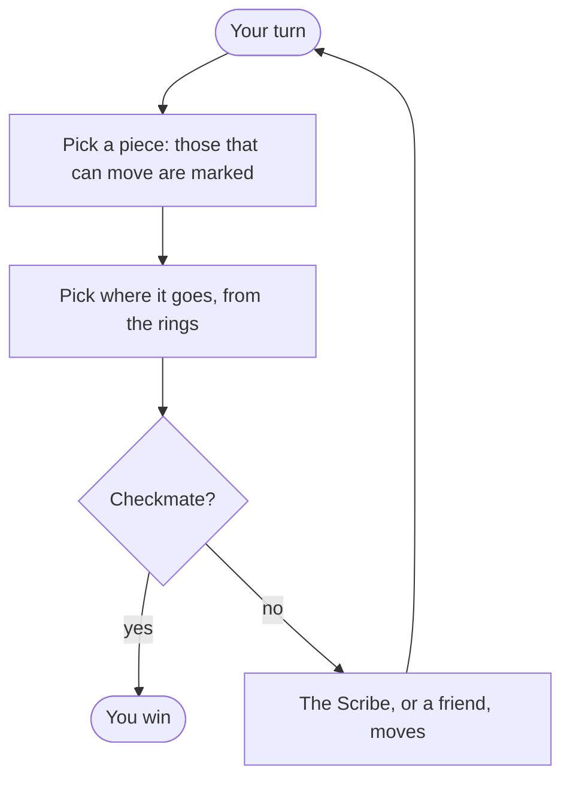

<!-- Written by tools/build-docs.mjs from the sources. Edit those, then run npm run build:docs. -->

# Shogi

**Wing VI · Games of the World** · oldest pieces c. 1058 CE · Japan

[← Mū tōrere](mutorere.md) · [All games](README.md) · [Gomoku →](gomoku.md)

| | |
| --- | --- |
| In the Archives | Playable against the Scribe, or a friend on the same screen |
| Rules | Still played |
| How we know them | Unbroken tradition |
| Family | [The chess family](README.md#the-chess-family) |
| Exhibit id | `shogi`: `[librarium_archives start="shogi"]` |

## At a glance

| | |
| --- | --- |
| Board | 9 × 9 |
| Pieces | One colour, pointing at the enemy |
| Drops | Captured pieces come back into play |

## The placard

Shogi, Japanese chess, belongs to the same family as chaturanga and xiangqi. The oldest pieces yet found, sixteen of them, were dug up at Kōfuku-ji in Nara beside a wooden plaque dated 1058, and they already have the five-sided shape of modern pieces.

Both sides' pieces are the same colour: only the way a piece points shows whose it is. That made possible shogi's great invention of the 16th century, the drop. A captured piece changes sides, and its captor can put it back on the board later, so the game never thins out. Ōhashi Sōko set down the standard rules in 1636.

## A turn

## The rules as played here

1. You move first, with the pieces pointing away from you. Checkmate the Scribe's king to win.
2. King: one step any way. Gold: one step any way but diagonally back. Silver: one step forward or diagonally. Knight: two forward and one across, jumping. Lance: any distance straight forward. Bishop and rook: as in chess. Pawn: one step forward, and it captures the same way.
3. A piece that moves into, out of or within the far three ranks is promoted. Pawns, lances, knights and silvers then move like golds; bishops and rooks gain the king's step as well. Here a piece always promotes when it can.
4. Drops: a piece you capture becomes yours. On a later turn, instead of moving, you can put it on any empty square: pick it from your hand at the right, then a ring. You may not drop a pawn on a file where you already have an unpromoted pawn, drop a piece where it could never move, or give checkmate by dropping a pawn.
5. House rule: after 150 moves each the game is drawn.

**Source:** Modern shogi, except that promotion is automatic and repetition (sennichite) is replaced by a move limit.

### Rule choices

- **Shogi:** drops follow the full rules (no second unpromoted pawn on a file, no dead pieces, no pawn-drop mate). Promotion is automatic whenever it is allowed, and a 150-move limit replaces the repetition rule.

## At the table

| | |
| --- | --- |
| The Scribe | Gentle, Fair or Sharp (see [the Scribe](../scribe.md#levels)) |
| Pass-and-play with a friend | Yes |
| Undo | Yes |
| Hint | Yes |
| Saved and resumed | Yes |

Keys, the move list, replays and the guide are the same at every table: see [Visiting the Archives](../visiting.md#at-a-table).

## How the Scribe plays

**Method:** Shared search: negamax with alpha-beta; captures played out at the leaves; iterative deepening; time budget per level. See [the Scribe](../scribe.md).

**Game by game (Chess, Shogi):** Captures tried first; chess up to five moves deep, shogi up to four, with drops near the kings when the list is long

## Sources

The sources for every placard are listed in [Historical notes and sources](../sources.md).

## In the code

| | |
| --- | --- |
| Rules and the Scribe | [`src/rules/shogi.js`](../../src/rules/shogi.js) |
| Table presenter | [`src/hall/table-shogi.js`](../../src/hall/table-shogi.js) |
| 3D model | [`src/hall/build-games-of-the-world.js`](../../src/hall/build-games-of-the-world.js) |
| Placard | [`src/hall/09-exhibit-data.js`](../../src/hall/09-exhibit-data.js) |
