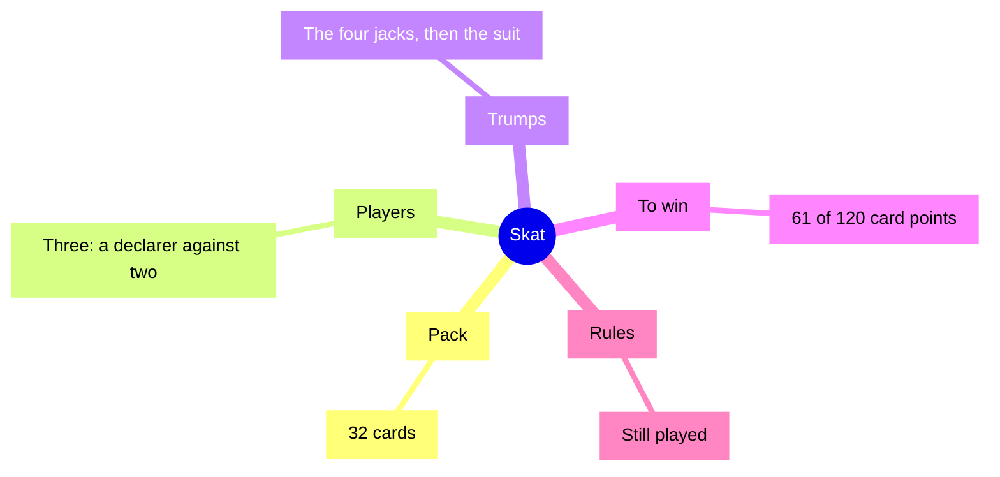
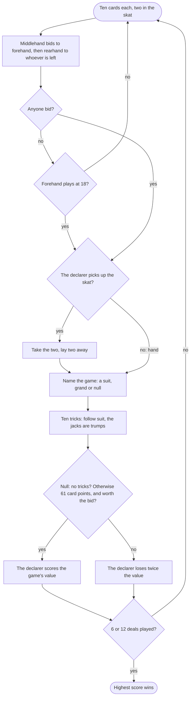

<!-- Written by tools/build-docs.mjs from the sources. Edit those, then run npm run build:docs. -->

# Skat

**Wing IV · Printed Boards and Parlour Tables** · c. 1810 CE · Altenburg, Saxony

[← Cassino](cassino.md) · [All games](README.md) · [Snakes and Ladders →](snakes.md)

| | |
| --- | --- |
| In the Archives | Playable against the Scribe, in 3 seats |
| Rules | Still played |
| How we know them | Still played; international rules of 1999 |
| Family | [Cards](README.md#cards) |
| Exhibit id | `skat`: `[librarium_archives start="skat"]` |
| Game | **6 deals** · 12 deals |
| Suits drawn | French by default; the Pack switch redraws it in French, German, Swiss or Italian suits |

## At a glance

| | |
| --- | --- |
| Pack | 32 cards |
| Players | Three: a declarer against two |
| Trumps | The four jacks, then the suit |
| To win | 61 of 120 card points |

## The placard

Skat was invented around 1810 by the members of a card club in Altenburg, south of Leipzig, led by the lawyer Friedrich Ferdinand Hempel. It grew out of Schafkopf, with bidding from l'Hombre and Tarock; its name means the discard, the two cards laid away.

Grand and null joined it in 1848. The first national Skat congress met at Altenburg in 1886 and set out the first general rules, and a fountain topped by the four jacks was put up in the town in 1903. Melted down in 1942, it was recast in 1954.

German emigrants took the game to America, where an American Skat League was founded in 1898. In 1999 the German and international associations agreed one set of rules, which this table follows.

> The table plays the international rules of 1999, without the announced and open games.

## A turn

Seats: You, West, East.

## The rules as played here

1. Three players: you, and West and East, both played by the Scribe. A 32-card pack; ten cards each, and two face down in the middle, the skat. Play goes to the left. The player on the dealer's left is forehand, then middlehand, then the dealer, rearhand.
2. Bidding: middlehand names numbers to forehand (18, 20, 22, 23, 24, 27, 30 ...), who says yes or passes; then rearhand bids to whoever is left. The last bidder standing is the declarer and must play a game worth at least the bid. If nobody bids, forehand may play at 18 or throw the cards in.
3. The declarer may pick up the skat and lay two cards away, or play hand. Then names the game: a suit (diamonds 9, hearts 10, spades 11, clubs 12), grand (24, only the jacks are trumps) or null (23, or 35 hand: lose every trick). The jacks are the top trumps, clubs, spades, hearts, diamonds, then the trump suit's ace, ten, king, queen, nine, eight, seven.
4. Forehand leads. Follow suit if you can (a jack counts as a trump, not its suit). Cards count: ace 11, ten 10, king 4, queen 3, jack 2. The declarer, with the skat, needs 61 of the 120.
5. A suit or grand game is worth its base times: the matadors (top trumps held, or missing, in an unbroken run from the jack of clubs), plus 1 for game, 1 for hand, 1 for schneider (90 points) and 1 for schwarz (every trick). Won, the declarer scores it; lost, twice as much is taken off; worth less than the bid, it is lost anyway. After 6 deals (or 12) the highest score wins.

**Source:** The international rules of 1999 after pagat.com, without the announced schneider, schwarz and open games or null ouvert. Scores are the declarer's game values, without the extra 50 a won game earns in tournament scoring.

### Rule choices

- **Skat:** the international rules of 1999 after pagat.com: the auction (middlehand to forehand, then rearhand to the survivor; forehand may play at 18 if nobody bids), picking up the skat or playing hand, suit games, grand and null with their values, matadors with or without, schneider and schwarz, and the overbid rule. Announced schneider and schwarz, the open games and null ouvert are left out, and so is the extra 50 a won game earns in tournament scoring. Six or twelve deals; the highest score wins.

### Game

Chosen at the table under Options. Changing it restarts the game.

| Choice | |
| --- | --- |
| 6 deals | the default |
| 12 deals |  |

## At the table

| | |
| --- | --- |
| The Scribe | Gentle, Fair or Sharp (see [the Scribe](../scribe.md#levels)) |
| Pass-and-play with a friend | No |
| Undo | No |
| Hint | No |
| Saved and resumed | Yes |
| Pack switch | Yes |

Keys, the move list, replays and the guide are the same at every table: see [Visiting the Archives](../visiting.md#at-a-table).

## How the Scribe plays

**Method:** Sampling the unseen cards: deals what it cannot see at random and plays each deal out, as Tarocchi's Sharp does. See [the Scribe](../scribe.md).

**Games with hidden cards and tiles:** Judges each game by its strength (jacks, high trumps, side aces, tens with their aces, empty suits) and bids up to the value of the best game strong enough to play. Picks up the skat unless strong enough for a hand game, lays away the pair that leaves the strongest game, and names the strongest game that reaches the bid. Declares by drawing trumps with sure winners; defends by letting the other defender's tricks stand and throwing points on them. Sharp samples the hidden hands in play

## Sources

Checked in [the placard fact-check](../fact-check.md):

- **Claims:** Invented around 1810 by the Brommesche Tarock club in Altenburg, led by Friedrich Ferdinand Hempel; from Schafkopf, with bidding from l'Hombre and Tarock; the name means the discard; grand and null from 1848; the first Skat congress at Altenburg in 1886 and its general rules; the fountain of the four jacks, 1903, melted down 1942 and recast 1954; the American Skat League, 1898; the agreed rules of 1999 **Source:** David Parlett, history of Skat; pagat.com, Skat

The sources for every placard are listed in [Historical notes and sources](../sources.md).

## In the code

| | |
| --- | --- |
| Rules and the Scribe | [`src/rules/skat.js`](../../src/rules/skat.js) |
| Table presenter | [`src/hall/table-skat.js`](../../src/hall/table-skat.js) |
| 3D model | [`src/hall/build-card-room.js`](../../src/hall/build-card-room.js) |
| Placard | [`src/hall/09-exhibit-data.js`](../../src/hall/09-exhibit-data.js) |
