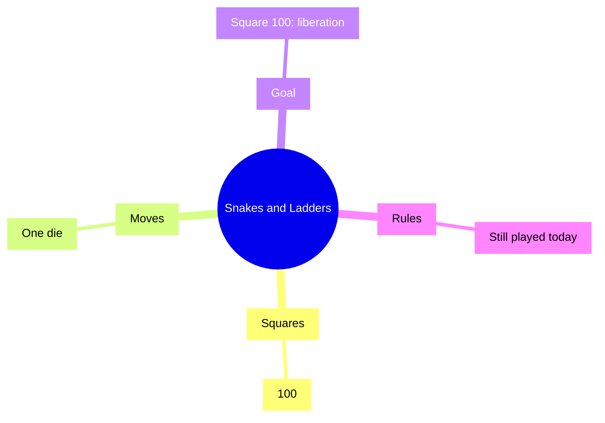
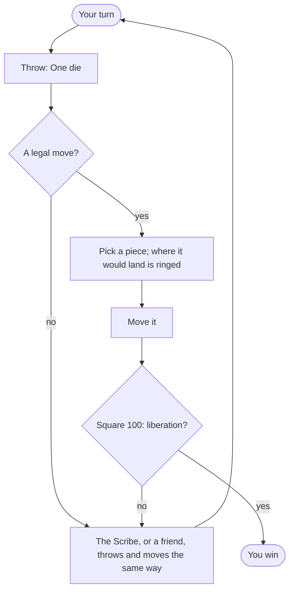

<!-- Written by tools/build-docs.mjs from the sources. Edit those, then run npm run build:docs. -->

# Snakes and Ladders

**Wing IV · Printed Boards and Parlour Tables** · 18th–19th century CE · India, then England

[← Patience](patience.md) · [All games](README.md) · [Bézique →](bezique.md)

| | |
| --- | --- |
| In the Archives | Playable against the Scribe, or a friend on the same screen |
| Rules | Still played today |
| How we know them | Still played |
| Family | [Roll and move on a printed track](README.md#roll-and-move-on-a-printed-track) |
| Exhibit id | `snakes`: `[librarium_archives start="snakes"]` |

## At a glance

| | |
| --- | --- |
| Squares | 100 |
| Moves | One die |
| Goal | Square 100: liberation |

## The placard

Long before it was a children's game, snakes and ladders was a lesson. In India it was gyan chaupar, the game of knowledge, or moksha patam, played by Jains, Hindus and Sufis on boards of their own. Ladders were virtues such as faith, generosity and knowledge; snakes were vices such as theft, debt and lust; and square 100 was liberation. Boards survive from 18th- and 19th-century western India.

The snakes outnumbered the ladders, because the way down is easier than the way up. F. H. Ayres registered an English version in 1892, with Victorian virtues and as many ladders as snakes, and in 1943 Milton Bradley turned the snakes into playground chutes.

## A turn

## The rules as played here

1. Throw the die and move your piece that many squares, along each row and up to the next.
2. Land at the foot of a ladder, a virtue, and you climb it. Land on a snake's head, a vice, and you slide down to its tail.
3. There are more snakes than ladders: the old boards taught that the way down is easier than the way up.
4. The first to land exactly on 100, liberation, wins. A throw that would go past 100 is lost.

**Source:** The squares of Faith (12), Disobedience (41), Reliability (51), Theft (52), Generosity (57), Debt (69), Murder (73), Knowledge (76), Asceticism (78) and Lust (99) follow an old Indian board. The snake of Anger at 88, and where each ladder and snake ends, are our own.

## At the table

| | |
| --- | --- |
| The Scribe | Gentle, Fair or Sharp (see [the Scribe](../scribe.md#levels)) |
| Pass-and-play with a friend | Yes |
| Undo | No |
| Hint | No |
| Saved and resumed | No |

Keys, the move list, replays and the guide are the same at every table: see [Visiting the Archives](../visiting.md#at-a-table).

## How the Scribe plays

**Method:** Nothing to choose: the throw moves your one counter. See [the Scribe](../scribe.md).

## Sources

The sources for every placard are listed in [Historical notes and sources](../sources.md).

## In the code

| | |
| --- | --- |
| Rules and the Scribe | [`src/rules/snakes-and-ladders.js`](../../src/rules/snakes-and-ladders.js) |
| Table presenter | [`src/hall/12-presenters.js`](../../src/hall/12-presenters.js) |
| 3D model | [`src/hall/build-backfill-tables.js`](../../src/hall/build-backfill-tables.js) |
| Placard | [`src/hall/09-exhibit-data.js`](../../src/hall/09-exhibit-data.js) |
