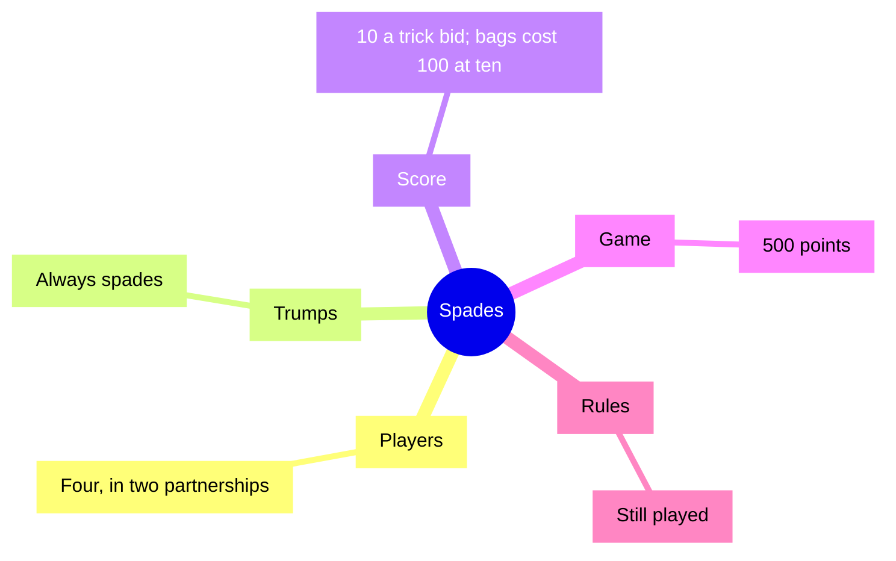
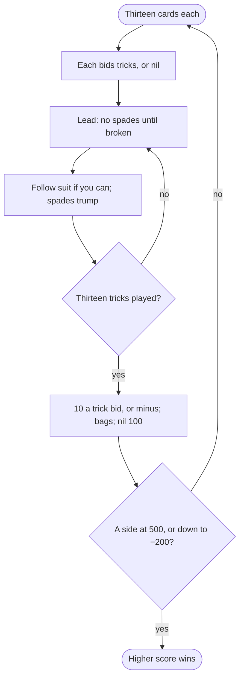

<!-- Written by tools/build-docs.mjs from the sources. Edit those, then run npm run build:docs. -->

# Spades

**Wing V · The Modern Board Game** · late 1930s CE · Cincinnati, then the world

[← Contract Bridge](bridge.md) · [All games](README.md) · [Kalah →](kalah.md)

| | |
| --- | --- |
| In the Archives | Playable against the Scribe, in 4 seats |
| Rules | Still played |
| How we know them | Still played |
| Family | [Cards](README.md#cards) |
| Exhibit id | `spades`: `[librarium_archives start="spades"]` |
| Game | **To 500** · To 250 |

## At a glance

| | |
| --- | --- |
| Players | Four, in two partnerships |
| Trumps | Always spades |
| Score | 10 a trick bid; bags cost 100 at ten |
| Game | 500 points |

## The placard

Spades is a whist game with a bridge-like bid, simplified: spades are always trumps, and each player says how many tricks they will take. The bridge writer George Coffin traced it to Cincinnati, Ohio, between 1937 and 1939.

American soldiers carried it round the world in the Second World War, and veterans brought it home, where with the GI Bill it took hold in colleges and home games. It stayed popular wherever American troops were stationed.

Its scoring punishes greed as well as failure: every trick over the bid is a bag, and ten bags cost a hundred points. The nil bid, promising to take nothing, turns a hopeless hand into a hundred.

## A turn

Seats: You, West, North, East.

## The rules as played here

1. You and North, your partner, against West and East, all played by the Scribe. Thirteen cards each. Spades are always trumps; aces are high.
2. Each player bids the number of tricks they expect to take, starting left of the dealer. Your side's bid is yours and North's together. A bid of nil promises to take no tricks at all.
3. The player left of the dealer leads. Follow suit if you can; if you cannot, play any card. The highest spade wins, or with no spade in the trick, the highest card of the suit led. Spades may not be led until one has been played on another suit, unless you hold nothing else.
4. A side that takes at least its bid scores 10 a trick bid and 1 for each extra trick, a bag; every tenth bag costs 100. A side that falls short loses 10 a trick bid. Nil scores 100 if made and loses 100 if not; the nil bidder's tricks count as bags for the side, not towards the partner's bid.
5. The first side to 500 (or 250) wins; a side that falls to −200 loses.

**Source:** Spades with the standard partnership rules Wikipedia and pagat.com give: bidding with nil, spades broken before they are led, 10 a trick, bags with a penalty at ten, and 500 to win. Blind nil is left out.

### Rule choices

- **Spades:** after Wikipedia and pagat.com: partnerships, bids of nil to thirteen, spades not led until broken, 10 a trick bid, 1 a bag and 100 off at ten bags, nil 100 either way (the nil bidder's tricks count as bags, not towards the partner's bid), and the game to 500 (or 250) or down to −200. Blind nil is left out.

### Game

Chosen at the table under Options. Changing it restarts the game.

| Choice | |
| --- | --- |
| To 500 | the default |
| To 250 |  |

## At the table

| | |
| --- | --- |
| The Scribe | Gentle, Fair or Sharp (see [the Scribe](../scribe.md#levels)) |
| Pass-and-play with a friend | No |
| Undo | No |
| Hint | No |
| Saved and resumed | Yes |

Keys, the move list, replays and the guide are the same at every table: see [Visiting the Archives](../visiting.md#at-a-table).

## How the Scribe plays

**Method:** Sampling the unseen cards: deals what it cannot see at random and plays each deal out, as Tarocchi's Sharp does. See [the Scribe](../scribe.md).

**Games with hidden cards and tiles:** Bids its sure and likely tricks (aces, guarded kings, high and long spades, short suits to ruff with) and nil with almost nothing. Plays Whist's book, but ducks for bags once its side has made the bid, covers a partner's nil and leads low into an opponent's. Sharp deals the unseen cards round many times and plays each deal out, for the card that scores its side best

**Measured strength**

| Fair vs Gentle | Sharp vs Fair | Games |
| --- | --- | --- |
| 73–27 | 44–16 | 100 and 60 games to 250 |

## Sources

Checked in [the placard fact-check](../fact-check.md):

- **Claims:** Spades always trump, each player bids tricks; traced by George Coffin to Cincinnati, 1937–39; spread by soldiers in the Second World War, then in colleges with the GI Bill; bags and nil **Source:** Wikipedia, Spades (card game)

The sources for every placard are listed in [Historical notes and sources](../sources.md).

## In the code

| | |
| --- | --- |
| Rules and the Scribe | [`src/rules/spades.js`](../../src/rules/spades.js) |
| Table presenter | [`src/hall/table-card-room-6.js`](../../src/hall/table-card-room-6.js) |
| 3D model | [`src/hall/build-card-room-6.js`](../../src/hall/build-card-room-6.js) |
| Placard | [`src/hall/09-exhibit-data.js`](../../src/hall/09-exhibit-data.js) |
