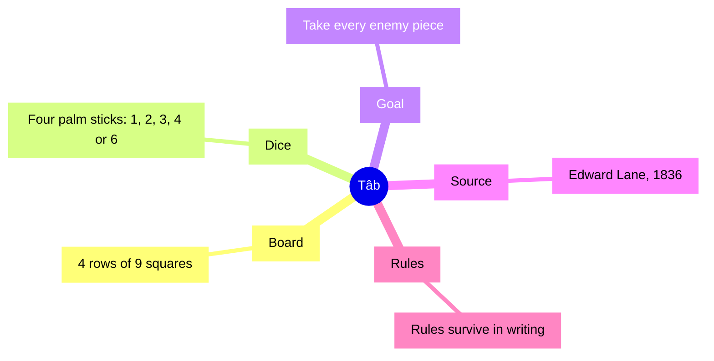
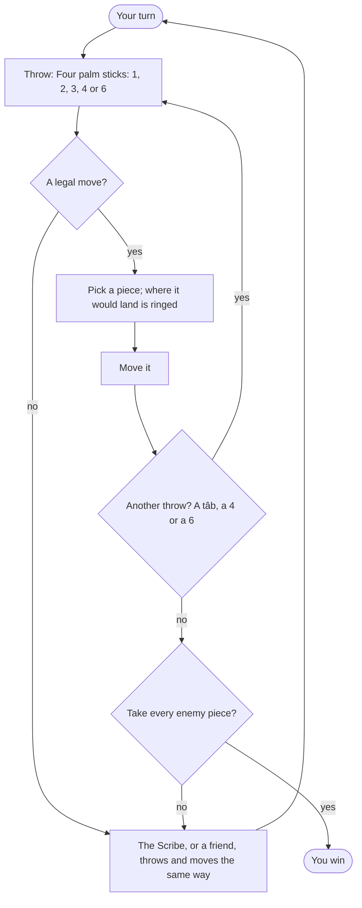

<!-- Written by tools/build-docs.mjs from the sources. Edit those, then run npm run build:docs. -->

# Tâb

**Wing VI · Games of the World** · recorded in the 1820s · Egypt · recorded by Edward Lane

[← Seega](seega.md) · [All games](README.md) · [Nard →](nard.md)

| | |
| --- | --- |
| In the Archives | Playable against the Scribe, or a friend on the same screen |
| Rules | Rules survive in writing |
| How we know them | Survive in writing |
| Family | [Race games](README.md#race-games) |
| Exhibit id | `tab`: `[librarium_archives start="tab"]` |

## At a glance

| | |
| --- | --- |
| Board | 4 rows of 9 squares |
| Dice | Four palm sticks: 1, 2, 3, 4 or 6 |
| Goal | Take every enemy piece |
| Source | Edward Lane, 1836 |

## The placard

Tâb is a race and a battle at once. In Egypt it was played on four rows of squares drawn in the dust or cut in a plank, with pieces of stone on one side and red brick or tile on the other. Edward Lane recorded it in 1836, beside seega.

The dice are four slips of palm stick, white on one face. One white face is a tâb, and a piece cannot leave home until its owner throws one. After that, pieces chase each other round the middle rows, knock out any enemy they land on, and may make one raid through the enemy's home row.

Lane also describes pieces joining into stacks that split again on a tâb. The table leaves stacking out and moves each throw as it is made, to keep the game easy to follow.

## A turn

## The rules as played here

1. You have a row of nine dark stones nearest you; the Scribe has nine pieces of red tile at the far side. Pieces travel through the rows as the arrows show: along your own row, back along the next, out along the third, and then round the two middle rows.
2. Throw four palm sticks and count the white sides: one white is a tâb (1), two count 2, three count 3, four count 4, and none counts 6. A tâb, a 4 or a 6 earns another throw. Each throw moves one piece.
3. A piece that has never moved needs a tâb to start, and then moves one square.
4. Land on an enemy piece to take it. You may not land on your own.
5. Once in its life a piece may go on into the enemy's home row instead of round the middle; it then comes back to the middle rows. A piece in the enemy's row cannot move while you still have pieces in your own home row.
6. Take all the Scribe's pieces to win.

**Source:** After Edward William Lane, Manners and Customs of the Modern Egyptians (1836). Lane's stacking of pieces ('eggeh) is left out, each throw is moved as it is made, and after 150 throws each the side with more pieces wins: those are our choices.

### Rule choices

- **Tâb:** four rows of nine. Four palm sticks: 1 (a tâb), 2, 3, 4, or 6 for no white face; a tâb, 4 or 6 throws again. A piece needs a tâb to start. Pieces run along their own row, back along the next, out along the third, then round the two middle rows; once in its life a piece may go through the enemy's home row instead, and it cannot move there while its owner has pieces at home. Landing on an enemy piece takes it; you may not land on your own. Each throw is moved at once, and Lane's stacking is left out. Taking every enemy piece wins; after 150 throws each the side with more pieces wins (house rule).

## At the table

| | |
| --- | --- |
| The Scribe | Gentle, Fair or Sharp (see [the Scribe](../scribe.md#levels)) |
| Pass-and-play with a friend | Yes |
| Undo | No |
| Hint | Yes |
| Saved and resumed | No |

Keys, the move list, replays and the guide are the same at every table: see [Visiting the Archives](../visiting.md#at-a-table).

## How the Scribe plays

**Method:** Rules of thumb: scored moves for dice games. See [the Scribe](../scribe.md).

**Measured strength**

| Fair vs Gentle | Sharp vs Fair | Games |
| --- | --- | --- |
| 85% | 61% | 400 and 600 |

**Game by game:** Captures, starting pieces, raids on the home row, and the chance an enemy can land on a square with one throw. Sharp weighs every piece on the board that way after each move

## Sources

The sources for every placard are listed in [Historical notes and sources](../sources.md).

## In the code

| | |
| --- | --- |
| Rules and the Scribe | [`src/rules/tab.js`](../../src/rules/tab.js) |
| Table presenter | [`src/hall/table-tab.js`](../../src/hall/table-tab.js) |
| 3D model | [`src/hall/build-tab.js`](../../src/hall/build-tab.js) |
| Placard | [`src/hall/09-exhibit-data.js`](../../src/hall/09-exhibit-data.js) |
