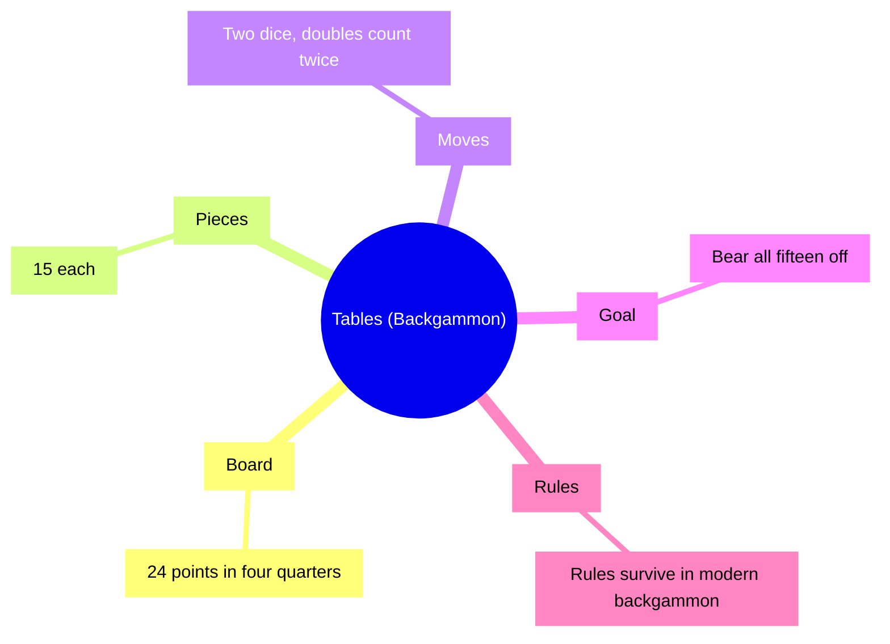
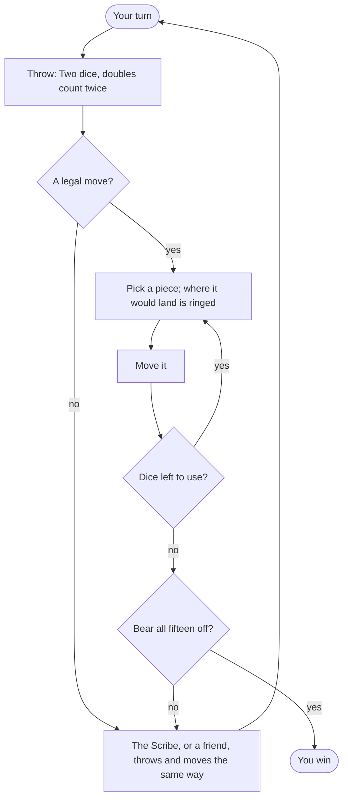

<!-- Written by tools/build-docs.mjs from the sources. Edit those, then run npm run build:docs. -->

# Tables

**Wing III · Kings, Cards and Courts** · c. 480 CE onward · Rome, Persia and medieval Europe

[← Hnefatafl](hnefatafl.md) · [All games](README.md) · [Chaturanga →](chaturanga.md)

| | |
| --- | --- |
| In the Archives | Playable against the Scribe, or a friend on the same screen |
| Rules | Rules survive in modern backgammon |
| How we know them | Modern backgammon, no cube |
| Family | [Race games](README.md#race-games) |
| Exhibit id | `tables`: `[librarium_archives start="tables"]` |

## At a glance

| | |
| --- | --- |
| Board | 24 points in four quarters |
| Pieces | 15 each |
| Moves | Two dice, doubles count twice |
| Goal | Bear all fifteen off |

## The placard

Tables is the family of games that backgammon belongs to. The Byzantine poet Agathias recorded a disastrous throw by the emperor Zeno, who reigned from 474 to 491, in a game of tabula: 24 points, 15 pieces a side and three dice. It descended from the Roman game of twelve lines. In Persia a close relative, nard, appears between the 3rd and 6th centuries, and one legend credits it to a vizier of Khosrow I.

Medieval Europe played tables everywhere. Louis IX banned it from his court in 1254, Alfonso X's Book of Games of 1283 describes several versions, and the name backgammon first appears in English in 1647. The doubling cube is a 1920s addition from New York.

We play modern backgammon, without the cube.

## A turn

## The rules as played here

1. Throw two dice and move one checker by each die, or one checker by both. Doubles are played four times.
2. Your checkers travel counterclockwise toward your home board in the near-right quarter.
3. You may not land on a point held by two or more of the Scribe's checkers. Land on a single one to hit it and send it to the bar.
4. A checker on the bar must come back in through the Scribe's home board before you move anything else.
5. You must use both dice if you can. If only one can be used, use the larger if possible.
6. When all fifteen are in your home board, start bearing them off. The first to bear off all fifteen wins.

**Source:** Modern backgammon rules without the doubling cube. Roman tabula used three dice and probably different starting rules.

## At the table

| | |
| --- | --- |
| The Scribe | Gentle, Fair or Sharp (see [the Scribe](../scribe.md#levels)) |
| Pass-and-play with a friend | Yes |
| Undo | No |
| Hint | Yes |
| Saved and resumed | No |

Keys, the move list, replays and the guide are the same at every table: see [Visiting the Archives](../visiting.md#at-a-table).

## How the Scribe plays

**Method:** Rules of thumb: scored moves for dice games. See [the Scribe](../scribe.md).

**Game by game:** Every legal full turn scored for pip count, safe points and exposed checkers

## Sources

Checked in [the placard fact-check](../fact-check.md):

- **Claim as it stood:** "Backgammon" first appears in English in 1647 **What the sources say:** The OED's first citation is 1647; Louis IX's ban 1254, Alfonso X's book 1283, the doubling cube 1920s New York **Verdict:** Correct

The sources for every placard are listed in [Historical notes and sources](../sources.md).

## In the code

| | |
| --- | --- |
| Rules and the Scribe | [`src/rules/tables.js`](../../src/rules/tables.js) |
| Table presenter | [`src/hall/table-tables.js`](../../src/hall/table-tables.js) |
| 3D model | [`src/hall/build-tables-board.js`](../../src/hall/build-tables-board.js) |
| Placard | [`src/hall/09-exhibit-data.js`](../../src/hall/09-exhibit-data.js) |
