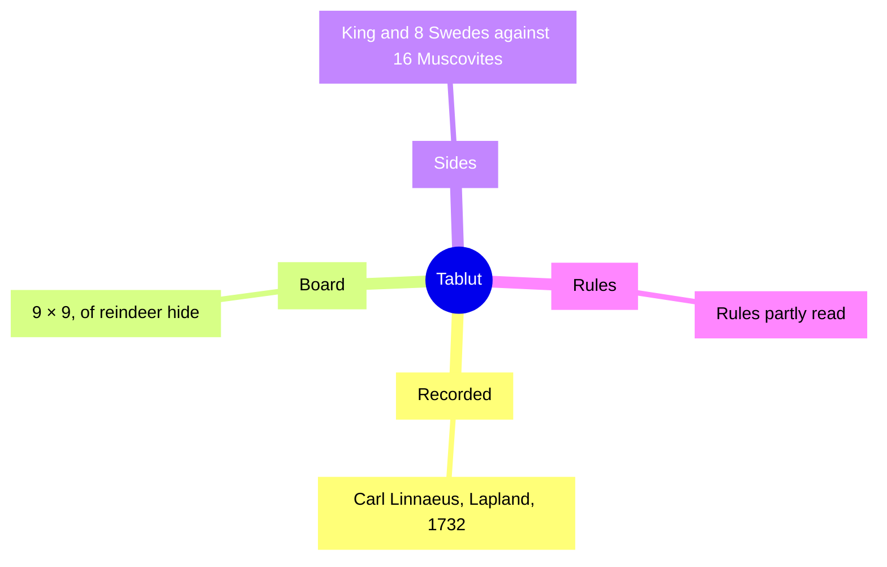
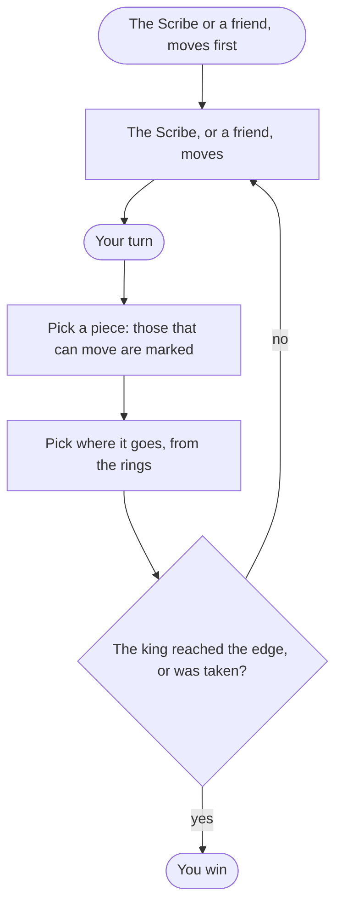

<!-- Written by tools/build-docs.mjs from the sources. Edit those, then run npm run build:docs. -->

# Tablut

**Wing IV · Printed Boards and Parlour Tables** · 1732 CE · Lapland · recorded by Linnaeus

[← Scopa](scopa.md) · [All games](README.md) · [Pope Joan →](popejoan.md)

| | |
| --- | --- |
| In the Archives | Playable against the Scribe, or a friend on the same screen |
| Rules | Rules partly read |
| How we know them | Partly reconstructed |
| Family | [Hunt and tafl games](README.md#hunt-and-tafl-games) |
| Exhibit id | `tablut`: `[librarium_archives start="tablut"]` |

## At a glance

| | |
| --- | --- |
| Recorded | Carl Linnaeus, Lapland, 1732 |
| Board | 9 × 9, of reindeer hide |
| Sides | King and 8 Swedes against 16 Muscovites |

## The placard

In the summer of 1732 the young Swedish naturalist Carl Linnaeus travelled through Lapland and wrote down a board game the Sámi played, Tablut, with a sketch of the board: a 9 × 9 mat of embroidered reindeer hide. A king and eight Swedes stand in the middle; sixteen Muscovites wait at the edges.

It is the last of the tafl games, the "table" games of northern Europe before chess, to be recorded while still in use. Linnaeus wrote in Latin and Swedish, and an English translation of 1811 garbled several rules, so players still argue over details. This table follows the reading most use today: the king escapes to any edge, and helps to capture.

## A turn

## The rules as played here

1. The Scribe commands the sixteen Muscovites and moves first. You command the king and his eight Swedes.
2. Every piece moves like a chess rook: any distance in a straight line, without jumping. Only the king may stop on the throne in the centre; others may pass over it when it is empty.
3. Trap an enemy piece between two of yours to capture it. The empty throne counts as an enemy to both sides, and the king helps the Swedes capture.
4. The king is captured like any other piece, by two Muscovites on opposite sides, except on the throne, where it takes four, and beside it, where it takes three with the throne as the fourth.
5. You win when the king reaches any square on the edge of the board. The Scribe wins by capturing him.
6. House rule: after a hundred moves each with no result, the game is drawn.

**Source:** Linnaeus's account of 1732, read as most modern players do: the king escapes to any edge square and is armed, and is captured by two except on or beside the throne.

### Rule choices

- **Tablut:** Linnaeus's 9 × 9 game read as most players read it today: the Muscovites move first, the king escapes to any edge square, he is armed, and he is captured by two except on or beside the throne (four, or three and the throne). Only the king may stop on the throne. House rule: a hundred moves each without a result is a draw.

## At the table

| | |
| --- | --- |
| The Scribe | Gentle, Fair or Sharp (see [the Scribe](../scribe.md#levels)) |
| Pass-and-play with a friend | Yes |
| Undo | Yes |
| Hint | Yes |
| Saved and resumed | Yes |

Keys, the move list, replays and the guide are the same at every table: see [Visiting the Archives](../visiting.md#at-a-table).

## How the Scribe plays

**Method:** Shared search: negamax with alpha-beta; captures played out at the leaves; iterative deepening; time budget per level. See [the Scribe](../scribe.md).

**Measured strength**

| Fair vs Gentle | Sharp vs Fair | Games |
| --- | --- | --- |
| 6–0 | 4–2 | 6 each |

**Game by game:** The king's open lines to the edge, Muscovites around him, material

## Sources

The sources for every placard are listed in [Historical notes and sources](../sources.md).

## In the code

| | |
| --- | --- |
| Rules and the Scribe | [`src/rules/tablut.js`](../../src/rules/tablut.js) |
| Table presenter | [`src/hall/table-tablut.js`](../../src/hall/table-tablut.js) |
| 3D model | [`src/hall/build-more-tables.js`](../../src/hall/build-more-tables.js) |
| Placard | [`src/hall/09-exhibit-data.js`](../../src/hall/09-exhibit-data.js) |
