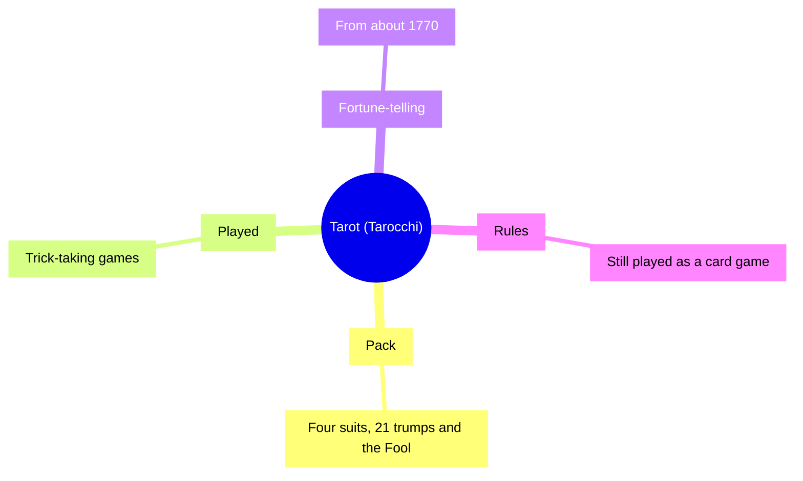
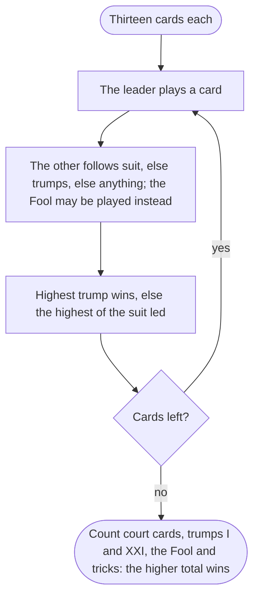

<!-- Written by tools/build-docs.mjs from the sources. Edit those, then run npm run build:docs. -->

# Tarot (Tarocchi)

**Wing III · Kings, Cards and Courts** · c. 1440 CE · Northern Italy · 15th century

[← Karnöffel](karnoffel.md) · [All games](README.md) · [Fox and Geese →](foxgeese.md)

| | |
| --- | --- |
| In the Archives | Playable against the Scribe |
| Rules | Still played as a card game |
| How we know them | Still played as a card game |
| Family | [Cards](README.md#cards) |
| Exhibit id | `tarot`: `[librarium_archives start="tarot"]` |
| Rule engine | `tarocchi` |

## At a glance

| | |
| --- | --- |
| Pack | Four suits, 21 trumps and the Fool |
| Played | Trick-taking games |
| Fortune-telling | From about 1770 |

## The placard

Tarot began as a card game, not a way of telling fortunes. Around 1440 Italian courts added a fifth suit of picture cards, called trionfi or triumphs, that beat the ordinary suits as trumps. A Ferrara account book of 1442 records painted packs of trionfi, and the gilded decks made for the Visconti and Sforza dukes of Milan in the 1440s and 1450s are the oldest that survive.

The game spread to France and Switzerland, where it is still played. Reading the cards came centuries later: Etteilla published a way of reading ordinary cards in 1770 and turned to the tarot in 1783, Antoine Court de Gébelin claimed an ancient Egyptian origin in 1781, and the Rider-Waite deck followed in 1909.

> The trumps on the easel are new paintings in the style of the gilded Milan decks. At the table you can play a simplified game of tarocchi for two: the first rules were never written down.

## A turn

## The rules as played here

1. Each player holds thirteen cards. You lead the first trick; whoever wins a trick leads the next.
2. Follow the suit that was led if you can. If you cannot, you must play a trump if you have one. Otherwise play anything.
3. The highest trump wins the trick; with no trump in it, the highest card of the suit led wins. In the suits, the king is highest, then the queen, knight and jack, then 10 down to 1.
4. The Fool can be played at any time instead of following. It never wins a trick, but you keep it for its points. If you lead the Fool, the other player's card wins.
5. At the end, count your cards: kings 5, queens 4, knights 3, jacks 2, and trumps I and XXI and the Fool 5 each. Each trick you won adds 1. The higher total wins.

**Source:** The rules of the first tarocchi games, played in Milan and Ferrara in the 1440s, were never written down. This is a simplified two-player game built on what every tarot game still shares: following suit, the duty to trump, and the Fool as an excuse. In old Italian packs the pip cards of cups and coins ranked in reverse; here every suit ranks the same way.

### Rule choices

- **Tarocchi:** the rules of the first tarot games of the 1440s were never written down, so the table plays a simplified two-player game built on what every tarot game still shares: follow suit, trump if you cannot, and the Fool as an excuse. Thirteen cards each; kings 5, queens 4, knights 3, jacks 2, trumps I and XXI and the Fool 5, and 1 for each trick.

## At the table

| | |
| --- | --- |
| The Scribe | Gentle, Fair or Sharp (see [the Scribe](../scribe.md#levels)) |
| Pass-and-play with a friend | No |
| Undo | No |
| Hint | No |
| Saved and resumed | No |

Keys, the move list, replays and the guide are the same at every table: see [Visiting the Archives](../visiting.md#at-a-table).

## How the Scribe plays

**Method:** Hidden information: plays only from what it can see. See [the Scribe](../scribe.md).

**Games with hidden cards and tiles:** Sharp deals the unseen cards at random many times over, consistent with what you have shown (a suit you could not follow), plays each deal out, and picks the card that scores best on average. Fair plays by rule of thumb

**Measured strength**

| Fair vs Gentle | Sharp vs Fair | Games |
| --- | --- | --- |
|  | 16–14 (by +3.4 points a game) | 30 |

## Sources

Checked in [the placard fact-check](../fact-check.md):

- **Claim as it stood:** "Etteilla wrote about divination with tarot around 1770" **What the sources say:** 1770 was his method for ordinary cards; his tarot book is 1783, his deck 1789. Court de Gébelin 1781 and Rider-Waite 1909 hold **Verdict:** Changed to "a way of reading ordinary cards in 1770 … the tarot in 1783"

The sources for every placard are listed in [Historical notes and sources](../sources.md).

## In the code

| | |
| --- | --- |
| Rules and the Scribe | [`src/rules/tarocchi.js`](../../src/rules/tarocchi.js) |
| Table presenter | [`src/hall/table-tarocchi.js`](../../src/hall/table-tarocchi.js) |
| 3D model | [`src/hall/build-cards.js`](../../src/hall/build-cards.js) |
| Placard | [`src/hall/09-exhibit-data.js`](../../src/hall/09-exhibit-data.js) |
