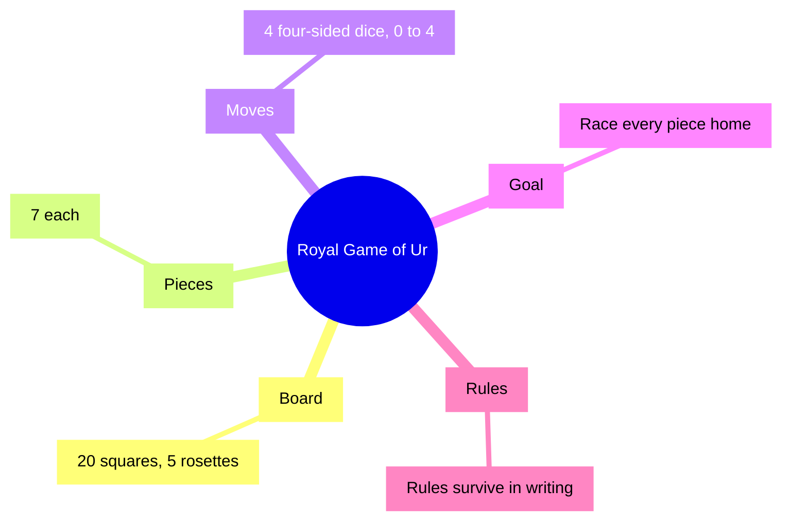
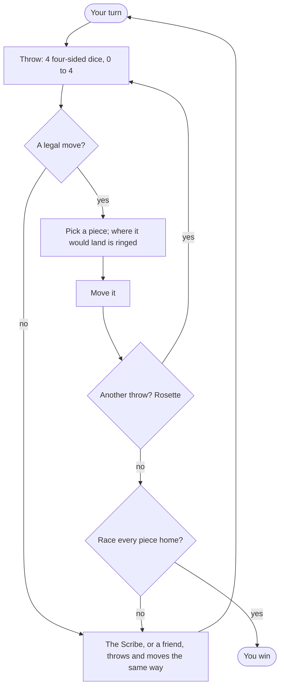

<!-- Written by tools/build-docs.mjs from the sources. Edit those, then run npm run build:docs. -->

# The Royal Game of Ur

**Wing I · The Dawn of Play** · c. 2600–2400 BCE · Mesopotamia · Sumer

[← The Başur Höyük Pieces](basur.md) · [All games](README.md) · [The First Dice →](dice.md)

| | |
| --- | --- |
| In the Archives | Playable against the Scribe, or a friend on the same screen |
| Rules | Rules survive in writing |
| How we know them | Survive in writing (tablet, c. 177 BCE; Finkel) |
| Family | [Race games](README.md#race-games) |
| Exhibit id | `ur`: `[librarium_archives start="ur"]` |

## At a glance

| | |
| --- | --- |
| Board | 20 squares, 5 rosettes |
| Pieces | 7 each |
| Moves | 4 four-sided dice, 0 to 4 |
| Goal | Race every piece home |

## The placard

Sir Leonard Woolley found five of these boards while excavating the Royal Cemetery at Ur between 1922 and 1934. The finest are inlaid with shell, red limestone and lapis lazuli. The game, also called Twenty Squares, spread across the ancient Near East, and more than a hundred boards have been found since.

It is the oldest board game whose rules survive in writing. A Babylonian scribe, Itti-Marduk-balāṭu, copied them onto a clay tablet around 177 BCE, and British Museum curator Irving Finkel translated it in the early 1980s. The game outlived its empires: Jewish families in Kochi, India, played a descendant until the 1950s.

We play Finkel's widely used reconstruction.

## A turn

## The rules as played here

1. Throw the four dice and count the marked tips facing up, from 0 to 4.
2. Enter a new piece or move one already on the board by that many squares. Your route runs along your own row, up the shared middle row, and back into your row.
3. Land on an opponent in the middle row to send it back to the start.
4. Landing on a rosette earns another throw. The middle rosette is a safe square.
5. Bear a piece off with an exact throw. The first to bear off all seven wins.

**Source:** Rules after Irving Finkel's translation of a Babylonian tablet from about 177 BCE.

## At the table

| | |
| --- | --- |
| The Scribe | Gentle, Fair or Sharp (see [the Scribe](../scribe.md#levels)) |
| Pass-and-play with a friend | Yes |
| Undo | No |
| Hint | Yes |
| Saved and resumed | No |

Keys, the move list, replays and the guide are the same at every table: see [Visiting the Archives](../visiting.md#at-a-table).

## How the Scribe plays

**Method:** Rules of thumb: scored moves for dice games. See [the Scribe](../scribe.md).

**Game by game (Senet, Ur):** Each move scored for progress, safety and captures; Gentle adds a lot of chance

## Sources

The sources for every placard are listed in [Historical notes and sources](../sources.md).

## In the code

| | |
| --- | --- |
| Rules and the Scribe | [`src/rules/00-core.js`](../../src/rules/00-core.js) |
| Table presenter | [`src/hall/12-presenters.js`](../../src/hall/12-presenters.js) |
| 3D model | [`src/hall/build-royal-game-of-ur.js`](../../src/hall/build-royal-game-of-ur.js) |
| Placard | [`src/hall/09-exhibit-data.js`](../../src/hall/09-exhibit-data.js) |
