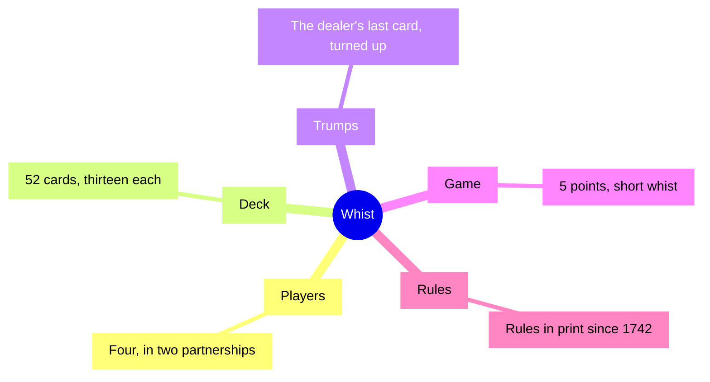
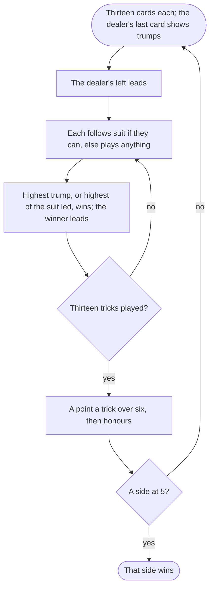

<!-- Written by tools/build-docs.mjs from the sources. Edit those, then run npm run build:docs. -->

# Whist

**Wing IV · Printed Boards and Parlour Tables** · 1742 CE · England · Hoyle's treatise

[← Tablut](tablut.md) · [All games](README.md) · [Patience →](patience.md)

| | |
| --- | --- |
| In the Archives | Playable against the Scribe, in 4 seats |
| Rules | Rules in print since 1742 |
| How we know them | Survive in print; short whist still played |
| Family | [Cards](README.md#cards) |
| Exhibit id | `whist`: `[librarium_archives start="whist"]` |
| Suits drawn | French by default; the Pack switch redraws it in French, German, Swiss or Italian suits |

## At a glance

| | |
| --- | --- |
| Players | Four, in two partnerships |
| Deck | 52 cards, thirteen each |
| Trumps | The dealer's last card, turned up |
| Game | 5 points, short whist |

## The placard

Whist grew out of ruff and honours, one of the English trick-taking games descended from triumph, and the name itself dates from the 1600s. Daines Barrington wrote that gentlemen first played it seriously at the Crown Coffee House in Bedford Row, London, around 1728.

In 1742 Edmond Hoyle published A Short Treatise on the Game of Whist. It set the standard rules for the next hundred years and made his name a byword: "according to Hoyle" still means "by the rules". Long whist was played to 10 points; short whist, to 5, later replaced it in Britain.

Whist is a partnership game, and its descendants include bridge. You play with the Scribe as your partner, North, against two more Scribes.

## A turn

Seats: You, West, North, East.

## The rules as played here

1. You sit South. North, opposite you, is your partner, played by the Scribe; West and East, also the Scribe, play against you both. Play goes clockwise.
2. Each of you holds thirteen cards. The dealer's last card is turned face up, and its suit is trumps for the deal. The player on the dealer's left leads to the first trick.
3. Follow suit if you can; if you cannot, play any card, a trump or not. The highest trump wins the trick, or with no trump in it, the highest card of the suit led, aces high. The winner leads to the next trick.
4. After thirteen tricks, the side that took more scores a point for every trick over six. Then honours: a side that held the ace, king, queen and jack of trumps between them scores 4, and a side that held three of the four scores 2. A side that began the deal on 4 cannot score honours.
5. Tricks score before honours. The first side to 5 points wins the game.

**Source:** Short whist, the 5-point game that replaced long whist in Britain, as described by John McLeod at pagat.com. We play a single game rather than a rubber of three.

### Rule choices

- **Whist:** short whist as on pagat.com: thirteen cards each, the dealer's last card turned for trumps, a point for every trick over six, honours (4 for all four, 2 for three; not for a side at four), tricks before honours, and one game to 5 points rather than a rubber. Gentle and Fair Scribes play some cards carelessly; Sharp plays every card by the book (cash winners, second hand low, third hand high, ruff when an opponent is winning).

## At the table

| | |
| --- | --- |
| The Scribe | Gentle, Fair or Sharp (see [the Scribe](../scribe.md#levels)) |
| Pass-and-play with a friend | No |
| Undo | No |
| Hint | Yes |
| Saved and resumed | Yes |
| Pack switch | Yes |

Keys, the move list, replays and the guide are the same at every table: see [Visiting the Archives](../visiting.md#at-a-table).

## How the Scribe plays

**Method:** Hidden information: plays only from what it can see. See [the Scribe](../scribe.md).

**Games with hidden cards and tiles:** Each Scribe plays by the book from what its seat can see: cash sure winners, draw trumps when long in them, lead a suit its partner can ruff, second hand low, third hand high, win as cheaply as possible, and discard its least useful card. Gentle and Fair play some cards at random. (A sampling search over the unseen cards was tried and played no better.)

**Measured strength**

| Fair vs Gentle | Sharp vs Fair | Games |
| --- | --- | --- |
| +0.9 tricks a deal | +0.3 tricks a deal | 150 deals each, every deal played twice with the sides swapped |

## Sources

The sources for every placard are listed in [Historical notes and sources](../sources.md).

## In the code

| | |
| --- | --- |
| Rules and the Scribe | [`src/rules/whist.js`](../../src/rules/whist.js) |
| Table presenter | [`src/hall/table-whist.js`](../../src/hall/table-whist.js) |
| 3D model | [`src/hall/build-whist.js`](../../src/hall/build-whist.js) |
| Placard | [`src/hall/09-exhibit-data.js`](../../src/hall/09-exhibit-data.js) |
