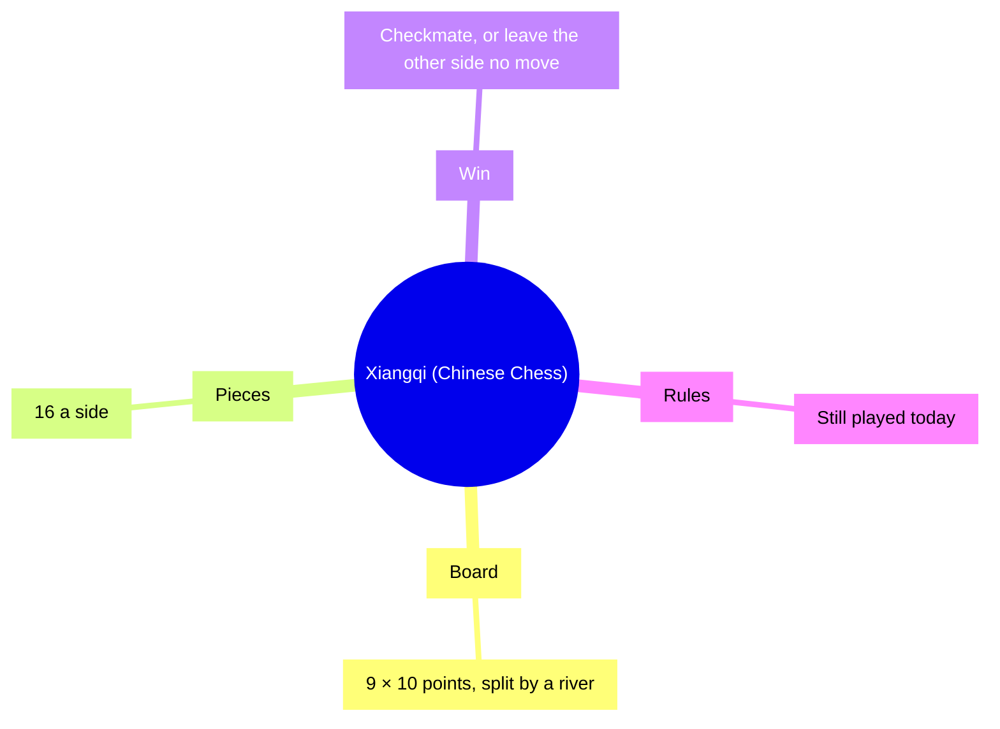
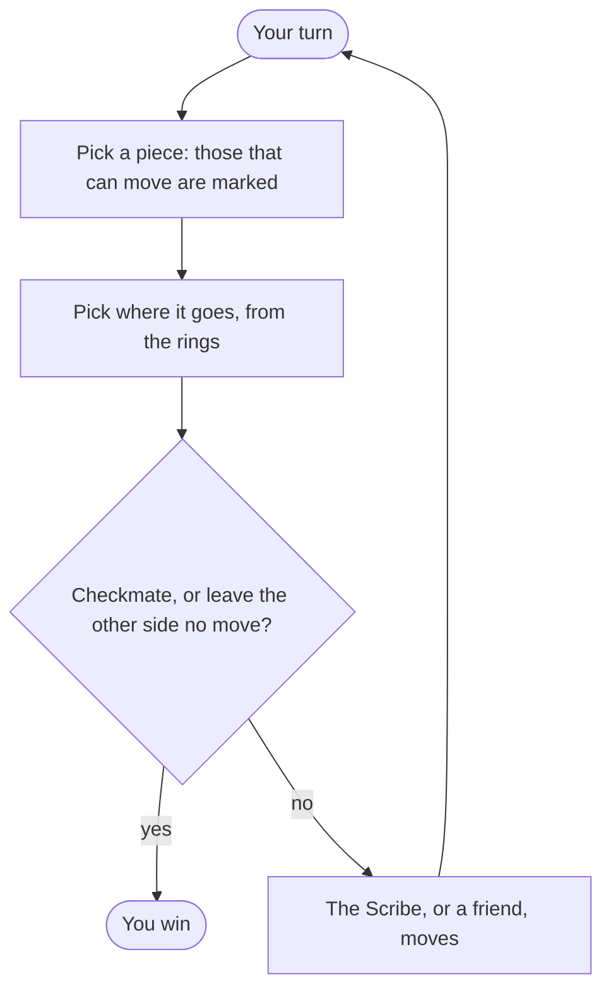

<!-- Written by tools/build-docs.mjs from the sources. Edit those, then run npm run build:docs. -->

# Xiangqi

**Wing III · Kings, Cards and Courts** · c. 800 CE · China · Tang to Song

[← Shatranj](shatranj.md) · [All games](README.md) · [Chaturaji →](chaturaji.md)

| | |
| --- | --- |
| In the Archives | Playable against the Scribe, or a friend on the same screen |
| Rules | Still played today |
| How we know them | Modern rules, settled by the Song dynasty |
| Family | [The chess family](README.md#the-chess-family) |
| Exhibit id | `xiangqi`: `[librarium_archives start="xiangqi"]` |

## At a glance

| | |
| --- | --- |
| Board | 9 × 10 points, split by a river |
| Pieces | 16 a side |
| Win | Checkmate, or leave the other side no move |

## The placard

Xiangqi, the "elephant game" or Chinese chess, is still played by millions. The earliest description of its rules is in a Tang dynasty story collection, the Xuanguai lu of Niu Sengru (779–847), and by the Southern Song dynasty (1127–1279) the game was the same as it is today.

Most historians think it grew, like shatranj, from the Indian chaturanga; some Chinese historians argue that it began in China and spread west. Its pieces are discs that stand on the points, not in the squares. A river divides the board, elephants may not cross it, the general never leaves his palace, and the cannon, which leaps to capture, has no counterpart in chess.

## A turn

## The rules as played here

1. You play red and move first. Checkmate the Scribe's general to win. A player with no legal move also loses.
2. The general and his two advisors stay inside the palace, the square marked with a cross. The general steps one point along a line, an advisor one point diagonally. The two generals may never face each other on an open file.
3. Elephants move exactly two points diagonally, never across the river, and are stopped by a piece in between. Horses move one point straight and one diagonally outward, and are stopped by a piece next to them in the straight direction.
4. Chariots move any distance in a straight line. Cannons move the same way, but capture only by jumping exactly one piece, of either colour, on the way.
5. Soldiers step one point forward; once across the river they may also step sideways. They never retreat.
6. House rule: sixty moves each with no capture is a draw.

**Source:** The modern rules, which have been settled since the Song dynasty. The rules against perpetual check are replaced here by the sixty-move rule.

## At the table

| | |
| --- | --- |
| The Scribe | Gentle, Fair or Sharp (see [the Scribe](../scribe.md#levels)) |
| Pass-and-play with a friend | Yes |
| Undo | Yes |
| Hint | Yes |
| Saved and resumed | Yes |

Keys, the move list, replays and the guide are the same at every table: see [Visiting the Archives](../visiting.md#at-a-table).

## How the Scribe plays

**Method:** Shared search: negamax with alpha-beta; captures played out at the leaves; iterative deepening; time budget per level. See [the Scribe](../scribe.md).

## Sources

The sources for every placard are listed in [Historical notes and sources](../sources.md).

## In the code

| | |
| --- | --- |
| Rules and the Scribe | [`src/rules/xiangqi.js`](../../src/rules/xiangqi.js) |
| Table presenter | [`src/hall/table-xiangqi.js`](../../src/hall/table-xiangqi.js) |
| 3D model | [`src/hall/build-backfill-tables.js`](../../src/hall/build-backfill-tables.js) |
| Placard | [`src/hall/09-exhibit-data.js`](../../src/hall/09-exhibit-data.js) |
