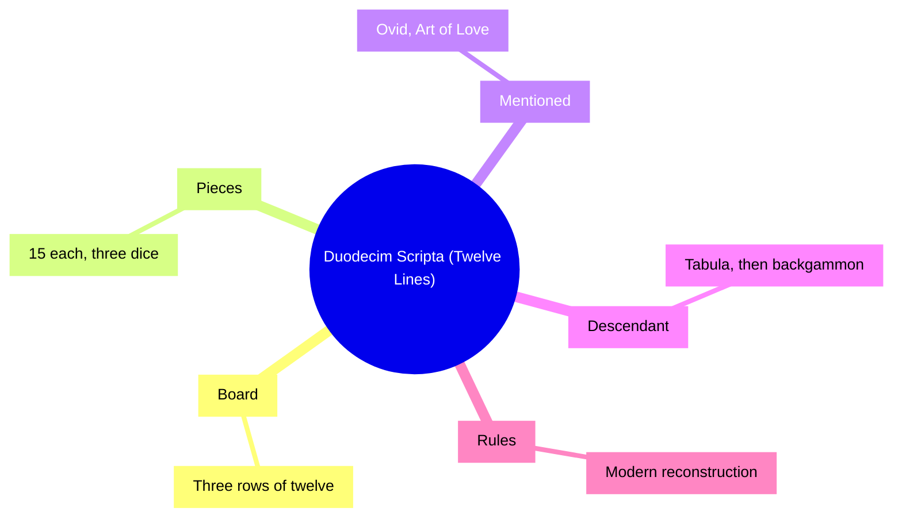
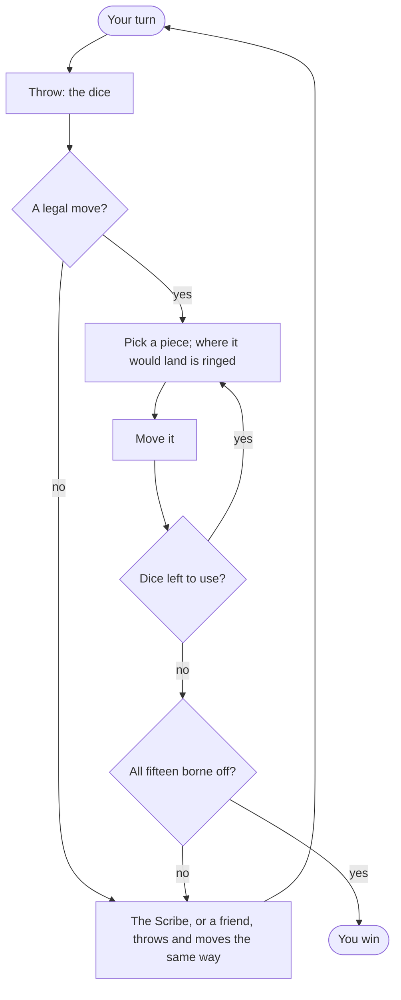

<!-- Written by tools/build-docs.mjs from the sources. Edit those, then run npm run build:docs. -->

# Ludus Duodecim Scriptorum

**Wing II · Strategy Takes the Table** · 1st century BCE onward · Roman Empire

[← Ludus Latrunculorum](latrunculi.md) · [All games](README.md) · [Patolli →](patolli.md)

| | |
| --- | --- |
| In the Archives | Playable against the Scribe, or a friend on the same screen |
| Rules | Modern reconstruction |
| How we know them | Lost |
| Family | [Race games](README.md#race-games) |
| Exhibit id | `xii`: `[librarium_archives start="xii"]` |

## At a glance

| | |
| --- | --- |
| Board | Three rows of twelve |
| Pieces | 15 each, three dice |
| Mentioned | Ovid, Art of Love |
| Descendant | Tabula, then backgammon |

## The placard

The game of twelve lines, ludus duodecim scriptorum, was played on boards of three rows of twelve, each row split in half. Ovid mentions it in his Art of Love, early in the 1st century CE, and boards survive across the Empire from Egypt to Britain, many from army camps.

Many boards spell out six six-letter words instead of plain marks. The one on this table reads LEVATE DALOCV, LVDERE NESCIS, IDIOTA RECEDE: "Get up, make way! You don't know how to play: fool, go away!"

Fifteen pieces a side and three dice raced around the board. The game is the ancestor of tabula, and so of backgammon, but how it was played was never written down.

> No Roman account of the rules survives. This table plays a modern reconstruction, after the basics worked out by Roland Austin and H. J. R. Murray, in the version the J. Paul Getty Museum gives.

## A turn

## The rules as played here

1. This is a modern reconstruction: no Roman account of the rules survives. You have fifteen pieces and throw three dice.
2. Each die brings a waiting piece onto your half of the middle row, on the space of its number, or moves a piece that many spaces on. You must use every die you can.
3. From your half of the middle row the course runs along the far row, right to left, then along the near row to the finish. The Scribe starts on the other half and shares the same course.
4. No piece may leave your home row until all fifteen are on the board. A piece taken must come back on before you move anything else.
5. Two or more pieces together are safe and block the space. Land on a single enemy piece to send it back to wait off the board.
6. When all fifteen are in the last six spaces, bear them off with exact throws: a piece on the last space needs a 1. The first to bear off all fifteen wins.

**Source:** A modern reconstruction, after the basics worked out by Roland Austin and H. J. R. Murray in the early 20th century and adapted from tabula, in the version the J. Paul Getty Museum gives in Ancient Rome at Home.

### Rule choices

- **Duodecim scripta:** fifteen pieces and three dice a side, every die used if it can be. Pieces enter on your half of the middle row by the number thrown, then run along the far row right to left and back along the near row; the Scribe enters on the other half and shares the course. No piece leaves the home row until all fifteen are on; a single piece can be hit and must re-enter before anything else moves; two together block. Bearing off from the last six spaces needs exact throws. The route follows the Getty's numbered board; the rules are reconstructions, and the placard says so.

## At the table

| | |
| --- | --- |
| The Scribe | Gentle, Fair or Sharp (see [the Scribe](../scribe.md#levels)) |
| Pass-and-play with a friend | Yes |
| Undo | No |
| Hint | Yes |
| Saved and resumed | No |

Keys, the move list, replays and the guide are the same at every table: see [Visiting the Archives](../visiting.md#at-a-table).

## How the Scribe plays

**Games with hidden cards and tiles (Nard, Duodecim scripta):** Every legal full turn, scored for the race, points held ahead of the enemy (Nard), lone pieces the enemy can reach weighed by what a hit would cost, and, in Duodecim scripta, pieces spread over the last six spaces so exact throws can bear them off

**Measured strength**

| Fair vs Gentle | Sharp vs Fair | Games |
| --- | --- | --- |
| 59% | 56% | 100 each |

## Sources

The sources for every placard are listed in [Historical notes and sources](../sources.md).

## In the code

| | |
| --- | --- |
| Rules and the Scribe | [`src/rules/ludus-duodecim-scriptorum.js`](../../src/rules/ludus-duodecim-scriptorum.js) |
| Table presenter | [`src/hall/table-xii.js`](../../src/hall/table-xii.js) |
| 3D model | [`src/hall/build-ludus-duodecim-scriptorum.js`](../../src/hall/build-ludus-duodecim-scriptorum.js) |
| Placard | [`src/hall/09-exhibit-data.js`](../../src/hall/09-exhibit-data.js) |
