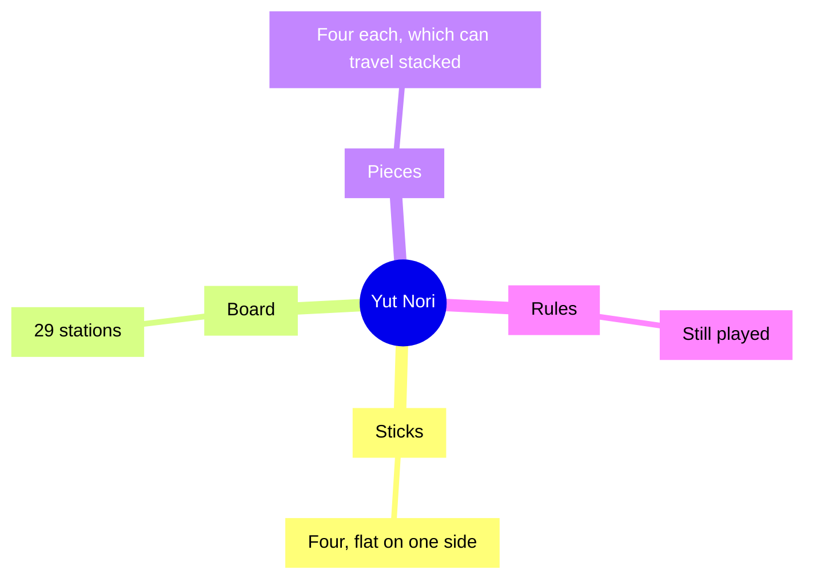
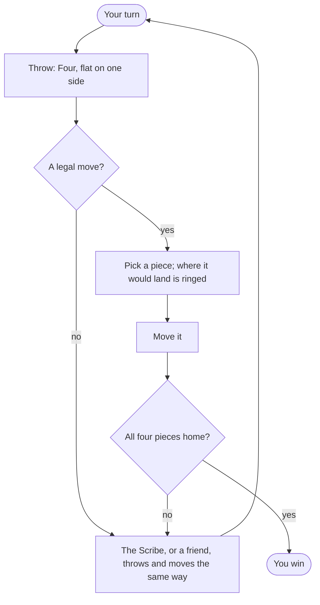

<!-- Written by tools/build-docs.mjs from the sources. Edit those, then run npm run build:docs. -->

# Yut Nori

**Wing VI · Games of the World** · traditional · Korea

[← Kōnane](konane.md) · [All games](README.md) · [Janggi →](janggi.md)

| | |
| --- | --- |
| In the Archives | Playable against the Scribe, or a friend on the same screen |
| Rules | Still played |
| How we know them | Still played |
| Family | [Race games](README.md#race-games) |
| Exhibit id | `yut`: `[librarium_archives start="yut"]` |

## At a glance

| | |
| --- | --- |
| Sticks | Four, flat on one side |
| Board | 29 stations |
| Pieces | Four each, which can travel stacked |

## The placard

Yut nori is the Korean family game of the New Year, played at Seollal and at the first full moon. Instead of dice, players throw four sticks, flat on one side and round on the other, and count the flat sides that land up: do (a pig, one step), gae (a dog, two), geol (a sheep, three), yut (a cow, four) and mo (a horse, five).

Each side races four pieces round a board of 29 stations, taking shortcuts across the middle from the corners. Pieces of one side can travel stacked, landing on an enemy sends it home, and a yut or a mo earns another throw. Its origin is uncertain; it is often traced to the Three Kingdoms period.

## A turn

## The rules as played here

1. Throw the four sticks and count the flat sides that land up: one is do (1 step), two gae (2), three geol (3), four yut (4), and none is mo (5).
2. Enter a new piece or move one already on the board, anticlockwise from the start corner near you on the right.
3. A piece that starts its move on a corner or on the centre takes the shortcut across the board instead.
4. Land on your own piece and they stack, moving together from then on. Land on the Scribe's and they all go back off the board.
5. Throwing yut or mo, or capturing, earns another throw. A piece goes home when it moves past the start corner. Bring all four home first to win.

**Source:** Common modern rules for two sides. Each throw is moved at once rather than saved up, and there is no back-do.

### Rule choices

- **Yut Nori:** a piece that starts its move on a corner or the centre takes the shortcut; your own pieces stack and move together; a yut, a mo or a capture earns another throw. Each throw is moved at once rather than saved up, and there is no back-do.

## At the table

| | |
| --- | --- |
| The Scribe | Gentle, Fair or Sharp (see [the Scribe](../scribe.md#levels)) |
| Pass-and-play with a friend | Yes |
| Undo | No |
| Hint | Yes |
| Saved and resumed | No |

Keys, the move list, replays and the guide are the same at every table: see [Visiting the Archives](../visiting.md#at-a-table).

## How the Scribe plays

**Method:** Rules of thumb: scored moves for dice games. See [the Scribe](../scribe.md).

**Measured strength**

| Fair vs Gentle | Sharp vs Fair | Games |
| --- | --- | --- |
| about 55% |  | hundreds |

**Game by game (Yut Nori, Pachisi):** Progress, captures, safety, and castles in Pachisi

## Sources

The sources for every placard are listed in [Historical notes and sources](../sources.md).

## In the code

| | |
| --- | --- |
| Rules and the Scribe | [`src/rules/yut-nori.js`](../../src/rules/yut-nori.js) |
| Table presenter | [`src/hall/table-yut.js`](../../src/hall/table-yut.js) |
| 3D model | [`src/hall/build-games-of-the-world.js`](../../src/hall/build-games-of-the-world.js) |
| Placard | [`src/hall/09-exhibit-data.js`](../../src/hall/09-exhibit-data.js) |
