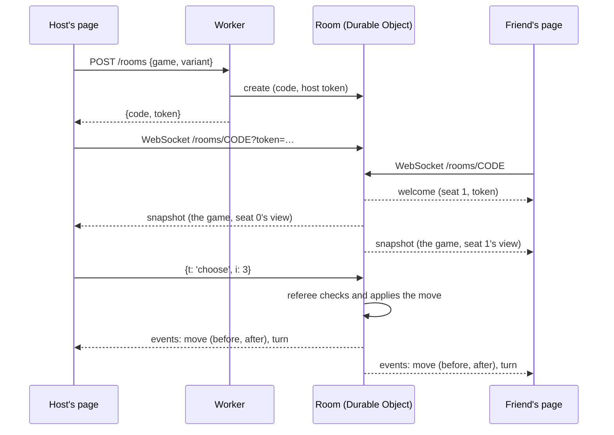

# Online play

Two people can play a table together from two phones or computers. One opens a room, at the **Games Desk** by the entrance or at a table, and the other joins it with the room's six-letter code or a link. The game itself is kept on a small server on Cloudflare's free plan. The server throws the dice, checks every move against the rules, and sends each player the game as they may see it.

Online play is offered at 53 tables: the 50 that already seat two people at one screen (the board games, such as chess, go, draughts, shogi and the tafl games, and the race games, such as Ur, Senet, Tables and Pachisi), and three card tables, **Gin Rummy**, **Écarté** and **Scopa**, where each hand stays on its own device. More card tables follow (see [What comes next](#what-comes-next)).

## For visitors

### At the Games Desk

The Games Desk stands on the left as you come in, with a notice board of the four steps behind it (the **Games Desk** stop on the rail, or the people button at the top of the screen, which opens the same panel from anywhere).

| Step | What happens |
| --- | --- |
| **Open a room** | You get a six-letter code and **Copy the link**. Send either to your friend. You can close the desk and walk the hall while you wait |
| Your friend opens the link, or types the code under **Join** at the desk | They are in the room. No game begins yet |
| **Suggest a game**: pick any online table, and its size or rules where it has them | Your friend sees the suggestion at their desk (it opens by itself, and the people button shows a dot) and **Accepts** or **Declines**. You can **Take it back** until they answer |
| Accepted | You both walk to that table. **Whoever suggested the game moves first** |
| Leave the table, or **Back to the room** at the end | You are back at the desk, still in the room. A game that is still on waits for you: **Back to the table** |
| Suggest the next | A suggestion accepted while a game is on ends that game (the desk says so before you accept) |
| **Leave the room** | You give up your seat |

A browser that was in a room within the day offers **Back to room …** at the desk, so a reload doesn't lose it.

### Saved games

The table's **Save** button (in **Options** on a phone) saves the game to a file, to carry on later at the Games Desk under **Carry on a saved game**.

| Game | Saved | Carried on |
| --- | --- | --- |
| Against the Scribe | At the start of your turn: before your throw at a dice table. The two-player tables, and the tables that keep their game between visits | It goes straight back to its table, as it was, against the Scribe |
| At one screen with a friend | At the start of either player's turn: before a throw at a dice table | Straight back to its table at one screen, with the same player to move |
| Online, in a room from the Games Desk | At any time, by either player. Only the one who presses Save gets the file | Bring the file to the desk. In a room, it is suggested to your friend; with no room, a room opens for it and the suggestion waits for whoever joins. **Each player sits in the seat they had**, whoever opened the room |

An online game's file is **sealed**: the server compresses the whole game, both hands and the stock included, and encrypts and signs it with a key only the server has (AES-GCM; `server/seal.mjs`). The file says which game it is and when it was saved, but nobody can read the cards in it or change it: a changed file, or one from another server, is refused. The file is about 1 to 30 KB.

### At a table

| Step | What happens |
| --- | --- |
| Sit down at a table, open **Options**, and choose **Online** in the Opponent row | The online panel opens |
| **Open a room** | You get a six-letter code (like `K7MXQ2`) and a **Copy the link** button. Send either to your friend |
| Your friend opens the link, or sits at any table that offers Online and types the code under **Join** | They walk to your table and sit down across from you. The game starts at once |
| Take turns | Your own moves are offered as usual. On your friend's turn the message says you are waiting, and their pieces move on your table as they move them |
| **Play again** at the end | A fresh game in the same room, for you both |
| **Leave the table**, or **Leave the room** in Options | You give up your seat, and your friend is told |

- **The far seat.** The friend who joins sits across the table: their camera looks from the other side, and the messages are turned round for them ("You capture…", "Your friend throws…").
- **Dice.** Each player throws for themselves with the Throw button, and the server throws the dice. Neither page can choose or change a throw.
- **A dropped connection.** The page tries again by itself. A reload with the link, or typing the code again, comes back to the same seat: each seat has a token, kept in that browser. The other player is told when their friend drops and comes back.
- **Not counted.** An online game doesn't count toward your record against the Scribe, and there are no hints or take-backs.
- **Variants.** The room plays the host's variant and rules (board size, the swap rule and so on), whatever the guest had chosen at their own table.
- **Closing.** A room is cleared a day after it was last used.

## How it works

- **The Worker** (`server/worker.mjs`) opens rooms and passes each WebSocket to its room. A room's code names its Durable Object.
- **Room seats and game seats.** In a Games Desk room, the one who suggests a game takes the game's first seat, and a saved game puts each player back in the seat they had, so the game's seats can be the room's the other way round (`flip`). Every message about the game is in the game's seats, and `snapshot.you` tells each page its own.
- **The seal's key** is the `SAVE_KEY` secret if one is set (32 random bytes, base64: `npx wrangler secret put SAVE_KEY`), or else a key the server makes for itself the first time and keeps in a Durable Object named `__keys`. Either way there is nothing to set up. A key set later makes earlier files unreadable, so set it before people save, or not at all.
- **The room** (`server/room.mjs`) is one Durable Object per game. It holds the seats' tokens and the referee, and saves the referee to its storage after every action. It uses the WebSocket hibernation API, so a room whose players are thinking costs nothing, and a bare `ping` is answered without waking it.
- **The referee** (`server/referee.mjs`) runs the game as the hall's turn loop does (`beginTurn`, `humanThrow` and `choose` in `src/hall/23-learning-the-game.js`), with a second person instead of the Scribe. It loads the same `js/rules.js` as the page, gives each room an engine of its own, and has the engines draw their random numbers from `crypto.getRandomValues`.
- **The page** (`src/hall/23b-online.js`) shows the table. For each move the server reports, it sets its own copy of the game to the server's state just before the move, plays the move with the table's own animation, and then checks its copy against the server's state after it. If the two ever differ, it takes the server's and lays the table out again. In the tests, every move of every online table lands on the server's state.

### What a player is sent

Every state and move a player is sent is that seat's view (`snapshotFor` and `eventsFor` on the referee). At the board and race tables the view is the whole game, as both players see the whole board. At a card table, every card the seat may not see is sent as a **card back** instead: the other hand, the stock, face-down discards, and the other player's marked cards in Écarté's exchange.

- **A back is a negative number** that stands for one card for one deal. The backs are drawn from `crypto.getRandomValues` for each deal and kept on the server, so they say nothing about the cards, and a back seen in one deal means nothing in the next.
- **Hidden hands are sorted by their backs.** In the cards' own order, the place a card was played from would tell where the others sit in the suits.
- **A move brings cards into view.** When the other player plays a card, or lays their hand down at a knock, the state sent as "before" the move already shows those cards. The page can then play the move on its own copy, and lands on the "after" state.
- **Hidden cards in moves.** A card a move names that the seat may not see, such as a face-down discard, is sent as its back.
- **Notes.** Where the rules' note names a card drawn blind ("You draw from the stock: the seven of clubs"), the other player gets the public note instead ("…draw from the stock.").
- **Prompts.** These are written on the page from that seat's own hand, never on the server.

Each card table lists, in `VIEWS` in `server/referee.mjs`, where its cards can be, which places are hidden from whom and when (Gin shows both hands after a knock), and every other field of its state as public. The tests play every card table out at random and fail if any field is unlisted, or if a seat is ever sent a card it has not seen, by value, by back, in a move, or by name in any text.

On the page, a card back is drawn as a card with a back on both sides (`crCard` with a negative card). The two card tables draw your own hand face up from either seat: `ME()` is the seat at this screen.

### Messages

| From the page | Meaning |
| --- | --- |
| `{t:'throw'}` | Throw the dice (when it is your turn to throw) |
| `{t:'choose', i}` | The move at place `i` in the list you were offered |
| `{t:'pass'}` | Pass, at a table where you may |
| `{t:'again'}` | A new game of the same, once this one is over |
| `{t:'propose', game, variant, toggles}` | Suggest a game (a Games Desk room only) |
| `{t:'propose', save}` | Suggest carrying on a saved game: `save` is the file's sealed text |
| `{t:'answer', yes}` | Accept or decline the other player's suggestion |
| `{t:'withdraw'}` | Take back your own suggestion |
| `{t:'save'}` | Save the game: the server answers with `saved`, to you alone |
| `{t:'sync'}` | Send me the game as it is (coming back to the table from the desk) |
| `{t:'leave'}` | Give up your seat |
| `ping` | Keep the connection open (answered `pong` without waking the room) |

| From the server | Meaning |
| --- | --- |
| `welcome` | Your seat and its token, the game and the host's settings, whether this is a Games Desk room (`lobby`), whether your friend is here, and the suggestion on the table |
| `snapshot` | The whole game as you may see it: on starting, on Play again or a suggestion accepted (`fresh`), a saved game carried on (`resumed`), and on coming back. `snap.you` is your seat in this game |
| `proposal` | The suggestion on the table (or none), and who `declined` or `withdrew` the last |
| `saved` | Your saved game: the sealed text, with the game, your seat and when |
| `events` | What happened, in order: `roll`, `move` (with the state before and after), `turn` (whose, and your moves if yours), `skip`, `nomove`, `over` |
| `presence`, `left` | Your friend's connection dropped or came back, or they left |
| `error` | A move out of turn or not offered: refused, and a fresh `snapshot` follows |
| `full`, `gone`, `replaced` | The room has two players already; there is no such room; this seat was opened in another tab |

## Setting up the server

Everything here is on Cloudflare's **free** Workers plan, which needs no card and so can't charge anything. If a day's free allowance were ever used up, new moves would fail until midnight UTC and the hall would go on as before with the Scribe and same-screen play.

1. **Create a free Cloudflare account** at [dash.cloudflare.com/sign-up](https://dash.cloudflare.com/sign-up). Choose the free plan; no domain is needed.
2. **Connect the repository** (Workers Builds: Cloudflare builds and deploys from GitHub itself, so no token is ever copied anywhere). In the dashboard: **Workers & Pages → Create → Import a repository**, sign in to GitHub and allow the Cloudflare app for `CptNope/Librarium-Archives`, then set:

   | Setting | Value |
   | --- | --- |
   | Project name | `librarium-online` (it must match `name` in `server/wrangler.toml`) |
   | Production branch | `main` |
   | Root directory | `server` |
   | Build command | (empty) |
   | Deploy command | `npx wrangler deploy` |

   Cloudflare deploys it, and again on every push to `main`. The free plan includes 3,000 build minutes a month ([Workers Builds limits](https://developers.cloudflare.com/workers/ci-cd/builds/limits-and-pricing/)); a deploy takes about a minute. The first time, the dashboard asks you to choose your `workers.dev` subdomain. The server's address is then `https://librarium-online.<your-subdomain>.workers.dev`, and `/health` there answers `{"ok":true}`.
3. **Or deploy from your computer** instead (Node 20 or later): `cd server`, `npm install`, `npx wrangler login`, `npx wrangler deploy`.
4. **Point the hall at it.**
   - The website: the `<meta name="librarium-online">` tag in `index.html` (set to `https://librarium-online.jca2016satx.workers.dev`). The single-file build leaves it out, as an artifact can't reach other sites.
   - WordPress: the shortcode's `online` attribute, `[librarium_archives online="https://librarium-online.<your-subdomain>.workers.dev"]`, or **Online play server** in the Elementor widget.
5. **Optionally, limit which sites may use it**: set `ALLOWED_ORIGINS` in `server/wrangler.toml` to your sites, for example `"https://cptnope.github.io,https://librarium.games"`, and deploy again.

### What the free plan allows

| Limit (per day) | What it means here |
| --- | --- |
| 100,000 requests | Opening a room and each connection cost a request or two, and each message from a player counts as 1/20 of a request. A 100-move game is about 10, so thousands of games a day |
| 13,000 GB-s of Durable Object time | Rooms hibernate between moves, so a game uses seconds, not hours |
| 100,000 rows written, 5 GB stored | One or two rows a move; a room is cleared a day after it was last used |

Figures from Cloudflare's [Durable Objects pricing](https://developers.cloudflare.com/durable-objects/platform/pricing/) page.

## Testing

| Command | What it checks |
| --- | --- |
| `npm test` (`tests/online.test.mjs`) | The referee, in Node: every online table played out at random by two players, packed and unpacked along the way as a sleeping room would be; moves out of turn or not offered refused; and the page's own copy landing on the server's state after every move. At the card tables: every field listed, and no seat ever sent a card it has not seen |
| `npm run test:online` | Starts a local server (`wrangler dev`, after `npm install` in `server/`) and plays whole games through it with two WebSocket players: rooms, seats, a refused move, a dropped connection rejoined with its token, a third player turned away, a code that was never opened, and Play again; then a Games Desk room: no game until one is accepted, a suggestion declined and the next accepted, the one who suggested it moving first, a game saved (sealed, to the saver alone), a changed file refused, and the file carried on in a new room with each player back in their seat |
| `npm run test:online -- --e2e` | The same, then the hall in Chromium against a WebSocket player: as host at chess (opening the room from the Opponent row), and as guest at Ur (joining by link, the camera across the table, the notes turned round, its own throws, and a reload back into the same seat); and at the card tables, joining gin in the second seat and opening Écarté as host, with the other hand and the stock only ever backs; the Games Desk (a suggestion accepted, a sealed save, the table left and come back to, and the file carried on in a new room); and saved games against the Scribe (chess) and at one screen (Ur) going to a file and coming back |

## What comes next

- **More card tables.** The two-player card tables still to come are Cribbage, Piquet, Bézique, Pinochle, Cassino, Conquian, Koi-Koi, Primero, Tarocchi and Dominoes. Each needs three things:
  - a `VIEWS` entry;
  - a public note wherever its notes name a hidden card;
  - its table drawn from either seat.

  Cribbage also needs its rules changed: they make the Scribe's crib discard by themselves. Bézique and Pinochle use two packs, so their backs need telling apart copy by copy.
- **Four-seat tables.** Bridge, Spades, Hearts, Whist and Euchre need rooms with more seats.
- **Matchmaking.** Rooms are private: there's no list of open rooms or of people waiting.
