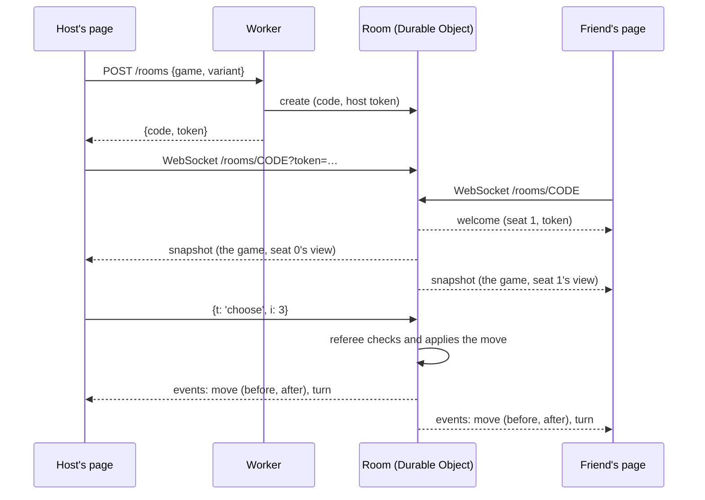

# Online play

Two people can play a table together from two phones or computers. One opens a room at the table, and the other joins it with the room's six-letter code or a link. The game itself is kept on a small server on Cloudflare's free plan. The server throws the dice, checks every move against the rules, and sends each player the game as they may see it.

Online play is offered at the 50 tables that already seat two people at one screen: the board games (chess, go, draughts, shogi, the tafl games and the rest) and the race games (Ur, Senet, Tables, Pachisi and the rest). The card tables are next (see [What comes next](#what-comes-next)).

## For visitors

| Step | What happens |
| --- | --- |
| Sit down at a table, open **Options**, and choose **Online** in the Opponent row | The online panel opens |
| **Open a room** | You get a six-letter code (like `K7MXQ2`) and a **Copy the link** button. Send either to your friend |
| Your friend opens the link, or sits at any table that offers Online and types the code under **Join** | They walk to your table and sit down across from you. The game starts at once |
| Take turns | Your own moves are offered as usual. On your friend's turn the message says you are waiting, and their pieces move on your table as they move them |
| **Play again** at the end | A fresh game in the same room, for you both |
| **Leave the table**, or **Leave the room** in Options | You give up your seat, and your friend is told |

- **The far seat.** The friend who joins sits across the table: their camera looks from the other side, and the messages are turned round for them ("You capture…", "Your friend throws…").
- **Dice.** Each player throws for themselves with the Throw button, and the server throws the dice. Neither page can choose or change a throw.
- **A dropped connection.** The page tries again by itself. A reload with the link, or typing the code again, comes back to the same seat: each seat has a token, kept in that browser. The other player is told when their friend drops and comes back.
- **Not counted.** An online game doesn't count toward your record against the Scribe, and there are no hints or take-backs.
- **Variants.** The room plays the host's variant and rules (board size, the swap rule and so on), whatever the guest had chosen at their own table.
- **Closing.** A room is cleared a day after it was last used.

## How it works



- **The Worker** (`server/worker.mjs`) opens rooms and passes each WebSocket to its room. A room's code names its Durable Object.
- **The room** (`server/room.mjs`) is one Durable Object per game. It holds the seats' tokens and the referee, and saves the referee to its storage after every action. It uses the WebSocket hibernation API, so a room whose players are thinking costs nothing, and a bare `ping` is answered without waking it.
- **The referee** (`server/referee.mjs`) runs the game as the hall's turn loop does (`beginTurn`, `humanThrow` and `choose` in `src/hall/23-learning-the-game.js`), with a second person instead of the Scribe. It loads the same `js/rules.js` as the page, gives each room an engine of its own, and has the engines draw their random numbers from `crypto.getRandomValues`.
- **The page** (`src/hall/23b-online.js`) shows the table. For each move the server reports, it sets its own copy of the game to the server's state just before the move, plays the move with the table's own animation, and then checks its copy against the server's state after it. If the two ever differ, it takes the server's and lays the table out again. In the tests, every move of every online table lands on the server's state.

### What a player is sent

Every state a player is sent goes through `viewOf(game, seat, state)` in `server/referee.mjs`. For the online tables today the view is the whole state, as both players see the whole board. For a game with hidden hands, the view will replace each card the seat may not see with a face-down placeholder (the other hand and the stock), so those cards never reach that device. Moves offered to one player are never sent to the other.

### Messages

| From the page | Meaning |
| --- | --- |
| `{t:'throw'}` | Throw the dice (when it is your turn to throw) |
| `{t:'choose', i}` | The move at place `i` in the list you were offered |
| `{t:'pass'}` | Pass, at a table where you may |
| `{t:'again'}` | A new game, once this one is over |
| `{t:'leave'}` | Give up your seat |
| `ping` | Keep the connection open (answered `pong` without waking the room) |

| From the server | Meaning |
| --- | --- |
| `welcome` | Your seat and its token, the game and the host's settings, and whether your friend is here |
| `snapshot` | The whole game as you may see it: on starting, on Play again (`fresh`), and on coming back |
| `events` | What happened, in order: `roll`, `move` (with the state before and after), `turn` (whose, and your moves if yours), `skip`, `nomove`, `over` |
| `presence`, `left` | Your friend's connection dropped or came back, or they left |
| `error` | A move out of turn or not offered: refused, and a fresh `snapshot` follows |
| `full`, `gone`, `replaced` | The room has two players already; there is no such room; this seat was opened in another tab |

## Setting up the server

Everything here is on Cloudflare's **free** Workers plan, which needs no card and so can't charge anything. If a day's free allowance were ever used up, new moves would fail until midnight UTC and the hall would go on as before with the Scribe and same-screen play.

1. **Create a free Cloudflare account** at [dash.cloudflare.com/sign-up](https://dash.cloudflare.com/sign-up). Choose the free plan; no domain is needed.
2. **Deploy once from your computer** (Node 20 or later):
   ```bash
   cd server
   npm install
   npx wrangler login     # opens Cloudflare in your browser to allow it
   npx wrangler deploy
   ```
   Wrangler prints the server's address, like `https://librarium-online.<your-subdomain>.workers.dev`.
3. **Or let GitHub deploy it** on every change to `main`: in Cloudflare, create an API token from the "Edit Cloudflare Workers" template, and add it to the repository's secrets as `CLOUDFLARE_API_TOKEN`, with your account ID as `CLOUDFLARE_ACCOUNT_ID`. The `Online server` workflow then tests the server and deploys it. Without the secrets it tests and skips the deploy.
4. **Point the hall at it.**
   - The website: add `data-online="https://librarium-online.<your-subdomain>.workers.dev"` to `<div id="lm-app">` in `index.html`.
   - WordPress: the shortcode's `online` attribute, `[librarium_archives online="https://librarium-online.<your-subdomain>.workers.dev"]`, or **Online play server** in the Elementor widget.
5. **Optionally, limit which sites may use it**: set `ALLOWED_ORIGINS` in `server/wrangler.toml` to your sites, for example `"https://cptnope.github.io,https://librarium.games"`, and deploy again.

### What the free plan allows

| Limit (per day) | What it means here |
| --- | --- |
| 100,000 requests | Opening a room and each connection cost a request or two, and each message from a player counts as 1/20 of a request. A 100-move game is about 10, so thousands of games a day |
| 13,000 GB-s of Durable Object time | Rooms hibernate between moves, so a game uses seconds, not hours |
| 100,000 rows written, 5 GB stored | One or two rows a move; a room is cleared a day after it was last used |

Figures from Cloudflare's [Durable Objects pricing](https://developers.cloudflare.com/durable-objects/platform/pricing/) page.

## Testing

| Command | What it checks |
| --- | --- |
| `npm test` (`tests/online.test.mjs`) | The referee, in Node: every online table played out at random by two players, packed and unpacked along the way as a sleeping room would be; moves out of turn or not offered refused; and the page's own copy landing on the server's state after every move |
| `npm run test:online` | Starts a local server (`wrangler dev`, after `npm install` in `server/`) and plays whole games through it with two WebSocket players: rooms, seats, a refused move, a dropped connection rejoined with its token, a third player turned away, a code that was never opened, and Play again |
| `npm run test:online -- --e2e` | The same, then the hall in Chromium against a WebSocket player: as host at chess (opening the room from the Opponent row), and as guest at Ur (joining by link, the camera across the table, the notes turned round, its own throws, and a reload back into the same seat) |

## What comes next

- **Card tables.** None of the card tables seats two people yet. Each two-player card game (gin, cribbage, piquet, bezique, cassino, Écarté, Conquian, Koi-Koi, Scopa and others) needs three things: a second human seat in its rules, a `viewOf` entry that hides the other hand and the stock, and a table that shows your own hand face up from either seat. The four-seat tables (Bridge, Spades, Hearts, Whist, Euchre) add more seats to the same rooms.
- **Matchmaking.** Rooms are private: there's no list of open rooms or of people waiting.
