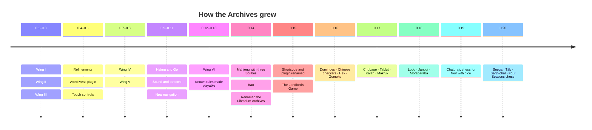
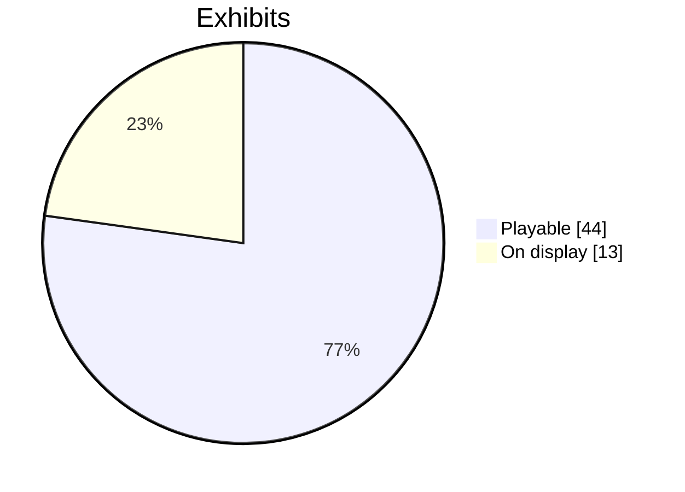

# Roadmap

## Open

- [ ] Swap the type-set wordmark for Librarium's logo files
- [ ] Hare and Hounds (the French military game), once the lines of its eleven-point board can be checked against a primary source
- [ ] The Checkered Game of Life and the Mansion of Happiness, once a square-by-square transcription of an original board and its rules can be checked
- [ ] A stronger Brandubh attacker
- [ ] A stronger Sharp level for Janggi

## Done

- [x] Renamed from the Librarium Museum of Play to the Librarium Archives, repository included
- [x] WordPress plugin with a shortcode and an Elementor widget, loading the Archives only where it is shown
- [x] Wing II: strategy games (Weiqi, Ludus latrunculorum, Nine Men's Morris, Oware, Brandubh)
- [x] Wing III: kings, cards and courts (Tables, chaturanga, shatranj, Lewis chessmen, cards, tarot)
- [x] Wing IV: printed boards and parlour tables (Fox and Geese, the new queen, Draughts, Pachisi, the Goose, Mahjong)
- [x] Wing V: the modern board game (Mansion of Happiness, Game of Life, Reversi, Halma, Dots and Boxes, the Landlord's Game)
- [x] Playable Halma for two
- [x] Wing VI: Games of the World (Mū tōrere, Kōnane, Fanorona to play; Shogi, Yut Nori, Bao on display)
- [x] Backfill playable rules: chess, shogi, Yut Nori, Pachisi
- [x] Playable Mahjong (with three Scribes) and Bao la Kujifunza
- [x] The Landlord's Game, from the patent drawing and text
- [x] New exhibits: Dominoes, Chinese checkers, Hex and Gomoku
- [x] New exhibits: Cribbage, Tablut, Kalah and Makruk
- [x] Seega and Tâb from Lane's Egypt, Bagh-chal from Nepal, and Alfonso X's Four Seasons chess
- [x] Chaturaji, four-handed chess with dice, against three Scribes
- [x] New exhibits: Ludo, Janggi and Morabaraba
- [x] Larger Dots and Boxes grids (5 × 5, chosen at the table)
- [x] A playable early card game: tarocchi for two
- [x] Difficulty settings for the Scribe
- [x] Playable Go on a 9 × 9 board
- [x] Backfill: the first dice, Petteia, Liubo, Patolli, Alquerque, Xiangqi, Snakes and Ladders
- [x] Sound: sticks, dice, pieces, cards and room tone, all synthesized in the browser, with a mute button
