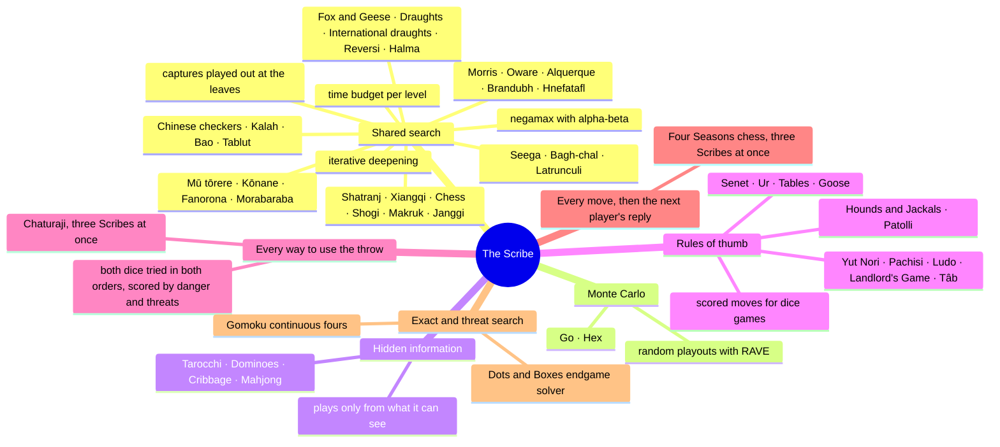
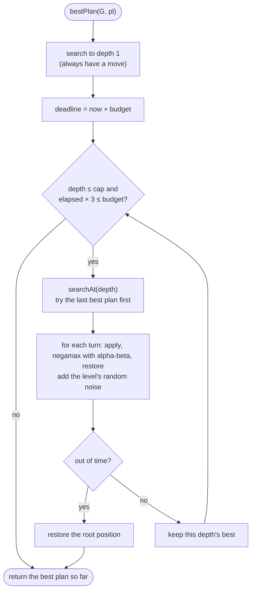
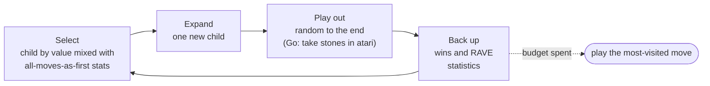

# The Scribe

The Scribe is the Archives' opponent at every table. It has three levels, chosen at any table and remembered: **Gentle**, **Fair** (the default) and **Sharp**. Each game's Scribe is built from one of a few families of method, picked to suit the game.

## Levels

| | Gentle | Fair | Sharp |
| --- | --- | --- | --- |
| Thinking budget | about 0.12 s | about 0.6 s | about 1.5 s |
| Search depth cap | 2 plies | the game's limit | the game's limit + 2 |
| Random tie-breaking noise | large (up to 6) | small (0.6) | tiny (0.05) |
| Dice and card games | often plays any legal move | sensible rules of thumb | looks further: danger, odds, what you have shown |

A level is set with `LibrariumRules.setLevel(name)`, and engines read it through `pick(gentle, fair, sharp)`.

## The shared search

Strategy games hand the Scribe five hooks (`snapshot`, `restore`, `turns`, `terminal`, `evaluate`) and call `bestPlan(this, pl, depth, maxDepth)`. It deepens one ply at a time until the level's budget would run out, so the Scribe plays as well as the visitor's device allows without stalling.

- **Turns, not moves.** `turns(pl)` returns whole turns, so a Fanorona capture chain, a Kalah extra move or a Morris mill-and-remove is searched as one step.
- **Move ordering.** Engines list captures and threats first, and each new depth tries the previous best plan first, so alpha-beta prunes more.
- **Safe interruption.** When the deadline passes mid-search, the search throws, and the root position is restored before the best plan so far is returned.
- **Wins sooner, losses later.** `terminal()` scores a finished game as `±1000 ± depth`.
- **Exchanges played out.** An engine that lists its captures (`noisy`) has them played out where the search stops, each side free to stand pat, so the Scribe does not count a piece won in the middle of an exchange. Latrunculi does this. These nodes read the clock at every step, and the first one-move look plays out nothing, so it always finishes.

## Monte Carlo search (Go and Hex)

RAVE lets a point that won when played *later* in a random game count a little toward playing it *now*. That is a good guess in both games, since stones never move. In Go the Scribe passes after you do if the count already favours it. In Hex, when the visitor turns the swap rule on, Fair and Sharp take a central opening stone.

## Games with hidden cards and tiles

The Scribe never looks at the visitor's hand or the deck. Each game's Scribe works from what a human player at that table could see.

| Game | How the Scribe decides |
| --- | --- |
| Tarocchi | Sharp deals the unseen cards at random many times over, consistent with what you have shown (a suit you could not follow), plays each deal out, and picks the card that scores best on average. Fair plays by rule of thumb |
| Dominoes | Sheds heavy tiles and doubles. Sharp also keeps tiles that match the ends it leaves, and leaves ends you have shown you cannot match (you drew or passed on them) |
| Cribbage | Sharp averages every possible four-card keep over all 46 possible starters, weighs what it gives the crib, and in the play avoids leaving counts of 5 or 21 |
| Whist | Each Scribe plays by the book from what its seat can see: cash sure winners, draw trumps when long in them, lead a suit its partner can ruff, second hand low, third hand high, win as cheaply as possible, and discard its least useful card. Gentle and Fair play some cards at random. (A sampling search over the unseen cards was tried and played no better.) |
| Piquet | Exchange: keeps aces, long suits, sets and runs in the making; Sharp tries every discard among its weakest cards against many random draws and keeps the best on average. Play: cashes sure winners, leads low from its longest suit, wins cheaply, and throws cards that cannot win |
| Hazard | Always calls a main of 7, the caster's best. Fair stakes 2; Sharp stakes 1, since the caster has the worse of every bet, unless it is behind near the end |
| Nard, Duodecim scripta | Every legal full turn, scored for the race, points held ahead of the enemy (Nard), lone pieces the enemy can reach weighed by what a hit would cost, and, in Duodecim scripta, pieces spread over the last six spaces so exact throws can bear them off |
| Hanafuda (koi-koi) | Takes the most valuable cards and yaku in the making; a card that will not match goes to the table only if its month is spent. Sharp also weighs each card a play leaves on the field by the chance you hold one of its month (counted from the cards it cannot see) and the yaku it would build for you. It stops at 7 points or with few cards left; Sharp calls koi-koi when it is ahead and the visitor is far from a yaku |
| Mahjong | Each of the three Scribes counts how far its hand is from ready (shanten) and keeps the discards that leave the most useful draws open. It claims only when a claim brings its hand closer |

## Hints

The Hint button asks the Sharp Scribe for its move in the visitor's seat, on a copy of the game, so its thinking cannot change anything. It is offered wherever the Scribe can plan for either seat: every table without dice or hidden hands, and Whist.

## Measured strength

Every Scribe is checked by simulation, playing level against level with seats swapped. Where a game strongly favours the first player, the games start from varied openings. Dice games need hundreds of games to show a difference; deterministic games need far fewer.

| Game | Fair vs Gentle | Sharp vs Fair | Games |
| --- | --- | --- | --- |
| Bao | 31–9 | 29–11 | 40 each |
| Gomoku | every game | 58–22 | 20, and 80 from varied openings |
| Hex | 9–1 (7 × 7) | 6–0 (9 × 9) | 10 and 6 |
| Kalah | 20–0 | 24–16 | 20 and 40, varied openings |
| Tablut | 6–0 | 4–2 | 6 each |
| Hnefatafl | 6–0 | 2–0, 2 draws | 6 and 4; long games reach the 150-move limit |
| International draughts | 6–0 | 3–0, 1 draw | 6 and 4 |
| Makruk | 6–0 | 2 wins, 4 draws | 6 each |
| Morabaraba | 6–0 | 4–2 | 6 each |
| Janggi | 4–0 | 2–2 | 4 each |
| Chinese checkers | 6–0 | 4–2 | 6 each |
| Tarocchi | | 16–14 (by +3.4 points a game) | 30 |
| Ludo | 81% | 65% | 600 and 1,000 |
| Chaturaji (one seat against three) | 41% against Gentle | 46% against Fair | 300 each; an even seat wins about 1 in 4 |
| Four Seasons chess (one seat against three) | 67% against Gentle | 47% against Fair | 60 each; an even seat wins about 1 in 4 |
| Bagh-chal | 19–0, 1 draw | 16–4 | 20 each, sides swapped |
| Seega | 7–2, 3 draws | 4–2, 6 draws | 12 each; many games end on the 20-move count |
| Tâb | 85% | 61% | 400 and 600 |
| Hounds and Jackals | 75% | 55% | 400 and 1,000; the two tracks never meet, so luck decides most games |
| Patolli | 91% | 73% | 400 and 600 |
| Checkered Game of Life | 71% | 50% | 1,000 each; the spin decides most games |
| Latrunculi | 4–1, 1 draw | 6–0, 1 draw | 6 and 7; with captures played out, the new Sharp beat the old one 7–0, with 7 draws |
| Jungle | 12–0 | 7–3, 2 draws | 12 each |
| Medieval chess (Lewis chessmen) | 6–0 | 1–0, 5 draws | 6 each; with only checkmate winning, many games are drawn |
| Courier chess | 5–0, 1 draw | 5–0, 1 draw | 6 each |
| Piquet | 74% | 55% | 400 parties of six deals each |
| Hazard | about 50% | 56% | 4,000 each; the dice decide almost everything |
| Nard | 58% | 59% | 100 each |
| Duodecim scripta | 59% | 56% | 100 each |
| Hanafuda (koi-koi) | 77% | 53% to 43% | 400 and 800 games of six months; Sharp also weighs what a play leaves on the field for you, and when to call koi-koi |
| Chaturanga | 6–0 | as Shatranj | 6; the same engine as Shatranj |
| Rithmomachia | 5–0, 1 draw | 2–2, 2 draws | 6 each; most games run to the 150-move limit |
| Whist (both seats of a side at one level) | +0.9 tricks a deal | +0.3 tricks a deal | 150 deals each, every deal played twice with the sides swapped |
| Dominoes | 61% | 62% | 400 and 600 hands |
| Cribbage | 60% | 57% | 300 each |
| The Landlord's Game | 67% | 52% | 600 and 1,500 |
| Pachisi (short) | 72% | | hundreds |
| Yut Nori | about 55% | | hundreds |
| Mū tōrere | | | Sharp looks 16 moves ahead and never loses |

Known weak spots: in Brandubh the visitor's side still wins most games against Sharp. The attackers now value the squares diagonally in from each corner and see when the king is one move from a corner, but in Scribe-against-Scribe games the defenders still win most often: on a 7 × 7 board, with these reconstructed rules, the king has a short road out. The Sharp level of Janggi and Rithmomachia is barely stronger than Fair in short matches; playing captures out at the end of the search was tried at both and dropped, since it cost more depth than it gained (on a busy or slower machine it made Janggi weaker). These are on the [roadmap](roadmap.md).

## Game by game

| Game | What the Scribe weighs |
| --- | --- |
| Senet, Ur | Each move scored for progress, safety and captures; Gentle adds a lot of chance |
| Tables | Every legal full turn scored for pip count, safe points and exposed checkers |
| Go | Monte Carlo with RAVE (above) |
| Morris, Morabaraba | Pieces, open two-in-a-rows, mills and mobility |
| Fox and Geese | Plays the geese, steering by how much room the fox has left |
| Reversi | Corners, edges and mobility, then exact disc counting near the end. Gentle plays a random legal move |
| Dots and Boxes | Never hands over boxes while it can help it, then solves the endgame exactly (Sharp from 22 open lines, Fair from 15) |
| Chess, Shogi | Captures tried first; chess up to five moves deep, shogi up to four, with drops near the kings when the list is long |
| Makruk, Janggi | Material (Janggi's tournament points), soldiers and cowries pushed forward |
| Tablut | The king's open lines to the edge, Muscovites around him, material |
| Hnefatafl | The king's open lines to the corners now and after one more move, his room to move, attackers beside him and on the squares that seal each corner, material. Only the 36 moves nearest the king are searched |
| International draughts | Men and flying kings (a king is worth over three men), advance, the centre and the back row; the longest-capture rule keeps the search narrow |
| Bao | Seeds, the inner row, and the best capture on offer; cheap to search, so Sharp looks twelve plies ahead |
| Kalah | Stores and seeds on each side; chains of extra moves searched as one turn |
| Gomoku | Every point near the stones ranked by the lines it makes for each side. Sharp hunts for a win by continuous fours, blocks yours, and searches a few moves scored by five-point windows |
| Ludo | Captures, coming out, getting home. Sharp counts how many enemy tokens could reach a square in one throw |
| The Landlord's Game | Lot tickets, buy or rent, luxuries, the jail fine, railroad rides. Sharp buys every lot it can afford, since land pays |
| Yut Nori, Pachisi | Progress, captures, safety, and castles in Pachisi |
| Hounds and Jackals | Progress, reaching the goal, the "good" holes, and keeping off the holes that slide back. The two tracks never meet, so luck decides most games |
| Latrunculi | Placing: counters next to friends and away from the corners. Moving: counters taken, threats and room to move |
| Patolli | Bringing markers home, captures in the centre, entering, the red tips, and avoiding the dark houses. Sharp also weighs the odds of being hit on a centre house |
| Tâb | Captures, starting pieces, raids on the home row, and the chance an enemy can land on a square with one throw. Sharp weighs every piece on the board that way after each move |
| Jungle | Material (the rat valued above the wolf for its threat to the elephant), every animal's distance from the enemy den, and pressure next to it; repeated positions count as draws in the search |
| Courier chess | Material (the courier and rook strongest), centralised pieces and advanced pawns, with captures tried first |
| Rithmomachia | Pieces taken by each side and pieces brought forward into contact; moves that capture are tried first |
| Seega | Placing: solid blocks that cannot be trapped. Moving: material, threats, room to move and pieces that cannot be trapped, searched with whole capture chains as one turn |
| Bagh-chal | Goats taken, goats open to a jump, and how much room the tigers have; the same score read from either side |
| Four Seasons chess | Its own strength against the others', pieces left hanging (with what defends them) and the squares round its king. Sharp also lets the next player answer each of its best eight moves |
| Chaturaji | Every way to use both dice, in either order or not at all, scored by points taken, rivals knocked out, and the odds that each piece is taken before its next turn. Sharp also checks its best dozen plans for two-move attacks on its king. Each of the three Scribes plays for itself |
